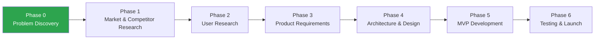

<div align="center">

# VeriGlow-ai

**AI-powered platform that helps consumers make informed decisions about the authenticity and trustworthiness of beauty products purchased online.**


</div>

---

## Table of Contents

- [Project Overview](#project-overview)
- [Problem Statement](#problem-statement)
- [Current Status](#current-status)
- [Roadmap](#roadmap)
- [Repository Structure](#repository-structure)
- [Future Technology Stack](#future-technology-stack)
- [How to Contribute](#how-to-contribute)
- [License](#license)

---

## Project Overview

VeriGlow-ai is an early-stage product that aims to give online beauty shoppers a clear, evidence-backed signal before they buy:

> *"Can I trust this listing, this seller, and this product?"*

The project is being built the way a real product team would build it: **research first, then requirements, then architecture, then code.** Every major decision is recorded in this repository so the reasoning is as visible as the result.

**What VeriGlow-ai is *not* (yet):** there is no application code in this repository today. That is intentional — see [Current Status](#current-status).

---

## Problem Statement

Consumers buying skincare and beauty products online struggle to trust whether products are **authentic**, **safe**, and **reliable**. Three concerns come up repeatedly:

| Concern | What the buyer experiences | Why it matters |
|---|---|---|
| **Counterfeit products** | Packaging looks right, but the product inside is not genuine | Unknown formulations applied directly to skin, eyes, and lips |
| **Expired or near-expiry stock** | Batch codes and expiry dates are hard to see or interpret before purchase | Degraded actives, contamination risk, wasted money |
| **Unclear seller information** | Marketplace sellers are often third parties with little visible history | Buyers cannot tell an authorised reseller from an anonymous one |

A large 2018 LocalCircles survey of Indian online shoppers found that cosmetics and fragrances were the categories most often reported as fake. Full evidence, assumptions, and open questions are in [`docs/01-research/01-problem-discovery.md`](docs/01-research/01-problem-discovery.md).

---

## Current Status

| | |
|---|---|
| **Current phase** | Problem Discovery |
| **Completed** | Repository setup · Problem discovery |
| **Next up** | Market research · Competitor analysis |

Live status is tracked in [`PROJECT_STATUS.md`](PROJECT_STATUS.md). Notable changes are logged in [`CHANGELOG.md`](CHANGELOG.md).

---

## Roadmap



| Phase | Goal | Key output |
|---|---|---|
| 0 — Problem Discovery ✅ | Define the problem worth solving | Problem discovery doc |
| 1 — Market & Competitor Research | Size the opportunity, map existing solutions | Market + competitor analysis |
| 2 — User Research | Validate the problem with real buyers | Interview findings, personas |
| 3 — Product Requirements | Decide what the MVP must do | PRD, user flows |
| 4 — Architecture & Design | Decide how to build it, and why | Architecture docs, ADRs |
| 5 — MVP Development | Build the smallest useful product | Working MVP |
| 6 — Testing & Launch | Prove it works and ship it | Test reports, deployment |

Detailed milestones and exit criteria live in [`ROADMAP.md`](ROADMAP.md).

---

## Repository Structure

```text
veriglow-ai/
├── .github/
│   ├── ISSUE_TEMPLATE/
│   │   ├── bug_report.md
│   │   └── feature_request.md
│   └── pull_request_template.md
├── assets/
│   ├── diagrams/              # Architecture and flow diagrams
│   └── screenshots/           # UI screenshots (once UI exists)
├── backend/                   # Backend service (not started)
├── docs/
│   ├── 01-research/           # Problem, market, competitors, users
│   ├── 02-product/            # PRD, personas, user flows
│   ├── 03-design/             # Architecture, system & database design
│   ├── 04-engineering/        # API design, development guidelines
│   ├── 05-testing/            # Testing strategy
│   ├── 06-deployment/         # Deployment plan
│   └── 07-decisions/          # Architecture Decision Records (ADRs)
├── frontend/                  # Web client (not started)
├── CHANGELOG.md
├── CONTRIBUTING.md
├── LICENSE
├── PROJECT_STATUS.md
├── README.md
└── ROADMAP.md
```

---

## Future Technology Stack

> ⚠️ **Nothing below is decided.** These are *candidates* to be evaluated in Phase 4. Each final choice will be recorded as an ADR in [`docs/07-decisions/`](docs/07-decisions/) with the alternatives considered and the trade-offs accepted.

| Layer | Candidates | Deciding question |
|---|---|---|
| Frontend | React + TypeScript, Next.js | Do we need server-side rendering for shareable verification pages? |
| Backend | Python (FastAPI), Node.js | Where does the AI/ML ecosystem matter most? |
| Database | PostgreSQL | Is relational data (products, sellers, batches) the dominant shape? |
| AI / ML | Hosted LLM API, vision models for packaging/label analysis | Can we get acceptable accuracy without training our own models? |
| Media storage | Object storage (S3-compatible or managed) | How many user-uploaded images, and for how long? |
| Hosting | Container-based PaaS | What is the cheapest reliable option for an MVP? |

---

## How to Contribute

Contributions — including research, feedback on documents, and challenges to assumptions — are welcome.

1. Read [`CONTRIBUTING.md`](CONTRIBUTING.md).
2. Open an issue using a [template](.github/ISSUE_TEMPLATE/) before starting significant work.
3. Branch from `main`, keep changes focused, and use [Conventional Commits](https://www.conventionalcommits.org/).
4. Open a pull request using the [PR template](.github/pull_request_template.md).

---

## License

Distributed under the MIT License. See [`LICENSE`](LICENSE).
