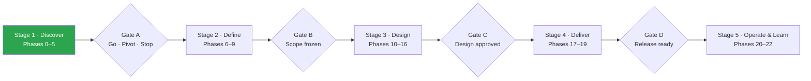

<div align="center">

# VeriGlow-ai

**AI-powered platform that helps consumers make informed decisions about the authenticity and trustworthiness of beauty products purchased online.**


</div>

---

## Table of Contents

- [Project Overview](#project-overview)
- [Problem Statement](#problem-statement)
- [Current Status](#current-status)
- [Roadmap](#roadmap)
- [Repository Structure](#repository-structure)
- [Future Technology Stack](#future-technology-stack)
- [How to Contribute](#how-to-contribute)
- [License](#license)

---

## Project Overview

VeriGlow-ai explores whether online beauty shoppers can get a clear, evidence-backed answer before and after they buy:

> *"Can I trust this listing, this seller, and this product?"*

The project is built the way a real product team works: **research first, then requirements, then architecture, then code.** Every major decision — including decisions *not* to build — is recorded here so the reasoning is as visible as the result. The full execution plan is in the [Master Project Guide](docs/00-project-management/MASTER_PROJECT_GUIDE.md).

**There is no application code in this repository yet.** That is intentional — see [Current Status](#current-status).

---

## Problem Statement

Consumers buying skincare and beauty products online struggle to trust whether products are **authentic**, **safe**, and **reliable**.

| Concern | What the buyer experiences | Why it matters |
|---|---|---|
| **Counterfeit products** | Packaging looks right, but the product inside is not genuine | Unknown formulations applied directly to skin, eyes, and lips |
| **Expired or relabelled stock** | Batch codes and expiry dates are hard to see or interpret, and can be altered | Degraded actives, contamination risk, wasted money |
| **Unclear seller information** | Marketplace sellers are often third parties with little visible history | Buyers cannot tell an authorised reseller from an anonymous one |
| **Failed recourse** | Returns are refused or there is no way to report a suspected fake | Buyers are left holding the product |

**What the evidence says so far** (details and sources in the research docs):

- About **1 in 5** Indian online shoppers report receiving a counterfeit in the past 12 months (all categories), and cosmetics and fragrances are repeatedly named among the most-faked categories.
- Around **69%** of consumers say they cannot identify a fake.
- **41%** of shoppers who received a fake were left with it, and **43%** had no way to report it.
- Counterfeit complaints to India's National Consumer Helpline rose roughly **3.7×** between 2021 and 2025 (all e-commerce).

These figures are self-reported or cross-category, and several come from organisations that sell anti-counterfeit services. The docs grade every source for that reason. See [`02-market-research.md`](docs/01-research/02-market-research.md).

---

## Current Status

| | |
|---|---|
| **Current phase** | 3 — Competitor Analysis (v2.0 complete) |
| **Completed** | Repository setup · Problem discovery · Market research v2.0 · Competitor analysis v2.0 · Master project guide |
| **Decision pending** | Accept or reject the competitor analysis recommendation |
| **Next up** | 4-week, no-build validation gate · User research |

> [!IMPORTANT]
> **The competitor analysis recommends STOP for the original idea** — a consumer app that verifies beauty authenticity — **unless a 4-week validation gate passes.** The evidence: every high-assurance verifier depends on data that brands hold; no consumer-side payer was found; and free AI assistants are already a partial substitute. Re-entry requires that at least 2 of 5 brands will share data or pilot, that a named payer exists, and that at least 30% of a target segment both doubted a purchase and took a costly action. See [`03-competitor-analysis.md` §0 and §13](docs/01-research/03-competitor-analysis.md).

Live status is tracked in [`PROJECT_STATUS.md`](PROJECT_STATUS.md). Notable changes are logged in [`CHANGELOG.md`](CHANGELOG.md).

---

## Roadmap

The project follows **24 phases in five stages**, with **four stage gates** that must pass before moving on. A failed gate is a valid outcome — it is cheaper to stop on evidence than to build the wrong thing.



| Stage | Phases | Key outputs | Status |
|---|---|---|---|
| 1 — Discover | 0 Setup · 1 Problem · 2 Market · 3 Competitors · 4 User research · 5 Validation + spike | Research docs, gate A decision | 🟡 In progress (Phase 3) |
| 2 — Define | 6 Personas · 7 Journeys · 8 Prioritisation · 9 PRD | PRD with frozen MVP scope | ⬜ |
| 3 — Design | 10 Architecture · 11 Stack · 12 Database · 13 API · 14 Frontend · 15 Backend · 16 AI | Design docs and ADRs | ⬜ |
| 4 — Deliver | 17 Sprint planning · 18 MVP · 19 Testing & hardening | Tested MVP on staging | ⬜ |
| 5 — Operate & Learn | 20 Deployment · 21 Monitoring · 22 Post-launch | Production release, iteration | ⬜ |
| Continuous | 23 Interview preparation | Case study | 🟡 |

Phase-by-phase exit criteria are in [`ROADMAP.md`](ROADMAP.md) and the [Master Project Guide](docs/00-project-management/MASTER_PROJECT_GUIDE.md).

---

## Repository Structure

```text
veriglow-ai/
├── .github/
│   ├── ISSUE_TEMPLATE/
│   │   ├── bug_report.md
│   │   └── feature_request.md
│   └── pull_request_template.md
├── assets/
│   ├── diagrams/                       # Architecture and flow diagrams
│   └── screenshots/                    # Competitor teardowns, later UI
├── backend/                            # Backend service (not started)
├── docs/
│   ├── 00-project-management/
│   │   └── MASTER_PROJECT_GUIDE.md     # Execution playbook, gates, milestone tracker
│   ├── 01-research/
│   │   ├── 01-problem-discovery.md     # ✅
│   │   ├── 02-market-research.md       # ✅ v2.0
│   │   ├── 02-market-research-review.md
│   │   ├── 03-competitor-analysis.md   # ✅ v2.0
│   │   ├── 03-competitor-analysis-review.md
│   │   └── 04-user-research.md         # next
│   ├── 02-product/                     # Personas, PRD, user flows
│   ├── 03-design/                      # Architecture, system & database design
│   ├── 04-engineering/                 # API design, development guidelines
│   ├── 05-testing/                     # Testing strategy
│   ├── 06-deployment/                  # Deployment plan
│   └── 07-decisions/                   # Architecture Decision Records (ADRs)
├── frontend/                           # Web client (not started)
├── CHANGELOG.md
├── CONTRIBUTING.md
├── LICENSE
├── PROJECT_STATUS.md
├── README.md
└── ROADMAP.md
```

Each research document has a **review record** beside it. Both research docs changed materially under review — that history is kept on purpose.

---

## Future Technology Stack

> ⚠️ **Nothing below is decided, and nothing will be until Gate A passes.** These are *candidates* to be evaluated in Phase 11. Each final choice will be recorded as an ADR in [`docs/07-decisions/`](docs/07-decisions/) with the alternatives considered and the trade-offs accepted.

| Layer | Candidates | Deciding question |
|---|---|---|
| Frontend | React + TypeScript, Next.js | Do we need server-side rendering for shareable pages? |
| Backend | Python (FastAPI), Node.js | Where does the AI/ML ecosystem matter most? |
| Database | PostgreSQL | Is relational data (products, sellers, batches) the dominant shape? |
| AI / ML | Hosted model API, vision models | Can it beat a free general-purpose AI assistant on a controlled test set? |
| Media storage | Object storage (S3-compatible or managed) | How many user-uploaded images, and for how long? |
| Hosting | Container-based PaaS | What is the cheapest reliable option for an MVP? |

---

## How to Contribute

Contributions — including research, feedback on documents, and challenges to assumptions — are welcome.

1. Read [`CONTRIBUTING.md`](CONTRIBUTING.md).
2. Open an issue using a [template](.github/ISSUE_TEMPLATE/) before starting significant work.
3. Branch from `main`, keep changes focused, and use [Conventional Commits](https://www.conventionalcommits.org/).
4. Open a pull request using the [PR template](.github/pull_request_template.md).

---

## License

Distributed under the MIT License. See [`LICENSE`](LICENSE).
