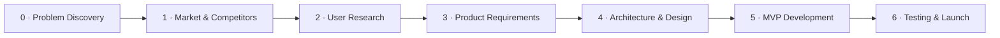

# Roadmap

This roadmap describes **phases**, not dates. A phase ends when its exit criteria are met — not when a calendar says so.

---

## Phase 0 — Problem Discovery ✅

**Goal:** Define a specific, evidence-backed problem.

- [x] Problem statement
- [x] Initial evidence and assumptions
- [x] Repository setup

**Exit criteria:** Problem statement written; key assumptions listed; open questions identified.

---

## Phase 1 — Market & Competitor Research

**Goal:** Understand the size of the opportunity and what already exists.

- [ ] Market research — `docs/01-research/02-market-research.md`
- [ ] Competitor analysis — `docs/01-research/03-competitor-analysis.md`

**Exit criteria:** At least 5 existing solutions analysed; a clear statement of the gap VeriGlow-ai would fill (or a decision to pivot).

---

## Phase 2 — User Research

**Goal:** Validate the problem with real buyers before designing a solution.

- [ ] Interview plan and screener
- [ ] 8–12 buyer interviews
- [ ] Synthesis — `docs/01-research/04-user-research.md`
- [ ] Personas — `docs/02-product/user-personas.md`

**Exit criteria:** Top problems ranked by frequency and severity from primary research.

---

## Phase 3 — Product Requirements

**Goal:** Decide exactly what the MVP does — and does not do.

- [ ] PRD — `docs/02-product/PRD.md`
- [ ] User flows — `docs/02-product/user-flows.md`
- [ ] Success metrics

**Exit criteria:** PRD reviewed; MVP scope frozen; measurable success criteria defined.

---

## Phase 4 — Architecture & Design

**Goal:** Decide how to build the MVP and record why.

- [ ] Architecture — `docs/03-design/architecture.md`
- [ ] System design — `docs/03-design/system-design.md`
- [ ] Database design — `docs/03-design/database-design.md`
- [ ] API design — `docs/04-engineering/api-design.md`
- [ ] ADRs for each major technology choice — `docs/07-decisions/`

**Exit criteria:** Every major technology choice has an accepted ADR.

---

## Phase 5 — MVP Development

**Goal:** Build the smallest product that delivers the core verification job.

- [ ] Development guidelines finalised
- [ ] Backend and frontend skeletons
- [ ] Core verification flow end-to-end
- [ ] CI pipeline

**Exit criteria:** A user can complete the core flow end-to-end in a deployed environment.

---

## Phase 6 — Testing & Launch

**Goal:** Prove the MVP works and put it in front of users.

- [ ] Testing strategy executed — `docs/05-testing/testing-strategy.md`
- [ ] Deployment — `docs/06-deployment/deployment-plan.md`
- [ ] Feedback loop with early users

**Exit criteria:** MVP live; success metrics being measured.
