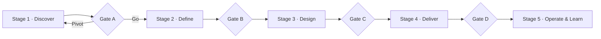

# Roadmap

This roadmap describes **phases and gates**, not fixed dates. A phase ends when its exit criteria are met — not when a calendar says so. The detailed playbook for every phase (deliverables, commits, questions, checklists) is the [Master Project Guide](docs/00-project-management/MASTER_PROJECT_GUIDE.md).

**Legend:** ✅ done · 🟡 in progress · ⬜ not started

---

## Stage 1 — Discover: *Is the problem real?*

| Phase | Goal | Main output | Status |
|---|---|---|---|
| 0 — Project Setup | Repo, conventions, tracking | Repo, templates, guide, risk register | 🟡 |
| 1 — Problem Discovery | Solution-free problem statement | [`01-problem-discovery.md`](docs/01-research/01-problem-discovery.md) | ✅ |
| 2 — Market Research | Size, trends, trust landscape, risks | [`02-market-research.md`](docs/01-research/02-market-research.md) v2.0 | 🟡 |
| 3 — Competitor Analysis | Every alternative, incl. substitutes and "do nothing" | [`03-competitor-analysis.md`](docs/01-research/03-competitor-analysis.md) v2.0 | 🟡 |
| 4 — User Research | Primary evidence from buyers and brands | `04-user-research.md` | ⬜ |
| 5 — Problem Validation + Feasibility Spike | Go / Pivot / Stop on pre-registered criteria | `05-problem-validation.md`, `06-feasibility-spike.md` | ⬜ |

**Gate A — Problem worth solving.** Passes when pre-registered criteria are met on primary evidence, a feasibility spike shows a viable technical path, and the adoption, feasibility and brand-data risks have documented answers. The competitor analysis adds three must-pass tests (G1 brand data, G2 named payer, G3 frequent and costly doubt). **If it fails:** pivot (back to Phase 3) or stop with a write-up.

## Stage 2 — Define: *What exactly will we build?*

| Phase | Goal | Main output | Status |
|---|---|---|---|
| 6 — User Personas | Evidence-based primary persona and anti-persona | `user-personas.md` | ⬜ |
| 7 — Journey Mapping | Ranked pain points on the current journey | `user-journeys.md` | ⬜ |
| 8 — Feature Prioritisation | MVP hypothesis and won't-have list | `feature-prioritization.md` | ⬜ |
| 9 — PRD | Frozen scope, numeric NFRs, AI requirements | `PRD.md` | ⬜ |

**Gate B — Scope frozen.** PRD approved; MVP fits ≤ 4 two-week sprints; every story traces to a pain and a metric.

## Stage 3 — Design: *How will we build it?*

| Phase | Goal | Main output | Status |
|---|---|---|---|
| 10 — Architecture | C4 views, system design, threat model | `architecture.md`, `system-design.md`, ADR-0001 | ⬜ |
| 11 — Tech Stack | Criteria-based stack decisions | Stack ADRs, cost estimate | ⬜ |
| 12 — Database | Access-pattern-driven data model | `database-design.md` | ⬜ |
| 13 — API | Contract-first OpenAPI 3.1 spec | `api-design.md`, `openapi.yaml` | ⬜ |
| 14 — Frontend Plan | Flows, wireframes, component and state design | `user-flows.md`, `frontend-plan.md` | ⬜ |
| 15 — Backend Plan | Clean-architecture modules, observability conventions | `backend-plan.md`, `testing-strategy.md` | ⬜ |
| 16 — AI Plan | Baseline, frozen golden set, numeric thresholds | `ai-design.md`, `ai-evaluation-plan.md` | ⬜ |

**Gate C — Design approved.** All stack, data, API and AI ADRs accepted; threat model reviewed; AI thresholds agreed.

## Stage 4 — Deliver: *Build, test, ship*

| Phase | Goal | Main output | Status |
|---|---|---|---|
| 17 — Sprint Planning | ≤ 4 sprints; Sprint 1 = walking skeleton | Release plan, Sprint 1 plan | ⬜ |
| 18 — MVP Development | Tested MVP deployed to staging | `backend/`, `frontend/`, CI/CD | ⬜ |
| 19 — Testing & Hardening | E2E, load, security, accessibility, AI evaluation, UAT | Test report v0.1 | ⬜ |

**Gate D — Release ready.** All P0 stories done; no open Sev-1/Sev-2 defects; AI meets thresholds on the held-out set.

## Stage 5 — Operate & Learn

| Phase | Goal | Main output | Status |
|---|---|---|---|
| 20 — Deployment | Production release with rollback and backups | `v0.1.0`, runbook | ⬜ |
| 21 — Monitoring | SLOs, alerts, product and AI metrics | `observability.md` | ⬜ |
| 22 — Post-launch | Measured iteration | Launch review, `v0.2.0` | ⬜ |

## Continuous — Phase 23: Interview Preparation

Captured after every phase; consolidated into a public case study after launch.
