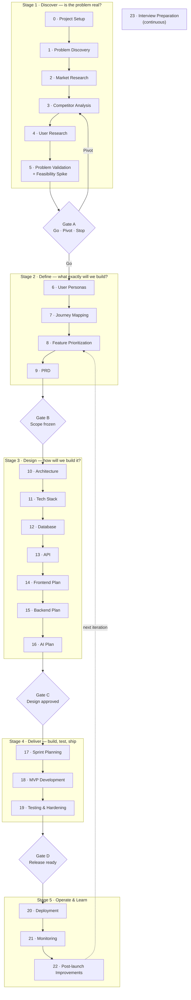
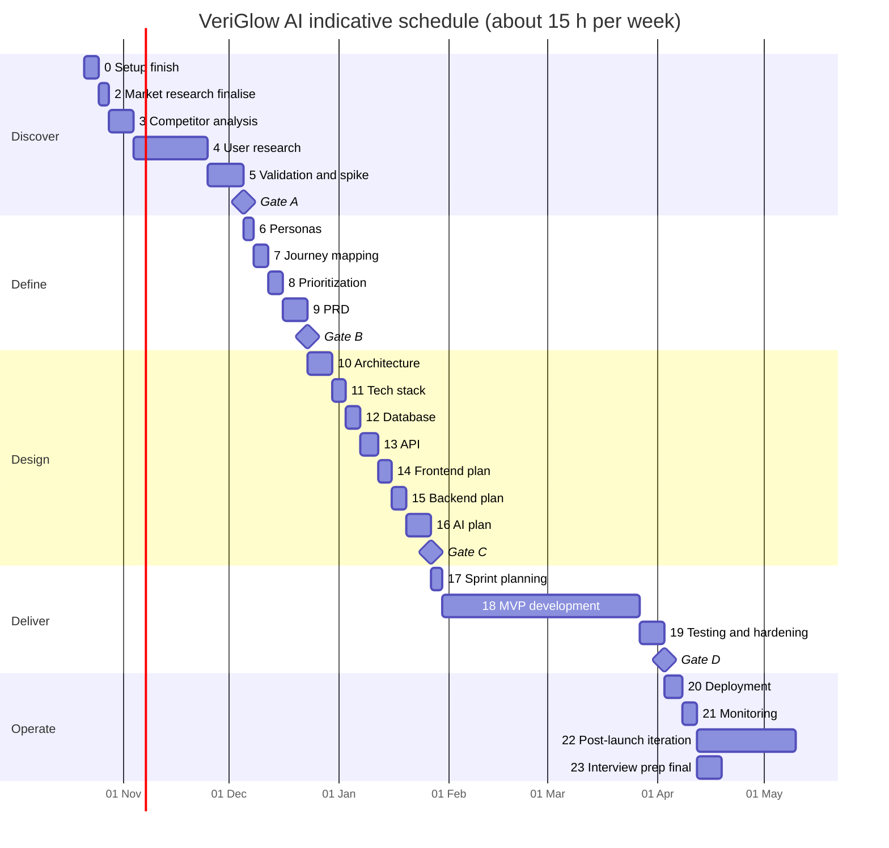

# VeriGlow AI — Master Project Guide

| Field | Value |
|---|---|
| **Project** | VeriGlow AI |
| **Document** | `docs/00-project-management/MASTER_PROJECT_GUIDE.md` |
| **Type** | Engineering execution playbook (not a product roadmap) |
| **Status** | Approved v1.1 — living document |
| **Owner** | Project lead (repository owner) |
| **Last updated** | 20 October 2026 |
| **Current phase** | Phase 3 — Competitor Analysis (v2.0 complete; recommends **STOP + 4-week validation gate**, awaiting your decision) |
| **Related** | [`PROJECT_STATUS.md`](../../PROJECT_STATUS.md) · [`ROADMAP.md`](../../ROADMAP.md) · [`CONTRIBUTING.md`](../../CONTRIBUTING.md) |

> [!IMPORTANT]
> **How to use this guide.** Work top to bottom. Do not start a phase until the previous phase's **exit criteria** are met and its **checklist** is ticked. When you finish a phase, update [`PROJECT_STATUS.md`](../../PROJECT_STATUS.md) and the [Master Milestone Tracker](#master-milestone-tracker). If you ever wonder "what next?", the answer is the first unticked row in the tracker.

---

## Table of Contents

- [Part I — Operating Model](#part-i--operating-model)
  - [1. Guiding principles](#1-guiding-principles)
  - [2. Where we are today](#2-where-we-are-today)
  - [3. Deviations from the original brief (and why)](#3-deviations-from-the-original-brief-and-why)
  - [4. Lifecycle and stage gates](#4-lifecycle-and-stage-gates)
  - [5. Roles: what Claude does vs. what you do](#5-roles-what-claude-does-vs-what-you-do)
  - [6. Conventions](#6-conventions)
  - [7. Target repository structure](#7-target-repository-structure)
  - [8. How each phase is written](#8-how-each-phase-is-written)
- [Part II — Phases](#part-ii--phases)
  - [Stage 1 · Discover](#stage-1--discover--is-the-problem-real) — Phases 0–5
  - [Stage 2 · Define](#stage-2--define--what-exactly-will-we-build) — Phases 6–9
  - [Stage 3 · Design](#stage-3--design--how-will-we-build-it) — Phases 10–16
  - [Stage 4 · Deliver](#stage-4--deliver--build-test-ship) — Phases 17–19
  - [Stage 5 · Operate & Learn](#stage-5--operate--learn) — Phases 20–22
  - [Continuous · Interview Preparation](#phase-23--interview-preparation) — Phase 23
- [Part III — Tracking](#part-iii--tracking)
  - [Master Milestone Tracker](#master-milestone-tracker)
  - [Indicative schedule](#indicative-schedule)
  - [Do Not Skip These Steps](#do-not-skip-these-steps)
- [Appendices](#appendices)
- [Changelog](#changelog)

---

# Part I — Operating Model

## 1. Guiding principles

| # | Principle | What it means in practice |
|---|---|---|
| 1 | **Evidence before opinion** | Every claim in a research or product doc carries an evidence tag (✅ Fact · 🟡 Low-confidence · 🔶 Assumption · ❓ Unverified), the legend used since `02-market-research.md`. |
| 2 | **Problem before solution** | Research documents (Phases 1–5) contain *no* features or technology. Solutions first appear in Phase 8. |
| 3 | **Decide once, write it down** | Every significant technical choice becomes an ADR in `docs/07-decisions/`. If it isn't written, it isn't decided. |
| 4 | **Lean until measured** | No folder, service, or tool exists until a phase needs it (no Kubernetes, Terraform, or ML-pipeline folders without a measured need). |
| 5 | **Gates, not vibes** | Four stage gates (A–D) have explicit pass/fail criteria. A failed gate is a *good outcome* — it saved you from building the wrong thing. |
| 6 | **Ship a thin slice early** | The first sprint deploys a "walking skeleton" end-to-end. Deployment is not a final-phase surprise. |
| 7 | **Quality is continuous** | Tests, security, and observability are written *during* development. Phases 19 and 21 harden and verify them; they don't start them. |
| 8 | **You must be able to explain everything** | Nothing is committed that you can't explain line by line in an interview. |
| 9 | **Public repo hygiene** | No secrets, no personal data from user research, no copyrighted material beyond fair analysis. |

## 2. Where we are today

*Snapshot as of 20 Oct 2026.*

| Phase | Status | Evidence |
|---|---|---|
| 0 — Project Setup | 🟡 **Mostly done** | Repo `n3h4a/veriGlow-ai` pushed (public, MIT) with docs skeleton, templates, README, ROADMAP, PROJECT_STATUS and this guide. **Remaining:** GitHub Project board, labels, milestones, branch protection, `SECURITY.md`, Obsidian setup, risk register. |
| 1 — Problem Discovery | ✅ **Done** | `docs/01-research/01-problem-discovery.md` with assumptions A1–A5 and evidence gaps. |
| 2 — Market Research | 🟡 **v2.0 committed** | v1.0 drafted, then reviewed (`02-market-research-review.md`: 5 critical issues incl. an unsearched "no verification exists" claim and undisclosed sponsor bias) and revised to v2.0. Both are committed. **Remaining:** personally spot-check 10 citations; confirm Mermaid renders on GitHub. |
| 3 — Competitor Analysis | 🟡 **v2.0 committed — decision pending** | v1.0 (PIVOT) failed a red-team review (`03-competitor-analysis-review.md`, 25/50). v2.0 recommends **STOP the current thesis + a 4-week, no-build validation gate**. **Remaining:** your decision on the recommendation; hands-on teardowns; community-forum mining. |
| 4 → 23 | ⬜ Not started | — |

> [!IMPORTANT]
> **The competitor analysis (v2.0) recommends STOP of the current thesis — not GO, and no longer PIVOT.** Every high-assurance verifier depends on brand-held data; no consumer-side payer was found; and free AI assistants are a live substitute. v1.0's "end-to-end purchase trust" pivot was rejected because freshness, seller authorisation and recourse each depend on brands or platforms too. Re-entry is allowed only if a **4-week validation gate** passes its three must-pass tests: **G1** ≥2 of 5 brands willing to share data or pilot; **G2** a named payer with a stated budget; **G3** ≥30% of a target segment doubted a purchase in 3 months *and* took a costly action. This front-loads the evidence Gate A needs, so **Phase 4 is now designed around G1–G3**. The formal Go / Pivot / Stop is still recorded at **Gate A** (Phase 5).

**Your next three actions:**
1. **Decide** whether you accept the STOP + validation-gate recommendation (`03-competitor-analysis.md` §0, §13). Record the decision in `PROJECT_STATUS.md`. If you disagree, write down which evidence you weigh differently.
2. Finish the Phase 0 remainder ([Phase 0 checklist](#phase-0--project-setup)): board, labels, branch protection, `SECURITY.md`, risk register.
3. Start recruiting now for G1–G3: 5 Indian beauty brands (G1, G2) and target-segment buyers for interviews and the n≥200 survey (G3). Recruiting is the slowest step in the whole discovery stage.

## 3. Deviations from the original brief (and why)

The brief listed 24 phases. All are kept, but five are re-ordered or re-scoped. Each change is deliberate; challenge them if you disagree.

| # | Brief said | This guide does | Why |
|---|---|---|---|
| D1 | Competitor Analysis (2) **before** Market Research (3) | **Market Research = 2, Competitor Analysis = 3** | Market research is already drafted, the repo's file numbering (`02-market-research.md`, `03-competitor-analysis.md`) already reflects this order, and market research §7 and Q11–Q15 are the *input* to competitor analysis. |
| D2 | PRD (6) **before** Personas (7), Journeys (8), Prioritisation (9) | **Personas 6 → Journeys 7 → Prioritisation 8 → PRD 9** | A PRD *documents* decisions about who, which pain, and what scope. Writing it first means writing it twice. Personas and journeys are inputs; prioritisation produces the scope the PRD freezes. |
| D3 | Problem Validation = desirability only | **Phase 5 adds a time-boxed technical feasibility spike** | The single largest risk in the market research is R-TEC-1: sophisticated fakes may be visually indistinguishable. If the "AI" part can't work, a PRD built on it is fiction. Validate *desirability* (users care and act) and *feasibility* (it can be built) before freezing scope. |
| D4 | Testing (19) as a phase after development | **Testing is continuous; Phase 19 is "Testing & Hardening"** | Writing tests after the code is the most common beginner anti-pattern. Unit/integration tests ship with every PR in Phase 18; Phase 19 adds E2E, load, security, accessibility, AI evaluation, and user acceptance. |
| D5 | Deployment (20) and Monitoring (21) after the MVP | **First deploy happens in Sprint 1 (walking skeleton); observability is designed in Phase 15** | Late first deploys surface environment, secrets, and networking problems when you have the least time. Phase 20 is the *production release*; Phase 21 adds SLOs, alerts, and dashboards on instrumentation that already exists. |
| D6 | Interview Preparation (23) at the end | **Continuous, with a final consolidation phase** | Interview stories are easiest to capture *when* the decision happens. Each phase includes "Interview relevance" and a question set you must answer before moving on. |

Additions not in the brief: **four stage gates**, a **threat model and privacy review** (Phase 10), a **risk register** (Phase 0, maintained throughout), and a **public case study** (Phase 23).

## 4. Lifecycle and stage gates



### Gate criteria

| Gate | After | Passes when | If it fails |
|---|---|---|---|
| **A — Problem worth solving** | Phase 5 | Pre-registered success criteria met on primary evidence; feasibility spike shows at least one viable technical path; risks R-ADO-1 and R-TEC-1 have a documented answer. | **Pivot:** reframe segment/problem and loop to Phase 3. **Stop:** archive with a write-up — a well-documented "no" is still a strong portfolio piece. |
| **B — Scope frozen** | Phase 9 | PRD approved; MVP scope fits the delivery budget (≤ 4 two-week sprints); every MVP story traces to a persona pain and a success metric. | Cut scope (Phase 8) rather than extend the timeline. |
| **C — Design approved** | Phase 16 | All ADRs for stack, data, API, and AI are accepted; threat model reviewed; AI evaluation plan has numeric acceptance thresholds; design reviewed against PRD NFRs. | Revise the specific design doc; don't start coding around an open question. |
| **D — Release ready** | Phase 19 | All P0 stories done; release checklist green; no open Sev-1/Sev-2 bugs; AI meets PRD thresholds on the held-out set; privacy policy live. | Fix or descope; never ship past a red security or privacy item. |

## 5. Roles: what Claude does vs. what you do

| Claude (mentor, reviewer, drafter) | You (owner, decision-maker, builder) |
|---|---|
| Researches public sources and drafts documents with evidence tags | Decides — every scope, stack, and design decision is yours and signed off in the doc |
| Challenges assumptions and plays devil's advocate | Talks to real users (Claude cannot run interviews) |
| Generates diagrams, templates, checklists, and ADR drafts | Runs, debugs, and understands every line of code |
| Reviews documents, PRs, and code; suggests improvements | Commits and pushes — **all commits authored solely by you, no co-author trailers** |
| Explains concepts before implementation | Configures GitHub, cloud accounts, secrets, and billing alerts |
| Quizzes you at each milestone until you can explain it | Keeps PROJECT_STATUS and the tracker current |
| Writes code **only when you explicitly ask** | Approves gate decisions |

## 6. Conventions

### 6.1 Git workflow

| Aspect | Convention | Why |
|---|---|---|
| Model | Trunk-based: `main` + short-lived branches (≤ 3 days) | Simple, industry-standard, avoids merge hell |
| Branch names | `docs/<phase>-<topic>`, `feat/<issue#>-<slug>`, `fix/<issue#>-<slug>`, `chore/<slug>`, `spike/<slug>` | Traceable to issues |
| Merging | PR → self-review checklist → CI green → **squash merge** | Clean history; one commit per change |
| Protection | `main` protected: PR required; status checks required once CI exists (Sprint 1) | Forces the habit even when solo |
| Commit format | [Conventional Commits 1.0.0](https://www.conventionalcommits.org/en/v1.0.0/): `type(scope): imperative summary` | Readable history; automatable changelog |
| Types | `docs`, `feat`, `fix`, `test`, `refactor`, `perf`, `ci`, `build`, `chore` | — |
| Scopes | `pm`, `research`, `product`, `design`, `adr`, `api`, `db`, `web`, `ai`, `infra`, `deps` | Groups history by area |
| Authorship | Your GitHub identity only; **no `Co-Authored-By` or tool trailers** | Your portfolio, your authorship |
| Versioning | [SemVer](https://semver.org/): `v0.x` pre-launch, `v0.1.0` = MVP public beta | Signals stability honestly |
| Tags/releases | Annotated tag + GitHub Release with notes from `CHANGELOG.md` | — |

### 6.2 Document lifecycle

```text
Draft v0.x  →  In Review  →  Approved v1.0  →  (revised v1.1, v2.0 …)  →  Superseded
```

Every document starts with the metadata table used in `02-market-research.md` (status, phase, depends-on, feeds-into) and ends with a changelog. A document is **Approved** only after the [review checklist](#appendix-b--document-review-checklist) passes.

### 6.3 Diagrams

- **Default: Mermaid** inside Markdown — renders natively on GitHub and in Obsidian, diffable, versioned.
- **Exception:** wireframes and affinity maps as images in `assets/diagrams/` or `assets/wireframes/`, with the editable source linked.
- Every diagram has a caption and a source/date if it encodes data.

### 6.4 Project management

| Tool | Setup |
|---|---|
| **GitHub Issues** | One issue per deliverable (doc, ADR, story, bug). |
| **GitHub Project (board)** | Columns: Backlog → Ready → In Progress → In Review → Done. |
| **Milestones** | One per stage gate (A–D), then one per sprint. |
| **Labels** | `type:docs` `type:feature` `type:bug` `type:spike` `type:adr` · `phase:00`…`phase:23` · `area:web` `area:api` `area:ai` `area:infra` · `priority:p0` `p1` `p2` |
| **PROJECT_STATUS.md** | Updated at every phase exit: current phase, last gate, next three actions, blockers. |
| **Risk register** | `docs/00-project-management/risk-register.md`, seeded from market research §14 and competitor analysis §11, reviewed at each gate. |

### 6.5 Obsidian (two-vault model)

| Vault | Contents | Committed? |
|---|---|---|
| **Vault 1 — the repo** (open the cloned repo folder as a vault) | Editing committed docs with live preview and backlinks | Yes, except `.obsidian/` (add to `.gitignore`) |
| **Vault 2 — private "VeriGlow Notebook"** | Learning notes, raw interview notes and recordings, interview Q&A bank, STAR stories, scratch thinking | **Never** — contains personal data and unpolished notes |

Obsidian settings for Vault 1: turn **off** "Use [[Wikilinks]]", set "New link format" to **relative path**, set the attachments folder to `assets/`. GitHub doesn't render wikilinks, so committed docs must use standard Markdown links.

## 7. Target repository structure

Folders are created **only when the phase that needs them begins**. 🆕 marks planned additions not yet in the repo.

```text
veriglow-ai/
├── .github/
│   ├── ISSUE_TEMPLATE/{bug_report.md, feature_request.md, research_task.md 🆕, adr.md 🆕}
│   ├── workflows/ 🆕                      # Phase 18 (Sprint 1): ci.yml, deploy.yml
│   ├── dependabot.yml 🆕                  # Phase 18
│   └── pull_request_template.md
├── assets/{diagrams/, screenshots/, wireframes/ 🆕}
├── backend/                               # Phase 18 — structure per ADR + backend-plan.md
├── frontend/                              # Phase 18 — structure per ADR + frontend-plan.md
├── spikes/ 🆕                              # Phase 5 — throwaway feasibility code, clearly labelled
├── docs/
│   ├── 00-project-management/
│   │   ├── MASTER_PROJECT_GUIDE.md        # this file
│   │   ├── risk-register.md 🆕
│   │   ├── release-plan.md 🆕             # Phase 17
│   │   └── sprints/sprint-01.md … 🆕      # Phase 17–18
│   ├── 01-research/
│   │   ├── 01-problem-discovery.md ✅
│   │   ├── 02-market-research.md (v2.0) ✅
│   │   ├── 02-market-research-review.md ✅ # design review record
│   │   ├── 03-competitor-analysis.md (v2.0) ✅
│   │   ├── 03-competitor-analysis-review.md ✅ # red-team review record
│   │   ├── 04-user-research.md
│   │   ├── 05-problem-validation.md 🆕
│   │   └── 06-feasibility-spike.md 🆕
│   ├── 02-product/
│   │   ├── user-personas.md
│   │   ├── user-journeys.md 🆕            # experience maps (Phase 7)
│   │   ├── feature-prioritization.md 🆕
│   │   ├── PRD.md
│   │   └── user-flows.md                  # screen/task flows (Phase 14)
│   ├── 03-design/
│   │   ├── architecture.md
│   │   ├── system-design.md
│   │   ├── threat-model.md 🆕
│   │   ├── database-design.md
│   │   └── ai-design.md 🆕
│   ├── 04-engineering/
│   │   ├── api-design.md + openapi.yaml 🆕
│   │   ├── frontend-plan.md 🆕
│   │   ├── backend-plan.md 🆕
│   │   ├── ai-evaluation-plan.md 🆕
│   │   ├── model-card.md 🆕                # Phase 18–19
│   │   └── development-guidelines.md
│   ├── 05-testing/{testing-strategy.md, test-report-v0.1.md 🆕}
│   ├── 06-deployment/{deployment-plan.md, release-checklist.md 🆕, runbook.md 🆕, observability.md 🆕}
│   ├── 07-decisions/{ADR-template.md, ADR-0001-*.md …}
│   ├── 08-post-launch/ 🆕                  # Phase 22
│   └── CASE_STUDY.md 🆕                    # Phase 23
├── .gitignore  CHANGELOG.md  CONTRIBUTING.md  LICENSE  SECURITY.md 🆕
└── PROJECT_STATUS.md  README.md  ROADMAP.md
```

## 8. How each phase is written

Every phase uses the same template so you always know where to look:

| Section | Answers |
|---|---|
| **Goal** | What "done" produces |
| **Why this phase exists** | What goes wrong without it |
| **Inputs required** | What must exist before you start |
| **Deliverables** | Markdown docs, diagrams, and other files — with path and whether they're committed |
| **Claude helps with / You personally do** | Division of work |
| **What to document** | Required content of the deliverables |
| **Diagrams** | Which diagrams must exist |
| **Git commits** | The commits to make, in order |
| **Exit criteria** | Objective conditions to move forward |
| **Questions you must answer** | Self-test before the next phase |
| **Common mistakes** | What beginners get wrong |
| **Interview relevance** | How this shows up in interviews |
| **Checklist** | Tick-box completion list |

Effort estimates assume **~15 focused hours/week**. Adjust to your calendar, but keep the order.

---

# Part II — Phases

## Stage 1 · Discover — *Is the problem real?*

---

## Phase 0 — Project Setup

**Status:** 🟡 Mostly done · **Remaining effort:** ~3 days

### Goal
A repository, workspace, and set of conventions where every later artifact has a home and every decision about *how we work* is made once.

### Why this phase exists
Reviewers and interviewers judge repo hygiene in the first 30 seconds. Conventions decided late cause churn (renaming files, rewriting history, inconsistent commits). Setting up the board and labels now means every later deliverable is tracked from day one.

### Inputs required
- One-line problem statement
- GitHub account, license choice (MIT — done)
- This guide

### Deliverables

| Deliverable | Path | Committed? |
|---|---|---|
| Repo with README, LICENSE, CONTRIBUTING, CHANGELOG, `.gitignore` | root | ✅ Done |
| Issue and PR templates | `.github/` | ✅ Done (add `research_task.md`, `adr.md`) |
| Docs skeleton | `docs/01…07/` | ✅ Done |
| Master guide | `docs/00-project-management/MASTER_PROJECT_GUIDE.md` | ✅ Done |
| Risk register (seeded from market research §14 and competitor analysis §11) | `docs/00-project-management/risk-register.md` | Yes |
| Security policy (public repo) | `SECURITY.md` | Yes |
| GitHub Project board, labels, milestones A–D | GitHub UI | n/a |
| Branch protection on `main` | GitHub settings | n/a |
| Obsidian Vault 1 + Vault 2 | local | `.obsidian/` gitignored |

### Claude helps with
Drafting templates, `SECURITY.md`, risk register, label set; reviewing the README for clarity; explaining trunk-based development and Conventional Commits.

### You personally do
Configure GitHub settings (board, labels, milestones, branch protection, secret scanning); set your git identity (`user.name`, `user.email`) to your GitHub account; set up both Obsidian vaults; decide the working cadence (e.g., weekly review every Sunday).

### What to document
- README: problem (one paragraph), current phase, how the repo is organised, link to this guide. **No feature claims yet.**
- CONTRIBUTING: branch naming, commit convention, PR process, doc lifecycle.
- PROJECT_STATUS: current phase, next three actions.
- Risk register: ID, risk, likelihood, impact, owner, mitigation, review date.

### Diagrams
- Repo structure tree (text) in README.
- Lifecycle flowchart (this guide, §4).

### Git commits
```text
docs(pm): add master project guide v1.0
docs(pm): add risk register seeded from market research risks
docs: add security policy
chore(github): add research-task and ADR issue templates
chore: ignore obsidian workspace config
docs: update README and PROJECT_STATUS for phase 0 completion
```

### Exit criteria
- Every row in the deliverables table exists.
- A test PR was opened, reviewed with the template, and squash-merged into protected `main`.
- Board has issues for Phases 2–5 deliverables.

### Questions you must answer
1. Why trunk-based development instead of GitFlow for this project?
2. Why open PRs when you're the only contributor?
3. Why MIT? What would change with Apache-2.0?
4. Why does the repo *not* have Kubernetes or Terraform folders?
5. What must never be committed to a public repo, and how do you prevent it?

### Common mistakes
- Scaffolding infrastructure folders "for later" (avoided — keep it that way).
- Using Obsidian wikilinks in committed docs (broken on GitHub).
- Committing `.env` files or API keys; no secret scanning.
- No board, so work lives in your head.

### Interview relevance
"How do you organise a project from zero?" — you can show conventions, a board, gates, and a decision log, which signals senior-level working habits.

### Checklist
- [x] GitHub repository created (public, MIT)
- [x] Folder structure pushed
- [x] README, CONTRIBUTING, CHANGELOG, LICENSE
- [x] Issue and PR templates
- [x] `docs/00-project-management/` with this guide
- [ ] Risk register
- [ ] `SECURITY.md`
- [ ] GitHub Project board, labels, milestones A–D
- [ ] Branch protection and secret scanning on
- [ ] Obsidian Vault 1 (repo) and Vault 2 (private) set up; `.obsidian/` gitignored
- [ ] Test PR merged through the full workflow
- [x] PROJECT_STATUS updated
- [ ] Reviewed and improved
- [ ] Ready to move forward

---

## Phase 1 — Problem Discovery

**Status:** ✅ Done · Re-open only if Phase 5 invalidates the problem statement

### Goal
A clear, solution-free statement of the problem, who has it, and which assumptions must be true for it to matter.

### Why this phase exists
Without a written problem, every later discussion drifts into features. The assumptions list (A1–A5) is what Phases 4–5 try to break.

### Inputs required
Initial idea; desk research.

### Deliverables

| Deliverable | Path | Committed? |
|---|---|---|
| Problem discovery doc (problem statement, evidence, assumptions A1–A5, gaps) | `docs/01-research/01-problem-discovery.md` | ✅ |

### Claude helps with
Desk research, evidence tagging, finding gaps, stress-testing the problem statement.

### You personally do
Own the problem statement; confirm every assumption is falsifiable.

### What to document
Problem statement; who is affected; evidence with sources; assumptions with IDs; known gaps (recent beauty-specific data, expiry data, primary interviews).

### Diagrams
Problem tree or cause–effect diagram (optional).

### Git commits
```text
docs(research): add problem discovery v1.0
```

### Exit criteria
Problem statement contains no solution; every assumption is testable; gaps are listed.

### Questions you must answer
1. State the problem in one sentence without naming a product, app, or technology.
2. Which assumption, if false, kills the project?
3. What evidence would change your mind?

### Common mistakes
Writing "the problem is there's no app that…" (that's a solution); untestable assumptions.

### Interview relevance
"Why did you build this?" — your answer starts here, with evidence, not passion.

### Checklist
- [x] Problem statement written and solution-free
- [x] Evidence cited
- [x] Assumptions A1–A5 listed
- [x] Gaps listed
- [x] Committed
- [x] Reviewed and improved
- [x] Ready to move forward

---

## Phase 2 — Market Research

**Status:** 🟡 v2.0 committed (20 Oct 2026) · **Remaining effort:** ~1 day (citation spot-checks, render check)

### Goal
An evidence-backed picture of the market: size, channels, trust landscape, counterfeit scale, platform strategies, journey trust gaps, trends, risks, and open questions — still with no product ideas.

### Why this phase exists
It tells you whether the space is large, growing, and underserved, and — more importantly — produces the **open questions** that steer competitor analysis and user research.

### Inputs required
`01-problem-discovery.md`; public sources (consultancy, regulator, intergovernmental, company filings, surveys).

### Deliverables

| Deliverable | Path | Committed? |
|---|---|---|
| Market research doc (exec summary, industry, trends, trust, counterfeits, platforms, journey, trends, opportunities, risks, top-20 insights, open questions Q1–Q20, references) | `docs/01-research/02-market-research.md` | ✅ |
| Design review record (issues, severity, fixes, residual weaknesses) | `docs/01-research/02-market-research-review.md` | ✅ |
| Risk list → seeds `risk-register.md` | `docs/00-project-management/risk-register.md` | Yes |

### Claude helps with
Source discovery, triangulating conflicting figures, evidence tagging, reviewing for solution leakage.

### You personally do
Spot-check at least 10 headline citations yourself (open the link, confirm the number and its scope). Approve the doc.

### What to document
Done in v2.0. The review pass confirmed every number has scope + date + source, conflicting sources are shown side by side, sponsor bias is disclosed in an evidence-quality register, and open questions are prioritised P0/P1/P2.

> [!CAUTION]
> **Problem sizing yes, TAM/SAM/SOM no.** v2.0's order-of-magnitude *problem* sizing (affected buyers per year, assumption-labelled, no value-at-risk figure) is the right level. A serviceable *market* depends on product scope, which doesn't exist until Phase 9 — computing one now would be fabricated precision. Revisit in the PRD.

> [!NOTE]
> **Lesson from the review, applied to every later research doc:** never write "no X exists" or "not found" unless a targeted search for X was actually run, and state the search scope. Absence of evidence presented as evidence of absence was the most damaging v1.0 error.

### Diagrams
Channel-mix chart, trust-concern taxonomy, counterfeit-loss trend, journey with trust gaps, regulatory timeline (all present).

### Git commits
```text
docs(research): add market research v2.0
docs(research): add market research design review record
docs(pm): seed risk register from market research risks
docs: update PROJECT_STATUS for phase 2 completion
```

### Exit criteria
Review checklist passes; 10 citations personally verified; all Mermaid diagrams render on GitHub; open questions assigned to Phases 3/4/5/10.

### Questions you must answer
1. Why do global beauty market sizes differ by 40–50% between sources?
2. What is the evidence that consumers can't identify fakes, and what are its limits?
3. Is the counterfeit problem bigger online or offline in India? Why is that contested?
4. What are the two trust strategies platforms use, and what do both lack?
5. Which finding is the *least* evidenced, and why does it matter most? (Hint: will consumers act on verification?)
6. Which sources have a financial interest in the counterfeit problem looking large, and how did you adjust for that?
7. What did the v1.0 review catch, and what process change prevents it recurring?

### Common mistakes
Quoting a single market size without scope; treating self-reported survey suspicion as confirmed counterfeits; sneaking features into "opportunities".

### Interview relevance
PM and founder-style interviews: "How big is the market? How do you know?" You'll show triangulation and source-quality grading.

### Checklist
- [x] Industry researched
- [x] Market size documented (with scope)
- [x] Consumer trust issues researched
- [x] Counterfeit market researched
- [x] Platforms analysed
- [x] References added (graded A/B/C)
- [x] Reviewed and improved (design review → v2.0)
- [ ] 10 headline citations personally verified
- [ ] Mermaid diagrams render on GitHub
- [x] GitHub committed (v2.0 + review record)
- [ ] Ready to move forward

---

## Phase 3 — Competitor Analysis

**Status:** 🟡 v2.0 committed 20 Oct 2026 — **decision pending** · **Remaining effort:** ~3 days · Start Phase 4 recruiting in parallel

> [!NOTE]
> **Where the document stands:** v1.0 recommended PIVOT; a red-team review (`03-competitor-analysis-review.md`) scored it 25/50 and found that the pivot inherited the same brand-data dependency it was meant to escape. v2.0 recommends **STOP the current thesis + a 4-week validation gate** (§13.3) and replaces the positioning quadrant with an **assurance ladder** (§6.3). **What's left:** (1) your decision on the recommendation; (2) hands-on teardowns — no app was installed or used; (3) mining Indian beauty communities (Reddit, YouTube, app-store reviews, Hindi sources), still a gap per its §2.4; (4) confirm the "Authenticate App" profile (OLNICA) is the product you meant.

### Goal
A complete map of every way a beauty buyer gets authenticity assurance today — direct competitors, indirect competitors, substitutes, and "do nothing" — with an honest view of where each is strong and weak.

### Why this phase exists
Your real competitor is usually not another startup; it's the buyer's current workaround ("I only buy on Nykaa", "I ask in a WhatsApp group", "I just hope"). If an alternative is good enough, switching cost wins. This phase also closes open questions Q11–Q15 from market research.

### Inputs required
Market research §7 and Q11–Q15; access to the apps and sites being analysed.

### Deliverables

| Deliverable | Path | Committed? |
|---|---|---|
| Competitor analysis doc (v2.0) | `docs/01-research/03-competitor-analysis.md` | ✅ |
| Red-team review record | `docs/01-research/03-competitor-analysis-review.md` | ✅ |
| Teardown screenshots (annotated) | `assets/screenshots/competitors/` | Yes |

### Claude helps with
Building the competitor universe, a consistent comparison framework, researching public policies (returns, authenticity guarantees), drafting SWOTs, challenging "we're different" claims.

### You personally do
Hands-on teardowns: install apps, walk through purchase and return flows, read actual return/authenticity policies, screenshot evidence. Rate each alternative from a buyer's point of view. **Decide** whether to accept the STOP + validation-gate recommendation.

### What to document
- **Competitor universe** in four tiers: (1) direct third-party authenticity services, including those in adjacent categories such as luxury goods; (2) platform programmes (marketplace enforcement, specialist sourcing guarantees, brand serialisation); (3) substitutes (brand D2C sites, community/WhatsApp checks, reviews, influencer trust, general-purpose AI assistants); (4) do nothing.
- **Comparison matrix** on consistent criteria: who bears the risk, what the buyer can see, when in the journey it helps, coverage, cost to buyer, evidence quality, assurance level.
- **SWOT** for the 3–5 most relevant alternatives.
- **Policy findings:** return/refund handling for suspected fakes (Q15), quick-commerce controls (Q12), Tira/Sephora India/Purplle policies (Q11).
- **Business models and incentives:** who pays, who benefits, who resists.
- **Gaps** stated as unmet needs, still no features — each with its structural dependency.

### Diagrams
- Competitive landscape map (tiers).
- Assurance ladder (table) — what each method can and cannot prove. v2.0 replaced the earlier positioning 2×2 because a `quadrantChart` renders inconsistently and an analyst-drawn empty quadrant manufactured whitespace.

### Git commits
```text
docs(research): add competitor analysis v2.0 and red-team review
docs(research): add competitor teardown screenshots and findings
docs(research): add community pain-point mining to competitor analysis
docs(research): record decision on competitor analysis recommendation
```

### Exit criteria
At least 10 alternatives across all four tiers; Q11–Q15 answered or explicitly marked unknown; assurance ladder shows where the white space is (or isn't) and why; recommendation accepted or rejected in writing.

### Questions you must answer
1. What is the strongest alternative today, and why would anyone switch from it?
2. What is "do nothing" costing a buyer, concretely?
3. Which competitor would copy you fastest if you succeeded, and how?
4. What advantage do you have? (An honest "none yet" is acceptable — say what could create one.)
5. Why does every high-assurance verifier depend on brand enrolment, and what does that mean for any new entrant?
6. Counterfeits are ~3% of national e-commerce complaints. Why might that understate the problem — and why might it not?
7. What is "genuine but compromised" stock, and why does authentication technology miss it?
8. Why did the v1.0 pivot fail the red-team review, and what would a credible pivot have to change?

### Common mistakes
Listing only direct competitors; feature-checklist comparisons that favour you; analysing from marketing pages instead of hands-on use; declaring "no competitors"; mistaking an infeasible quadrant for an opportunity.

### Interview relevance
"Who are your competitors and why would you win?" A four-tier answer including substitutes and do-nothing signals product maturity. "Tell me about a time you recommended stopping a project" — this phase is that story.

### Checklist
- [x] Competitor universe (4 tiers) built
- [ ] Hands-on teardowns done with screenshots
- [ ] Community pain-point mining (Reddit, YouTube, app reviews)
- [x] Comparison matrix complete
- [x] SWOT for top alternatives
- [x] Q11–Q15 answered or marked unknown
- [x] Assurance ladder (replaces positioning map)
- [x] References added
- [x] Metadata corrected
- [x] GitHub committed
- [x] Reviewed and improved (red-team review → v2.0)
- [ ] Recommendation accepted or rejected in writing
- [ ] Ready to move forward

---

## Phase 4 — User Research

**Effort:** ~3–4 weeks (recruiting dominates)

### Goal
Primary evidence about what real buyers **actually did** the last time they doubted a beauty product's authenticity — behaviour, not opinions about a hypothetical product — plus the brand evidence the validation gate requires.

### Why this phase exists
Everything so far is secondary data. The riskiest assumption in the market research — whether consumers will *act* on verification (R-ADO-1) — can only be tested with real people. The competitor analysis adds two more questions only primary research can answer: will brands share data (G1), and will anyone pay (G2)? This is the phase most often skipped and the one that most separates a portfolio project from a product.

### Inputs required
Assumptions A1–A5; market research P0/P1 open questions; competitor analysis validation gate **G1–G5** (§13.3) and decision variables (§11.3). The interview guide must let participants rank which failures (T1–T5) they have actually experienced, without you suggesting the ranking.

### Deliverables

| Deliverable | Path | Committed? |
|---|---|---|
| Research plan: objectives, hypotheses, **pre-registered success/kill thresholds** (G1–G3), method, sample, ethics | `docs/01-research/04-user-research.md` §1 | Yes |
| Screener, interview guides (buyers and brands), consent script | `docs/01-research/04-user-research.md` appendix | Yes |
| Raw notes, recordings, contact details | Private Vault 2 | **Never** |
| Anonymised synthesis (participants as P01–P12; brands as B01–B05) | `docs/01-research/04-user-research.md` §findings | Yes |
| Survey instrument + aggregated results (n ≥ 200 for G3) | same doc + `assets/diagrams/` | Yes (aggregates only) |
| Affinity map | `assets/diagrams/affinity-map.png` | Yes |

### Claude helps with
Writing non-leading interview questions (past behaviour, not hypotheticals), critiquing your guide, survey design and bias review, synthesis structure (affinity → themes → insights), evidence counting.

### You personally do
Recruit, conduct 8–12 buyer interviews (30–45 min) and 5 brand interviews, take verbatim notes, first-pass coding, run the survey. **Claude cannot do this part for you.**

### What to document
- Sample composition: city tier, age band, gender, purchase frequency, channels used. **Do not** recruit only friends or classmates — they share your assumptions and will be polite.
- Insights, each with an evidence count ("7 of 11 participants…") and anonymised quotes.
- Assumption-by-assumption result (supports / contradicts / inconclusive), and a result for each gate test G1–G3.
- Surprises — what you didn't expect.

### Diagrams
Affinity map; assumption evidence matrix (table); optional Mermaid `mindmap` of themes.

### Git commits
```text
docs(research): add user research plan, screener, and interview guides
docs(research): add anonymised interview synthesis
docs(research): add survey results and finalise user research v1.0
```

### Exit criteria
≥ 8 buyer interviews across ≥ 2 segments; 5 brand interviews; survey n ≥ 200; synthesis committed; every assumption A1–A5 and gate test G1–G3 has a verdict; thresholds were written **before** data collection.

### Questions you must answer
1. What did participants actually do the last time they suspected a fake?
2. Who did they hold responsible — platform, brand, seller, themselves?
3. Which assumption is now weakest?
4. What surprised you most?
5. How did you avoid leading questions and confirmation bias?
6. Did G1, G2 and G3 pass? What exactly did the brands say about sharing data?

### Common mistakes
Asking "would you use an app that…?"; pitching your idea in the interview; sampling only friends; summarising from memory instead of notes; committing personal data to a public repo.

### Interview relevance
PM interviews always probe "How did you validate demand?" Few candidates have interview transcripts and an evidence matrix. This is a differentiator.

### Checklist
- [ ] Research plan with pre-registered thresholds committed
- [ ] Screener, guides, consent script reviewed by Claude
- [ ] 8–12 buyer interviews conducted
- [ ] 5 brand interviews conducted
- [ ] Survey (n ≥ 200) run
- [ ] Raw data stored privately; nothing identifiable committed
- [ ] Synthesis and affinity map done
- [ ] Assumptions A1–A5 and gates G1–G3 each have a verdict
- [ ] GitHub committed
- [ ] Reviewed and improved
- [ ] Ready to move forward

---

## Phase 5 — Problem Validation (+ Feasibility Spike) — **Gate A**

**Effort:** ~1.5 weeks (1 week spike, time-boxed)

### Goal
A written **Go / Pivot / Stop** decision backed by (a) user and brand evidence that the problem is painful, acted upon and paid for, and (b) a feasibility spike showing at least one technically viable path.

### Why this phase exists
Sunk cost is strongest after weeks of research. Deciding against criteria written *before* the data is the only defence. The spike exists because the market research flags indistinguishable fakes (R-TEC-1) as high-likelihood, high-impact — scope built on an infeasible AI capability is wasted. The competitor analysis's G4 test (free AI assistants on genuine vs fake units) is the natural first spike.

### Inputs required
Phase 4 synthesis; pre-registered thresholds; competitor gaps and gate results; risk register.

### Deliverables

| Deliverable | Path | Committed? |
|---|---|---|
| Validation doc: assumption scorecard, gate results, problem statement v2, target segment, decision and rationale | `docs/01-research/05-problem-validation.md` | Yes |
| Spike report: question, approach, data used, result, limitations, recommendation | `docs/01-research/06-feasibility-spike.md` | Yes |
| Spike code (throwaway, labelled "not production") | `spikes/<slug>/` with README | Yes |
| Updated risk register | `docs/00-project-management/risk-register.md` | Yes |

### Claude helps with
Scoring assumptions honestly, steel-manning the "Stop" case, framing the spike question narrowly, explaining relevant AI concepts before you write any spike code.

### You personally do
Make the decision. Run the spike — **code starts only when you explicitly kick it off.**

### What to document
- **Desirability:** assumption scorecard with evidence counts vs. thresholds.
- **Feasibility:** one narrow, falsifiable spike question derived from research, e.g. "Do free AI assistants misclassify a controlled set of genuine and fake beauty units at a material rate?" Record data sources and their licences.
- **Viability:** who pays or partners (buyer, brand, platform), with the G1/G2 evidence.
- **Decision:** Go / Pivot / Stop, with what would reverse it.

### Diagrams
Assumption scorecard (table); validated problem framing (one-page diagram).

### Git commits
```text
docs(research): add problem validation scorecard
chore(spike): explore <question> (throwaway)
docs(research): add feasibility spike report
docs(research): record gate A decision
docs(pm): update risk register after gate A
```
> Conventional Commits doesn't define `spike`; `chore(spike): …` keeps tooling that enforces the standard type list happy.

### Exit criteria (Gate A)
Thresholds met or a documented pivot/stop; spike answered its question (positive *or* negative — both are results); R-ADO-1, R-TEC-1 and the brand-data dependency (R1 in competitor analysis §11.4) have a documented response.

### Questions you must answer
1. What was your kill criterion, and how close did you get to it?
2. What would make you reverse this decision?
3. What exactly did the spike prove — and not prove?
4. Who is the target user (or customer) now, and how is that different from what you assumed in Phase 1?

### Common mistakes
No pre-defined kill criteria; letting the spike grow into the product; treating "people said it's a good idea" as validation; ignoring a negative spike result.

### Interview relevance
"Tell me about a time data changed your mind." A documented gate decision is the perfect story.

### Checklist
- [ ] Assumption scorecard complete
- [ ] Gate tests G1–G5 scored
- [ ] Problem statement v2 written
- [ ] Spike time-boxed, run, and reported
- [ ] Spike code labelled throwaway
- [ ] Gate A decision recorded with rationale
- [ ] Risk register updated
- [ ] GitHub committed
- [ ] Reviewed and improved
- [ ] Ready to move forward

---

## Stage 2 · Define — *What exactly will we build?*

---

## Phase 6 — User Personas

**Effort:** ~3 days

### Goal
1 primary persona, at most 2 secondary personas, and 1 anti-persona — every attribute traceable to research evidence.

### Why this phase exists
Personas turn research into a decision tool: when two features compete, the primary persona decides. The anti-persona (e.g., the deliberate fake buyer from R-ADO-2) tells you whom *not* to design for.

### Inputs required
User research synthesis; validated segment from Gate A.

### Deliverables

| Deliverable | Path | Committed? |
|---|---|---|
| Personas + anti-persona + Jobs-to-be-Done statements | `docs/02-product/user-personas.md` | Yes |

### Claude helps with
Structuring personas around goals and behaviours; checking every attribute against evidence; writing JTBD statements.

### You personally do
Choose the primary persona; reject attributes without evidence.

### What to document
Name/label, context, goals, current behaviour, pains (ranked), trust triggers, channels, tech comfort, quote (anonymised), evidence references (P-IDs), JTBD: *"When ___, I want to ___, so I can ___."*

### Diagrams
Persona cards (Markdown tables); optional empathy map.

### Git commits
```text
docs(product): add evidence-based personas and anti-persona
```

### Exit criteria
Every attribute cites evidence; one primary persona chosen; anti-persona defined.

### Questions you must answer
1. Why is this the primary persona and not the others?
2. Which persona attribute has the weakest evidence?
3. Who is the anti-persona and what will you deliberately not build for them?

### Common mistakes
Demographic fiction ("Priya, 24, loves coffee"); too many personas; personas with no evidence links.

### Interview relevance
"Who is your user?" — answer with behaviour and evidence, not demographics.

### Checklist
- [ ] Primary persona defined
- [ ] ≤ 2 secondary personas
- [ ] Anti-persona defined
- [ ] JTBD statements written
- [ ] Every attribute traced to evidence
- [ ] GitHub committed
- [ ] Reviewed and improved
- [ ] Ready to move forward

---

## Phase 7 — User Journey Mapping

**Effort:** ~4 days

### Goal
An evidence-based **current-state** journey for the primary persona showing actions, thoughts, emotions, touchpoints, and pain points — plus "How might we…" opportunity statements.

### Why this phase exists
Market research §10 mapped a *desk-research* journey with 9 trust gaps. This phase replaces assumptions with what users actually told you and ranks which gap hurts most — the input to prioritisation.

### Inputs required
Personas; interview synthesis; market research §10.

### Deliverables

| Deliverable | Path | Committed? |
|---|---|---|
| Current-state journey + ranked pain points + HMW statements | `docs/02-product/user-journeys.md` | Yes |

### Claude helps with
Structuring the map, converting pains into HMW statements, reconciling with the market-research journey.

### You personally do
Rank the pain points using evidence frequency and severity.

### What to document
Stages (aware → research → compare → buy → receive → inspect → verify → use → recourse), per-stage actions/thoughts/emotions/touchpoints/pains, evidence counts, ranked "moments that matter", 5–10 HMW statements.

### Diagrams
- Mermaid `journey` diagram (emotional curve).
- Stage × pain matrix (table).

### Git commits
```text
docs(product): add current-state user journey for primary persona
docs(product): add ranked pain points and HMW opportunities
```

### Exit criteria
Journey validated against research; top 3 pain points ranked with evidence; HMWs written.

### Questions you must answer
1. Where in the journey does trust break most often — and most painfully?
2. Which of the 9 desk-research gaps did users *not* care about?
3. Which HMW would you pursue first, and why?

### Common mistakes
Mapping the happy path only; drawing the future-state journey before understanding the current one; journeys with no emotional data.

### Interview relevance
UX/PM rounds: "Walk me through your user's experience." A journey map with evidence is concrete and memorable.

### Checklist
- [ ] Current-state journey mapped
- [ ] Emotions and pains captured per stage
- [ ] Pain points ranked with evidence
- [ ] HMW statements written
- [ ] Diagram renders on GitHub
- [ ] GitHub committed
- [ ] Reviewed and improved
- [ ] Ready to move forward

---

## Phase 8 — Feature Prioritization

**Effort:** ~4 days

### Goal
A prioritised list of candidate solutions and a defined **MVP**: the smallest product that tests the riskiest remaining assumption for the primary persona.

### Why this phase exists
This is the first phase where solutions are allowed. Without explicit prioritisation and a written "won't have" list, scope expands until the project never ships.

### Inputs required
Ranked pain points and HMWs; spike results; competitor gaps; delivery budget (≤ 4 sprints).

### Deliverables

| Deliverable | Path | Committed? |
|---|---|---|
| Opportunity solution tree, candidate solutions, RICE scores, MoSCoW cut, MVP definition, won't-have list | `docs/02-product/feature-prioritization.md` | Yes |

### Claude helps with
Generating diverse solution options per opportunity (including non-AI options), RICE scoring sanity checks, challenging "must haves", estimating effort roughly.

### You personally do
Score, cut, and commit to the MVP. Write the won't-have list.

### What to document
- Opportunity → solutions → assumption tests (opportunity solution tree).
- RICE table (Reach, Impact, Confidence, Effort) with reasoning per score.
- MoSCoW: Must / Should / Could / Won't (this release).
- MVP hypothesis: *"We believe [persona] will [behaviour] when [capability], measured by [metric]."*
- Non-AI baseline option for every AI feature (why AI beats it, or doesn't).

### Diagrams
- Opportunity solution tree (Mermaid flowchart).
- Value vs. effort 2×2.

### Git commits
```text
docs(product): add opportunity solution tree and candidate solutions
docs(product): add RICE scoring and MVP scope
```

### Exit criteria
MVP scope fits ≤ 4 two-week sprints; won't-have list exists; each Must traces to a top-3 pain point.

### Questions you must answer
1. What's the riskiest assumption the MVP tests?
2. Why does this feature need AI? What's the non-AI baseline?
3. What did you cut that hurt most, and why?

### Common mistakes
Prioritising by excitement; no won't-have list; MVP = "everything but smaller"; AI for its own sake.

### Interview relevance
"How did you decide what to build first?" — RICE, MoSCoW, and a hypothesis-driven MVP is a textbook-strong answer.

### Checklist
- [ ] Opportunity solution tree drawn
- [ ] Candidate solutions include non-AI baselines
- [ ] RICE scoring complete with rationale
- [ ] MoSCoW cut made
- [ ] MVP hypothesis written
- [ ] Won't-have list written
- [ ] GitHub committed
- [ ] Reviewed and improved
- [ ] Ready to move forward

---

## Phase 9 — Product Requirements Document — **Gate B**

**Effort:** ~1 week

### Goal
An approved PRD that freezes MVP scope with user stories, acceptance criteria, non-functional requirements, AI requirements, and success metrics.

### Why this phase exists
The PRD is the contract between product and engineering. Every design decision in Stage 3 is checked against it; every test in Phase 19 traces back to it.

### Inputs required
Personas, journeys, prioritisation, spike report, risk register.

### Deliverables

| Deliverable | Path | Committed? |
|---|---|---|
| PRD | `docs/02-product/PRD.md` | Yes |
| README update: what the product is (no hype) | `README.md` | Yes |
| GitHub issues for every MVP user story (epic labels) | GitHub | n/a |

### Claude helps with
Drafting the PRD structure, writing Given/When/Then acceptance criteria, NFR checklists, metric definitions, spotting ambiguity and contradictions.

### You personally do
Approve scope; set metric targets; write the claim-language policy.

### What to document
1. Problem, goals, **non-goals**
2. Target persona (link)
3. User stories with acceptance criteria (Given/When/Then)
4. Functional requirements
5. **Non-functional requirements:** latency, availability, privacy (personal data minimisation), security, accessibility (WCAG 2.2 AA), mobile-first, cost ceiling per month
6. **AI requirements:** what the model outputs, acceptable error trade-off (which is worse here: false "genuine" or false "suspicious"?), confidence display, fallback when uncertain, human escalation
7. **Claim-language policy:** how results are phrased to manage liability (risk R-REG-1) — decided with evidence, reviewed in Phase 10
8. Success metrics: one north-star, 2–3 input metrics, guardrail metrics
9. Release criteria (feeds Gate D)
10. Serviceable market sizing for the chosen segment (now possible; see Phase 2 caution)
11. Open questions and dependencies

### Diagrams
Scope diagram (in/out); story map (epics × release).

### Git commits
```text
docs(product): add PRD draft v0.1
docs(product): add NFRs, AI requirements, and success metrics to PRD
docs(product): approve PRD v1.0 (gate B)
docs: update README with product overview
```

### Exit criteria (Gate B)
Every story has acceptance criteria; NFRs are numeric; AI error trade-off chosen; metrics defined with targets; issues created.

### Questions you must answer
1. What is out of scope, and why?
2. How will you know the MVP succeeded, numerically?
3. In this product, is a false positive or false negative worse? Why?
4. What happens when the AI is uncertain?

### Common mistakes
Vague NFRs ("fast", "secure"); no non-goals; metrics that can't be measured; PRD describing implementation.

### Interview relevance
PM and senior engineering rounds: "How do you write requirements?" "How do you define success?"

### Checklist
- [ ] Goals and non-goals
- [ ] Stories with Given/When/Then
- [ ] Numeric NFRs
- [ ] AI requirements and error trade-off
- [ ] Claim-language policy
- [ ] Success metrics with targets
- [ ] Release criteria
- [ ] Issues created for every story
- [ ] Gate B passed
- [ ] GitHub committed
- [ ] Reviewed and improved
- [ ] Ready to move forward

---

## Stage 3 · Design — *How will we build it?*

> Phases 10–16 are technology-aware design. Each significant decision becomes an **ADR** in `docs/07-decisions/`, numbered in the order written (`ADR-0001-architectural-style.md`, …), each with context, options, decision, consequences.

---

## Phase 10 — Architecture Design

**Effort:** ~1 week

### Goal
A technology-agnostic architecture that satisfies the PRD's functional and non-functional requirements, with documented trade-offs, a threat model, and a privacy data-flow review.

### Why this phase exists
Architecture is the set of decisions that are expensive to change later. Deciding them explicitly — and before the stack — prevents the stack from dictating the design.

### Inputs required
Approved PRD (especially NFRs and AI requirements); spike report.

### Deliverables

| Deliverable | Path | Committed? |
|---|---|---|
| Architecture (C4 context + container, quality attributes, style decision) | `docs/03-design/architecture.md` | Yes |
| System design (key flows, sequence diagrams, sync vs async, capacity estimates, failure modes) | `docs/03-design/system-design.md` | Yes |
| Threat model (STRIDE per container, data classification, mitigations) + privacy data-flow review | `docs/03-design/threat-model.md` | Yes |
| ADR: architectural style (e.g., modular monolith vs. services) | `docs/07-decisions/ADR-0001-*.md` | Yes |

### Claude helps with
Explaining C4, quality-attribute trade-offs, modular monolith vs. microservices for a solo MVP, sync vs. async for AI workloads, STRIDE; reviewing your diagrams; system-design mock questions.

### You personally do
Draw the diagrams yourself (understanding comes from drawing), choose the style, sign ADRs. Map your data to the DPDP Rules (notified 14 Nov 2025 and phased in over 12–18 months, per market research v2.0) — consent, purpose limitation, retention and deletion — and note which obligations will be in force by your launch date.

### What to document
Quality attributes ranked (e.g., correctness of verdict > privacy > latency > cost); C4 L1/L2; key flows as sequences; where state lives; how long-running AI work is handled; failure modes and degradation; back-of-envelope capacity (users, requests/day, image storage/month); trust boundaries; personal data inventory and retention.

### Diagrams
- C4 Level 1 (System Context)
- C4 Level 2 (Containers)
- Sequence diagrams for the top 2–3 flows
- Data-flow diagram with trust boundaries (for threat model)

### Git commits
```text
docs(design): add C4 context and container diagrams
docs(design): add system design with key flow sequences
docs(design): add threat model and privacy data-flow review
docs(adr): add ADR-0001 architectural style
```

### Exit criteria
Every PRD NFR maps to an architectural mechanism; threat model has mitigations for each high risk; ADR accepted.

### Questions you must answer
1. Why this architectural style for a one-person MVP? When would you change it?
2. Which component fails first under 10× load?
3. Where is personal data stored, for how long, and why?
4. What's the biggest security threat and its mitigation?

### Common mistakes
Microservices for a solo MVP ("resume-driven architecture"); diagrams with vendor logos before stack decisions; no threat model; ignoring async processing for slow AI calls.

### Interview relevance
**System design rounds.** You'll be able to whiteboard your own system, defend trade-offs, and discuss scaling with real numbers.

### Checklist
- [ ] Quality attributes ranked
- [ ] C4 L1 and L2 drawn
- [ ] Key flow sequence diagrams
- [ ] Capacity estimates
- [ ] Failure modes documented
- [ ] Threat model (STRIDE) and privacy review
- [ ] ADR-0001 accepted
- [ ] GitHub committed
- [ ] Reviewed and improved
- [ ] Ready to move forward

---

## Phase 11 — Technology Stack Selection

**Effort:** ~4 days

### Goal
An accepted ADR for each stack decision, chosen with weighted criteria from the architecture and PRD — not from trends.

### Why this phase exists
"Why did you choose X?" is the most common technical interview question about a portfolio project. "Because it's popular" fails; a criteria matrix passes.

### Inputs required
Architecture; NFRs; cost ceiling; your skills and learning goals; candidates listed in README.

### Deliverables

| Deliverable | Path | Committed? |
|---|---|---|
| ADRs: backend language/framework, frontend framework, database, object storage, AI approach/provider (provisional — finalised in Phase 16), auth, hosting/platform, CI/CD | `docs/07-decisions/ADR-000N-*.md` | Yes |
| Cost estimate (monthly, at MVP scale) | `docs/06-deployment/deployment-plan.md` §cost | Yes |
| README "Tech stack" section (with ADR links) | `README.md` | Yes |

### Claude helps with
Building the decision matrix, explaining trade-offs per option, surfacing hidden costs (free-tier limits, cold starts, vendor lock-in), checking current pricing and versions.

### You personally do
Weight the criteria and pick. Prefer technology you can explain deeply over technology that looks impressive.

### What to document
Per ADR: context, criteria with weights (fit to NFRs, ecosystem/AI library support, operational simplicity, cost, your proficiency, learning value, hiring signal), options scored, decision, consequences, revisit trigger.

### Diagrams
Updated C4 container diagram annotated with chosen technologies.

### Git commits
```text
docs(adr): add ADR-0002 backend framework
docs(adr): add ADR-0003 frontend framework
docs(adr): add ADR-0004 primary database
docs(adr): add ADR-0005 hosting platform and CI/CD
docs(design): annotate container diagram with chosen stack
docs: update README tech stack section
```

### Exit criteria
Every container has an accepted technology ADR; monthly cost estimate under the PRD ceiling.

### Questions you must answer
1. For each choice: what was the runner-up and why did it lose?
2. What would make you revisit this decision?
3. What's your monthly cost at 100 and 10,000 users?

### Common mistakes
Choosing first and justifying later; too many new technologies at once; ignoring free-tier limits; no revisit triggers.

### Interview relevance
"Why X over Y?" — every answer is a linked ADR.

### Checklist
- [ ] Criteria and weights defined
- [ ] ADR per stack decision
- [ ] Cost estimate
- [ ] Container diagram annotated
- [ ] README updated
- [ ] GitHub committed
- [ ] Reviewed and improved
- [ ] Ready to move forward

---

## Phase 12 — Database Design

**Effort:** ~4 days · Iterate with Phase 13

### Goal
A data model — conceptual → logical → physical — driven by access patterns, with data classification, retention, and migration strategy.

### Why this phase exists
Data outlives code. Schema mistakes become migrations, data loss, or privacy incidents later.

### Inputs required
PRD stories; architecture; database ADR; threat model's data inventory.

### Deliverables

| Deliverable | Path | Committed? |
|---|---|---|
| Database design | `docs/03-design/database-design.md` | Yes |

### Claude helps with
Normalisation vs. denormalisation trade-offs, indexing for access patterns, modelling AI results (versioned, auditable), migration strategy, reviewing the ERD.

### You personally do
List access patterns from stories, design the ERD, choose indexes.

### What to document
Entities and relationships; access patterns → indexes; data classification (public / internal / personal / sensitive); retention and deletion rules; where binary data (images) lives (object storage, not the DB); how AI outputs are stored with model version for auditability; migration tooling and naming; seed data strategy.

### Diagrams
Mermaid `erDiagram` (logical); physical schema table.

### Git commits
```text
docs(design): add conceptual and logical data model
docs(design): add access patterns, indexes, and retention rules
```

### Exit criteria
Every story's data need is satisfied; every personal-data field has a purpose and retention rule; ERD renders.

### Questions you must answer
1. Which query is most frequent, and which index serves it?
2. Why aren't images stored in the database?
3. How do you delete a user's data on request?
4. How do you know which model version produced a given result?

### Common mistakes
Designing tables before access patterns; storing blobs in the DB; no audit trail for AI outputs; collecting data "just in case".

### Interview relevance
Schema design and indexing questions in backend and system design rounds.

### Checklist
- [ ] Access patterns listed
- [ ] ERD drawn
- [ ] Indexes justified
- [ ] Data classified, retention defined
- [ ] AI result versioning modelled
- [ ] Migration strategy chosen
- [ ] GitHub committed
- [ ] Reviewed and improved
- [ ] Ready to move forward

---

## Phase 13 — API Design

**Effort:** ~5 days

### Goal
A contract-first API: an OpenAPI 3.1 spec plus a design doc covering resources, errors, auth, versioning, pagination, idempotency, rate limits, and async job handling.

### Why this phase exists
The API is the contract between frontend, backend, and AI services. Writing it first lets frontend and backend be built and tested independently and produces documentation for free.

### Inputs required
PRD stories; data model; architecture sequences; auth ADR.

### Deliverables

| Deliverable | Path | Committed? |
|---|---|---|
| API design doc | `docs/04-engineering/api-design.md` | Yes |
| OpenAPI spec (lint-clean) | `docs/04-engineering/openapi.yaml` | Yes |

### Claude helps with
REST resource modelling, error format ([RFC 9457 Problem Details](https://www.rfc-editor.org/rfc/rfc9457)), async patterns for long AI work (`202 Accepted` + status resource), idempotency keys for uploads, reviewing the spec.

### You personally do
Write the spec; map every story to endpoints; lint it.

### What to document
Resources and endpoints; request/response schemas with examples; error catalogue; authN/authZ per endpoint; versioning strategy; pagination; rate limits; idempotency; file upload limits and validation; async job lifecycle.

### Diagrams
Sequence diagrams per critical endpoint (especially the async AI flow).

### Git commits
```text
docs(api): add API design principles and resource model
docs(api): add OpenAPI 3.1 specification v0.1
docs(api): add async job flow and error catalogue
```

### Exit criteria
Every MVP story maps to endpoints; spec lints clean; errors and auth defined for every endpoint.

### Questions you must answer
1. Why async for AI processing? How does the client learn the result?
2. What happens if the client retries an upload?
3. How will you version the API without breaking clients?
4. What does a 4xx vs. 5xx mean in your API?

### Common mistakes
Verbs in URLs; inconsistent error shapes; synchronous long-running calls; no upload size limits; designing endpoints per screen.

### Interview relevance
API design is a standard backend interview topic; a real OpenAPI spec is concrete evidence.

### Checklist
- [ ] Resource model
- [ ] OpenAPI spec written and linted
- [ ] Error catalogue
- [ ] Auth per endpoint
- [ ] Versioning, pagination, idempotency, rate limits
- [ ] Async flow designed
- [ ] GitHub committed
- [ ] Reviewed and improved
- [ ] Ready to move forward

---

## Phase 14 — Frontend Planning

**Effort:** ~4 days

### Goal
A frontend plan: information architecture, screen inventory, task flows, low-fidelity wireframes, state and data-fetching approach, accessibility, and performance budget.

### Why this phase exists
Without wireframes and flows, the UI is designed while coding — the slowest and most inconsistent way to build it.

### Inputs required
PRD; journeys; OpenAPI spec; frontend ADR.

### Deliverables

| Deliverable | Path | Committed? |
|---|---|---|
| Task/screen flows | `docs/02-product/user-flows.md` | Yes |
| Wireframes (low-fi) | `assets/wireframes/` | Yes |
| Frontend plan | `docs/04-engineering/frontend-plan.md` | Yes |

### Claude helps with
Screen inventory from stories, flow diagrams, component breakdown, state-management trade-offs, accessibility checklist, explaining how to present AI uncertainty to users.

### You personally do
Sketch wireframes; decide the component structure; test flows on a phone-sized screen.

### What to document
Screen inventory; flows (happy, error, empty, loading); component tree; state and data-fetching approach; form validation; how results and confidence are displayed (per claim-language policy); accessibility (WCAG 2.2 AA); mobile-first breakpoints; performance budget (e.g., bundle size, largest contentful paint target); analytics events mapped to PRD metrics.

### Diagrams
User flow diagrams (Mermaid flowchart); component tree.

### Git commits
```text
docs(product): add user flows for MVP stories
docs(web): add low-fidelity wireframes
docs(web): add frontend plan with component and state design
```

### Exit criteria
Every MVP story has a flow and wireframe; error/empty/loading states designed; analytics events mapped.

### Questions you must answer
1. How does the UI communicate uncertainty without causing panic or false confidence?
2. Where does state live and why?
3. How will this perform on a low-end phone on a slow network?

### Common mistakes
Designing only happy paths; desktop-first for a mobile-heavy audience; ignoring accessibility; no analytics plan.

### Interview relevance
Frontend rounds: state management, performance, accessibility; PM rounds: UX of AI uncertainty.

### Checklist
- [ ] Screen inventory
- [ ] Flows incl. error/empty/loading
- [ ] Wireframes
- [ ] Component tree and state approach
- [ ] Accessibility and performance budget
- [ ] Analytics events mapped to metrics
- [ ] GitHub committed
- [ ] Reviewed and improved
- [ ] Ready to move forward

---

## Phase 15 — Backend Planning

**Effort:** ~4 days

### Goal
A backend plan applying clean architecture: module boundaries, layering, configuration and secrets, error handling, background jobs, and **observability conventions designed up front**.

### Why this phase exists
Clean boundaries make the AI component swappable, the code testable, and the system explainable. Observability designed now means monitoring in Phase 21 is configuration, not retrofitting.

### Inputs required
Architecture; data model; OpenAPI spec; backend ADR.

### Deliverables

| Deliverable | Path | Committed? |
|---|---|---|
| Backend plan | `docs/04-engineering/backend-plan.md` | Yes |
| Development guidelines (finalised) | `docs/04-engineering/development-guidelines.md` | Yes |
| Testing strategy (unit/integration/contract/E2E split, coverage goals) | `docs/05-testing/testing-strategy.md` | Yes |

### Claude helps with
Explaining clean/hexagonal architecture with your domain, designing ports for the AI provider, 12-factor configuration, structured logging and correlation IDs, test pyramid design.

### You personally do
Define modules and dependency rules; write the guidelines you'll actually follow.

### What to document
Module map and dependency direction (domain ← application ← infrastructure/interface); folder structure; config and secrets handling; error-handling strategy mapped to API errors; background job design; validation; logging format, correlation IDs, metrics to emit, tracing; coding standards, linting, formatting; test pyramid and coverage targets.

### Diagrams
Layer/dependency diagram; module diagram; background job flow.

### Git commits
```text
docs(api): add backend plan with module boundaries and layering
docs(engineering): finalise development guidelines
docs(testing): add testing strategy and coverage targets
```

### Exit criteria
Every API endpoint maps to a module; the AI provider sits behind an interface (port); logging/metrics conventions defined; testing strategy agreed.

### Questions you must answer
1. Explain your layers and why dependencies point inward.
2. How would you swap the AI provider without touching business logic?
3. How do you trace one user request across logs?
4. What do you unit test vs. integration test?

### Common mistakes
Business logic in controllers; AI SDK calls scattered everywhere; secrets in code; logging free-text strings.

### Interview relevance
Low-level design rounds: layering, SOLID, testability, dependency injection.

### Checklist
- [ ] Module and layer design
- [ ] AI behind a port/interface
- [ ] Config and secrets strategy
- [ ] Error-handling strategy
- [ ] Observability conventions
- [ ] Development guidelines finalised
- [ ] Testing strategy written
- [ ] GitHub committed
- [ ] Reviewed and improved
- [ ] Ready to move forward

---

## Phase 16 — AI Planning — **Gate C**

**Effort:** ~1 week

### Goal
An AI design and evaluation plan that defines exactly what the model does, how it is built or bought, what data it uses (and whether you're allowed to use it), how it's evaluated against numeric thresholds from the PRD, and how it fails safely.

### Why this phase exists
"We used AI" is not an answer; "here is the baseline, the evaluation set, the metrics, and why the model beats the baseline" is. In an authenticity product, a confident wrong answer causes real harm and liability.

### Inputs required
PRD AI requirements and error trade-off; spike report; architecture; data model; threat model.

### Deliverables

| Deliverable | Path | Committed? |
|---|---|---|
| AI design | `docs/03-design/ai-design.md` | Yes |
| AI evaluation plan (golden set, metrics, thresholds, segments) | `docs/04-engineering/ai-evaluation-plan.md` | Yes |
| Data card (sources, licences, consent, labelling, splits) | `docs/04-engineering/ai-evaluation-plan.md` §data | Yes |
| ADR: AI approach (build vs. buy, model/provider) | `docs/07-decisions/ADR-000N-ai-approach.md` | Yes |
| Gate C design review record | `PROJECT_STATUS.md` | Yes |

### Claude helps with
Problem framing (classification? extraction? retrieval? rules?), build-vs-buy trade-offs, evaluation metric choice, leakage and bias pitfalls, prompt/model versioning, guardrails, explaining concepts until you can teach them back.

### You personally do
Collect and label the evaluation set; decide thresholds; verify data licences and platform terms of service.

### What to document
1. **Task framing:** inputs, outputs, and what the AI does *not* decide.
2. **Baseline:** the simplest non-ML or rule-based approach, measured first.
3. **Approach options:** hosted model API vs. open-weight model vs. classic ML/CV — accuracy, latency, cost, privacy, lock-in.
4. **Data:** sources, licence/consent, no scraping that violates terms, labelling protocol, train/val/test splits, leakage prevention, class balance.
5. **Evaluation:** golden set held out and frozen; metrics tied to the PRD error trade-off (e.g., precision at a fixed recall, calibration); per-segment results; acceptance thresholds.
6. **Failure handling:** abstain/"can't determine" path, confidence thresholds, human escalation, claim language.
7. **Adversarial considerations:** counterfeiters adapt (R-TEC-3).
8. **Operations:** latency and cost budget per request, model/prompt versioning, drift monitoring signals, feedback capture.
9. **Responsible AI:** what a model card will state (Phase 18–19).

### Diagrams
AI pipeline (input → preprocessing → model → post-processing → decision → explanation); evaluation workflow; feedback loop.

### Git commits
```text
docs(ai): add AI task framing and baseline
docs(ai): add data card and labelling protocol
docs(ai): add evaluation plan with acceptance thresholds
docs(adr): add ADR-000N AI approach
docs(pm): record gate C design approval
```

### Exit criteria (Gate C)
Baseline defined; golden set specified and frozen; numeric thresholds agreed; failure modes have handling; all Stage 3 ADRs accepted; design reviewed against PRD NFRs.

### Questions you must answer
1. What exactly does the model predict, and what does it never decide?
2. What is your baseline, and by how much must the model beat it?
3. How did you prevent data leakage?
4. What happens when the model is wrong, and who is harmed?
5. Why build vs. buy?

### Common mistakes
No baseline; evaluating on training data; accuracy as the only metric on imbalanced data; ignoring data licensing; no abstain path; prompts not versioned.

### Interview relevance
**AI/ML engineering rounds.** Evaluation design, leakage, metrics, and failure handling are exactly what interviewers probe to separate "called an API" from "engineered an AI system".

### Checklist
- [ ] Task framed with boundaries
- [ ] Baseline defined
- [ ] Build-vs-buy ADR accepted
- [ ] Data card with licences
- [ ] Golden set specified and frozen
- [ ] Metrics and thresholds set
- [ ] Failure and abstain handling
- [ ] Cost/latency budget
- [ ] Gate C passed
- [ ] GitHub committed
- [ ] Reviewed and improved
- [ ] Ready to move forward

---

## Stage 4 · Deliver — *Build, test, ship*

---

## Phase 17 — Sprint Planning

**Effort:** ~3 days

### Goal
A sequenced backlog of estimated, ready user stories organised into ≤ 4 two-week sprints, with Sprint 1 defined as a deployable walking skeleton.

### Why this phase exists
Sprint plans convert design into a schedule you can track, and expose overcommitment before it happens.

### Inputs required
PRD stories; all Stage 3 docs; available hours per week.

### Deliverables

| Deliverable | Path | Committed? |
|---|---|---|
| Release plan (sprints, goals, risks) | `docs/00-project-management/release-plan.md` | Yes |
| Sprint 1 plan | `docs/00-project-management/sprints/sprint-01.md` | Yes |
| Definition of Ready / Definition of Done | `CONTRIBUTING.md` | Yes |
| Issues estimated, labelled, and assigned to sprint milestones | GitHub | n/a |

### Claude helps with
Splitting stories into vertical slices, estimation sanity checks, dependency ordering, writing DoR/DoD.

### You personally do
Estimate, commit to sprint goals based on your real capacity.

### What to document
Sprint goals; story list per sprint; capacity; dependencies; risks.

Suggested sprint shape (adjust after Phase 16):

| Sprint | Goal |
|---|---|
| **S1 — Walking skeleton** | Repos scaffolded per plans; CI (lint, test, build) green; health endpoint; one thin end-to-end slice; **deployed to staging**; secrets management working |
| **S2 — Core domain** | Persistence, core API endpoints from OpenAPI, auth, validation, unit + integration tests |
| **S3 — AI integration** | AI behind its port: stub first, then real provider; async jobs; evaluation harness running against the golden set |
| **S4 — Frontend & hardening** | Full MVP flows, error/empty/loading states, analytics events, accessibility pass, bug fixing |

### Diagrams
Mermaid `gantt` release timeline; story map.

### Git commits
```text
docs(pm): add release plan and sprint structure
docs(pm): add sprint 01 plan
docs: add definition of ready and definition of done
```

### Exit criteria
Every Must story estimated and assigned; Sprint 1 issues meet DoR; capacity ≥ planned work.

### Questions you must answer
1. Why is Sprint 1 a walking skeleton instead of a feature?
2. What's your Definition of Done?
3. What's the critical path?

### Common mistakes
Horizontal slicing ("all DB this sprint"); planning at 100% capacity; deploying for the first time in the last sprint.

### Interview relevance
TPM and behavioural rounds: "How do you plan and track work?"

### Checklist
- [ ] Stories sliced vertically and estimated
- [ ] Release plan written
- [ ] Sprint 1 = walking skeleton
- [ ] DoR / DoD written
- [ ] Milestones and board set
- [ ] GitHub committed
- [ ] Reviewed and improved
- [ ] Ready to move forward

---

## Phase 18 — MVP Development

**Effort:** ~8 weeks (4 sprints) · **Coding starts only when you explicitly ask**

### Goal
A working, tested, deployed-to-staging MVP that meets every Must story's acceptance criteria.

### Why this phase exists
This is where the design becomes software — and where discipline (small PRs, tests, CI) decides whether the codebase stays clean.

### Inputs required
Sprint plans; all Stage 3 docs; Gate C passed.

### Deliverables

| Deliverable | Path | Committed? |
|---|---|---|
| Backend code + tests | `backend/` | Yes |
| Frontend code + tests | `frontend/` | Yes |
| CI workflow (lint, type-check, test, build, security scan) | `.github/workflows/ci.yml` | Yes |
| CD to staging | `.github/workflows/deploy.yml` | Yes |
| Dependency updates | `.github/dependabot.yml` | Yes |
| AI evaluation harness + results | per backend plan | Yes |
| Model card (initial) | `docs/04-engineering/model-card.md` | Yes |
| Sprint review + retro notes | `docs/00-project-management/sprints/sprint-0N.md` | Yes |
| `CHANGELOG.md` entries; tag `v0.1.0-rc.1` at end | root | Yes |

### Claude helps with
Explaining each component before you write it, pair-programming on request, code review on your PRs, suggesting tests, debugging help, refactoring suggestions after implementation, commit message wording.

### You personally do
Write or deeply understand every line; run everything locally; keep PRs small; run sprint ceremonies (plan, review with a recorded demo, retro).

### What to document
Per sprint: goal, done/not-done, demo link or GIF, retro (keep / change / try), velocity. Update ADRs if reality forces a change (never silently diverge from a doc).

### Diagrams
Keep architecture diagrams in sync with what was actually built; add a deployment diagram for staging.

### Git commits (examples — one per PR, squash-merged)
```text
build: scaffold backend per backend plan
build: scaffold frontend per frontend plan
ci: add lint, test, and build workflow
ci: deploy main to staging
feat(api): add health endpoint
feat(api): add <resource> endpoints per OpenAPI v0.1
test(api): add integration tests for <resource>
feat(ai): add provider port with stub adapter
feat(ai): add <provider> adapter behind AI port
test(ai): add evaluation harness against golden set
feat(web): add <flow> screens with loading and error states
fix(api): <specific bug>
refactor(api): extract <concern> into application service
docs(pm): add sprint 0N review and retro
chore(release): v0.1.0-rc.1
```

### Exit criteria
All Must stories meet acceptance criteria on staging; CI green on `main`; AI harness reports results against thresholds; no known Sev-1 bugs.

### Questions you must answer
1. Walk me through a request from the UI to the database and back.
2. What was the hardest bug and how did you find it?
3. Where did you deviate from the design and why?
4. What would you refactor first?

### Common mistakes
Giant PRs; skipping tests "to save time"; code you can't explain; silent divergence from docs; committing secrets.

### Interview relevance
Code walkthroughs and "tell me about a technical challenge". Your commit history *is* evidence of how you work.

### Checklist
- [ ] Sprint 1 walking skeleton deployed to staging
- [ ] CI required on `main`
- [ ] All Must stories done
- [ ] Tests written with each PR
- [ ] AI harness running against golden set
- [ ] Model card drafted
- [ ] Sprint reviews and retros documented
- [ ] Docs/ADRs updated where reality changed
- [ ] `v0.1.0-rc.1` tagged
- [ ] Reviewed and improved
- [ ] Ready to move forward

---

## Phase 19 — Testing & Hardening — **Gate D**

**Effort:** ~1 week

### Goal
Evidence that the release candidate is correct, secure, accessible, performant enough, and that the AI meets its thresholds — summarised in a test report.

### Why this phase exists
Unit tests prove parts work; this phase proves the *system* works for real users under realistic conditions, and catches what developers systematically miss.

### Inputs required
Release candidate on staging; testing strategy; PRD release criteria; AI evaluation plan.

### Deliverables

| Deliverable | Path | Committed? |
|---|---|---|
| E2E tests for critical flows | `frontend/` or `e2e/` per testing strategy | Yes |
| Load test scripts + results vs. NFRs | per testing strategy | Yes |
| Security review (current OWASP Top 10 checklist, dependency + secret scan results) | `docs/05-testing/test-report-v0.1.md` | Yes |
| Accessibility audit | same | Yes |
| AI evaluation on held-out set + per-segment results | same + model card | Yes |
| UAT with 3–5 research participants | same (anonymised) | Yes |
| Release checklist | `docs/06-deployment/release-checklist.md` | Yes |

### Claude helps with
Test case design from acceptance criteria, load-test scenarios, security checklist walkthroughs, interpreting results, bug triage and severity.

### You personally do
Run every test; run UAT sessions with real users; triage and fix.

### What to document
Test summary by type; NFR results vs. targets; AI results vs. thresholds; open defects with severity; UAT findings; go/no-go recommendation.

### Diagrams
Test pyramid with actual counts; requirement-to-test traceability table.

### Git commits
```text
test(e2e): add critical-path end-to-end tests
test(perf): add load test scenarios
fix(security): <specific finding>
docs(testing): add v0.1 test report
docs(deploy): add release checklist
docs(ai): update model card with held-out evaluation results
```

### Exit criteria (Gate D)
All PRD release criteria met; no open Sev-1/Sev-2 defects; AI thresholds met on held-out set; release checklist green.

### Questions you must answer
1. How do you know each acceptance criterion is satisfied?
2. What's your p95 latency under expected load?
3. What did users struggle with in UAT?
4. What security issues did you find and fix?

### Common mistakes
Treating "tests pass" as "product works"; no load or security testing; no real-user acceptance; tuning AI on the held-out set (leakage).

### Interview relevance
QA strategy, performance testing, and "how do you know it works?" questions.

### Checklist
- [ ] E2E tests green
- [ ] Load test meets NFRs
- [ ] Security review done
- [ ] Accessibility audit done
- [ ] AI meets thresholds on held-out set
- [ ] UAT completed
- [ ] Test report committed
- [ ] Gate D passed
- [ ] Reviewed and improved
- [ ] Ready to move forward

---

## Stage 5 · Operate & Learn

---

## Phase 20 — Deployment

**Effort:** ~5 days

### Goal
A production release (`v0.1.0`) with repeatable deployment, safe database migrations, rollback, backups, TLS, cost alerts, and legal pages.

### Why this phase exists
Production is where real data and real users live. The difference between a demo and a product is that you can deploy, roll back, and recover safely.

### Inputs required
Gate D passed; staging pipeline from Sprint 1; hosting ADR.

### Deliverables

| Deliverable | Path | Committed? |
|---|---|---|
| Deployment plan (environments, pipeline, migrations, rollback, backups, cost) | `docs/06-deployment/deployment-plan.md` | Yes |
| Runbook (deploy, rollback, restore, rotate secrets, incident steps) | `docs/06-deployment/runbook.md` | Yes |
| Production environment + domain + TLS | hosting platform | n/a |
| Privacy policy and terms pages | `frontend/` | Yes |
| GitHub Release `v0.1.0` with notes | GitHub | n/a |

### Claude helps with
Pipeline review, migration safety (backward-compatible changes), rollback design, backup/restore drills, environment parity checklist, privacy-policy content structure (you should have it reviewed by someone qualified if real users' data is collected).

### You personally do
Configure production, set billing alerts, run a restore drill, perform the release.

### What to document
Environments table (local/staging/prod); pipeline stages; secrets handling; migration procedure; rollback procedure and when to use it; backup schedule and tested restore; monthly cost vs. estimate.

### Diagrams
Deployment diagram (production topology); CI/CD pipeline flowchart.

### Git commits
```text
ci: add production deployment workflow with manual approval
docs(deploy): finalise deployment plan
docs(deploy): add runbook with rollback and restore procedures
feat(web): add privacy policy and terms pages
chore(release): v0.1.0
```

### Exit criteria
Production live over HTTPS; rollback tested; backup restored at least once; billing alerts on; release notes published.

### Questions you must answer
1. How do you roll back a bad deploy? A bad migration?
2. How long would recovery from total data loss take?
3. Where are secrets stored and who can read them?
4. What does production cost per month?

### Common mistakes
Untested backups; migrations that break the previous version; manual "click-ops" deploys; no cost alerts; missing privacy policy.

### Interview relevance
DevOps/SRE questions: CI/CD, zero-downtime deploys, migrations, disaster recovery.

### Checklist
- [ ] Production environment live with TLS
- [ ] Pipeline deploys to prod with approval
- [ ] Rollback tested
- [ ] Backup restore tested
- [ ] Billing alerts set
- [ ] Privacy policy and terms live
- [ ] Runbook committed
- [ ] `v0.1.0` released
- [ ] Reviewed and improved
- [ ] Ready to move forward

---

## Phase 21 — Monitoring

**Effort:** ~4 days

### Goal
SLOs, dashboards, alerts, error tracking, product analytics for PRD metrics, AI-specific monitoring, and an incident process — on top of the instrumentation built in Phase 18.

### Why this phase exists
Without monitoring you find out about outages from users (or never). Without product analytics you can't tell whether the MVP hypothesis was right.

### Inputs required
Observability conventions (Phase 15); PRD metrics; production running.

### Deliverables

| Deliverable | Path | Committed? |
|---|---|---|
| Observability doc: SLIs/SLOs, dashboards, alert rules, on-call (you), analytics events, AI monitoring | `docs/06-deployment/observability.md` | Yes |
| Postmortem template | `docs/08-post-launch/postmortem-template.md` | Yes |
| Dashboards and alerts configured | monitoring tool | n/a |

### Claude helps with
Choosing SLIs, setting realistic SLOs and error budgets, symptom-based alerting, AI drift signals, privacy-respecting analytics.

### You personally do
Configure tools, trigger a test alert, verify dashboards show real data.

### What to document
SLIs/SLOs (availability, p95 latency, AI job success rate); error budget; alert rules with thresholds and actions; dashboard list; analytics events → metrics; AI signals (score distribution, abstain rate, user disagreement/feedback rate, cost per request); incident severity levels and process.

### Diagrams
Observability architecture (where logs, metrics, traces, events flow).

### Git commits
```text
feat(api): add <metric> instrumentation      # only if gaps found
docs(deploy): add observability, SLOs, and alerting
docs(post-launch): add postmortem template
```

### Exit criteria
Test alert received; dashboards show live data; PRD north-star metric measurable; AI monitoring signals visible.

### Questions you must answer
1. What are your SLOs and why those numbers?
2. What wakes you up, and what doesn't?
3. How would you detect the AI degrading?
4. Is the MVP hypothesis being proven or disproven right now?

### Common mistakes
Alerting on causes (CPU) instead of symptoms (errors, latency); vanity metrics; no AI-specific monitoring; analytics that collect more personal data than needed.

### Interview relevance
SRE questions on SLOs/error budgets; ML-ops questions on drift.

### Checklist
- [ ] SLIs and SLOs defined
- [ ] Dashboards live
- [ ] Symptom-based alerts tested
- [ ] Error tracking on
- [ ] Product analytics measuring PRD metrics
- [ ] AI monitoring signals live
- [ ] Incident process and postmortem template
- [ ] GitHub committed
- [ ] Reviewed and improved
- [ ] Ready to move forward

---

## Phase 22 — Post-launch Improvements

**Effort:** ~4 weeks for the first iteration, then ongoing

### Goal
A disciplined learning loop: measure against PRD metrics, gather feedback, prioritise the next iteration, pay down debt, and improve the AI only through the evaluation gate.

### Why this phase exists
Launch is the start of learning, not the end of the project. Iteration evidence ("v0.2 improved X by Y because Z") is what makes a portfolio project look like a real product.

### Inputs required
Monitoring data; user feedback; tech debt observed during Phase 18.

### Deliverables

| Deliverable | Path | Committed? |
|---|---|---|
| Launch review (metrics vs. targets, hypothesis verdict, learnings) | `docs/08-post-launch/launch-review.md` | Yes |
| Tech debt register | `docs/08-post-launch/tech-debt.md` | Yes |
| Postmortems (if incidents) | `docs/08-post-launch/postmortem-YYYY-MM-DD.md` | Yes |
| v0.2 prioritisation (RICE again) | `docs/02-product/feature-prioritization.md` (new section) | Yes |
| Model card updates per model change | `docs/04-engineering/model-card.md` | Yes |

### Claude helps with
Analysing metrics and feedback, root-cause analysis, re-prioritisation, refactoring plans, AI error analysis.

### You personally do
Talk to users again; decide what v0.2 is; run the loop.

### What to document
Hypothesis verdict; what to keep/change/kill; debt items with cost-of-delay; every AI change with before/after metrics on the frozen golden set (**no model ships unless it beats the current one**).

### Diagrams
Metric trend charts; updated architecture if changed.

### Git commits
```text
docs(post-launch): add v0.1 launch review
docs(post-launch): add tech debt register
docs(product): prioritise v0.2 backlog
perf(api): <specific improvement with measured result>
feat(ai): <model change> (+X precision on golden set)
chore(release): v0.2.0
```

### Exit criteria (first iteration)
Launch review published; v0.2 scoped and planned (back to Phase 17); top debt items scheduled.

### Questions you must answer
1. Was the MVP hypothesis right? What's the evidence?
2. What would you build next and why?
3. What did you learn that changed your design?

### Common mistakes
Adding features without measuring; never paying down debt; changing the model without re-evaluating; abandoning the project after launch.

### Interview relevance
"What would you do differently?" and "How did you iterate?" — the strongest stories come from here.

### Checklist
- [ ] Launch review published
- [ ] Hypothesis verdict recorded
- [ ] Tech debt register maintained
- [ ] v0.2 prioritised
- [ ] AI changes gated on golden-set evaluation
- [ ] GitHub committed
- [ ] Reviewed and improved
- [ ] Ready for next iteration

---

## Phase 23 — Interview Preparation

**Effort:** Continuous (~30 min after each phase) + ~1 focused week after launch

### Goal
You can explain any part of VeriGlow AI — product, design, code, AI, operations — confidently at three depths (30 seconds, 2 minutes, 15 minutes), and the repo presents itself without you in the room.

### Why this phase exists
The project only creates value in interviews if you can tell its story clearly and defend its decisions under questioning.

### Inputs required
Every doc, ADR, retro, and gate record from Phases 0–22.

### Deliverables

| Deliverable | Path | Committed? |
|---|---|---|
| Public case study (problem → evidence → decisions → architecture → results → learnings) | `docs/CASE_STUDY.md` | Yes |
| Polished README (one-line pitch, demo GIF/video, architecture diagram, stack with ADR links, how to run) | `README.md` | Yes |
| Demo video (2–3 min) | linked from README | Link only |
| Question bank, STAR stories (6–8), pitches (30 s / 2 min / 15 min) | Private Vault 2 | **No** |
| Mock interview log (Claude-led quizzes and scores) | Private Vault 2 | **No** |

> Interview-prep notes stay private: a public folder of rehearsed answers reads oddly to reviewers. The **case study** is the public, polished version.

### Claude helps with
Quizzing you after every phase until you answer confidently; mock interviews by round type (PM, system design, AI/ML, backend, behavioural); critiquing your STAR stories; reviewing the case study.

### You personally do
Practice out loud; record yourself; maintain the question bank; update stories as the project evolves.

### What to document (privately)
- **Question bank** by category, seeded from every phase's "Questions you must answer".
- **STAR stories**, e.g.: a decision changed by data (the competitor analysis STOP, Gate A); a scope cut (Phase 8); a design trade-off (ADR); hardest bug; an incident; something you'd do differently.
- **Numbers to know:** market evidence, sample sizes, latency, cost, AI metrics, user metrics.

### Diagrams
One clean architecture diagram you can redraw from memory in 3 minutes.

### Git commits
```text
docs: add VeriGlow AI case study
docs: polish README with demo, architecture, and stack
```

### Exit criteria
You can redraw the architecture from memory; answer every phase's questions without notes; deliver all three pitch lengths; pass a Claude mock interview in each round type.

### Questions you must answer
1. Pitch VeriGlow AI in 30 seconds.
2. What's the most important decision you made, and what evidence drove it?
3. What would you do differently?
4. What are the system's weaknesses today?

### Common mistakes
Memorising scripts; hiding weaknesses (interviewers find them — owning them is a strength); describing features instead of decisions; claiming more than you built.

### Interview relevance
This *is* interview relevance.

### Checklist
- [ ] Question bank maintained throughout
- [ ] 6–8 STAR stories written
- [ ] Case study published
- [ ] README polished with demo
- [ ] Architecture redrawable from memory
- [ ] Three pitch lengths rehearsed
- [ ] Mock interviews passed in each round type
- [ ] Ready for interviews

---

# Part III — Tracking

## Master Milestone Tracker

The single ordered list of everything to produce. **Your next task is always the first ⬜ or 🟡 row you can act on.** Update status as you go: ✅ done · 🟡 in progress · ⬜ not started.

| # | Phase | Type | Deliverable | Path / location | Depends on | Status |
|---|---|---|---|---|---|---|
| M01 | 0 | PM | Repo, license, README, CONTRIBUTING, CHANGELOG, templates | root, `.github/` | — | ✅ |
| M02 | 0 | Doc | Master project guide | `docs/00-project-management/MASTER_PROJECT_GUIDE.md` | M01 | ✅ |
| M03 | 0 | Doc | Risk register (seeded) | `docs/00-project-management/risk-register.md` | M02 | ⬜ |
| M04 | 0 | Doc | Security policy | `SECURITY.md` | M01 | ⬜ |
| M05 | 0 | PM | Board, labels, milestones A–D, branch protection, secret scanning | GitHub | M01 | ⬜ |
| M06 | 0 | PM | Obsidian Vault 1 + Vault 2; `.obsidian/` gitignored | local | M01 | ⬜ |
| M07 | 1 | Doc | Problem discovery | `docs/01-research/01-problem-discovery.md` | M01 | ✅ |
| M08 | 2 | Doc | Market research v2.0 + design review record (committed ✅; 10 citations verified and render check pending) | `docs/01-research/02-market-research.md`, `02-market-research-review.md` | M07 | 🟡 |
| M09 | 3 | Doc | Competitor analysis v2.0 + red-team review (committed ✅; decision, teardowns and community mining pending) | `docs/01-research/03-competitor-analysis.md`, `03-competitor-analysis-review.md` | M08 | 🟡 |
| M10 | 3 | Diagram | Competitive landscape + assurance ladder | in M09 | M09 | ✅ |
| M11 | 4 | Doc | User research plan, screener, guides, consent, **pre-registered thresholds (G1–G3)** | `docs/01-research/04-user-research.md` | M08 (start in parallel with M09) | ⬜ |
| M12 | 4 | Research | 8–12 buyer interviews, 5 brand interviews, survey n ≥ 200 | Private Vault 2 | M11 | ⬜ |
| M13 | 4 | Doc | Anonymised synthesis + affinity map | `04-user-research.md`, `assets/diagrams/` | M12 | ⬜ |
| M14 | 5 | Doc | Problem validation scorecard | `docs/01-research/05-problem-validation.md` | M13 | ⬜ |
| M15 | 5 | Code (spike) | Feasibility spike (time-boxed, throwaway) | `spikes/<slug>/` | M14 | ⬜ |
| M16 | 5 | Doc | Spike report | `docs/01-research/06-feasibility-spike.md` | M15 | ⬜ |
| M17 | 5 | **Gate A** | Go / Pivot / Stop recorded; risk register updated | `05-problem-validation.md`, M03 | M14, M16 | ⬜ |
| M18 | 6 | Doc | Personas + anti-persona + JTBD | `docs/02-product/user-personas.md` | M17 | ⬜ |
| M19 | 7 | Doc + Diagram | Current-state journey, ranked pains, HMWs | `docs/02-product/user-journeys.md` | M18 | ⬜ |
| M20 | 8 | Doc + Diagram | Opportunity solution tree, RICE, MoSCoW, MVP hypothesis | `docs/02-product/feature-prioritization.md` | M19 | ⬜ |
| M21 | 9 | Doc | PRD v1.0 | `docs/02-product/PRD.md` | M20 | ⬜ |
| M22 | 9 | PM | Issues for every MVP story | GitHub | M21 | ⬜ |
| M23 | 9 | **Gate B** | Scope frozen | `PROJECT_STATUS.md` | M21, M22 | ⬜ |
| M24 | 10 | Doc + Diagram | Architecture (C4 L1/L2) | `docs/03-design/architecture.md` | M23 | ⬜ |
| M25 | 10 | Doc + Diagram | System design (sequences, capacity, failure modes) | `docs/03-design/system-design.md` | M24 | ⬜ |
| M26 | 10 | Doc | Threat model + privacy review | `docs/03-design/threat-model.md` | M24 | ⬜ |
| M27 | 10 | ADR | Architectural style | `docs/07-decisions/ADR-0001-*.md` | M24 | ⬜ |
| M28 | 11 | ADR | Stack ADRs (backend, frontend, DB, storage, auth, hosting, CI/CD) | `docs/07-decisions/` | M27 | ⬜ |
| M29 | 11 | Doc | Cost estimate; README stack section | `deployment-plan.md`, `README.md` | M28 | ⬜ |
| M30 | 12 | Doc + Diagram | Database design (ERD, indexes, retention) | `docs/03-design/database-design.md` | M28 | ⬜ |
| M31 | 13 | Doc | API design + OpenAPI 3.1 spec | `docs/04-engineering/api-design.md`, `openapi.yaml` | M30 | ⬜ |
| M32 | 14 | Doc + Diagram | User flows, wireframes, frontend plan | `user-flows.md`, `assets/wireframes/`, `frontend-plan.md` | M31 | ⬜ |
| M33 | 15 | Doc + Diagram | Backend plan, dev guidelines, testing strategy | `backend-plan.md`, `development-guidelines.md`, `testing-strategy.md` | M31 | ⬜ |
| M34 | 16 | Doc + Diagram | AI design | `docs/03-design/ai-design.md` | M25, M33 | ⬜ |
| M35 | 16 | Doc | AI evaluation plan + data card; golden set frozen | `docs/04-engineering/ai-evaluation-plan.md` | M34 | ⬜ |
| M36 | 16 | ADR | AI approach (build vs. buy) | `docs/07-decisions/` | M35 | ⬜ |
| M37 | 16 | **Gate C** | Design approved | `PROJECT_STATUS.md` | M24–M36 | ⬜ |
| M38 | 17 | Doc | Release plan, Sprint 1 plan, DoR/DoD | `release-plan.md`, `sprints/sprint-01.md`, `CONTRIBUTING.md` | M37 | ⬜ |
| M39 | 18 · S1 | Code | Backend + frontend scaffolds per plans | `backend/`, `frontend/` | M38 | ⬜ |
| M40 | 18 · S1 | CI/CD | CI workflow (lint, test, build, scans); CI required on `main` | `.github/workflows/ci.yml` | M39 | ⬜ |
| M41 | 18 · S1 | Deploy | Walking skeleton deployed to **staging** | `.github/workflows/deploy.yml` | M40 | ⬜ |
| M42 | 18 · S2 | Code | Persistence, migrations, core endpoints, auth + tests | `backend/` | M41 | ⬜ |
| M43 | 18 · S3 | Code | AI port + stub, then real adapter; async jobs | `backend/` | M42 | ⬜ |
| M44 | 18 · S3 | Code | AI evaluation harness against golden set | per backend plan | M43 | ⬜ |
| M45 | 18 · S4 | Code | Frontend MVP flows, states, analytics, a11y pass | `frontend/` | M42 | ⬜ |
| M46 | 18 | Doc | Model card (initial); sprint reviews/retros | `model-card.md`, `sprints/` | M44 | ⬜ |
| M47 | 18 | Release | `v0.1.0-rc.1` tagged | GitHub | M43–M46 | ⬜ |
| M48 | 19 | Code | E2E tests + load tests | per testing strategy | M47 | ⬜ |
| M49 | 19 | Review | Security, accessibility, AI held-out evaluation, UAT | — | M47 | ⬜ |
| M50 | 19 | Doc | Test report v0.1; release checklist | `docs/05-testing/`, `docs/06-deployment/` | M48, M49 | ⬜ |
| M51 | 19 | **Gate D** | Release ready | `PROJECT_STATUS.md` | M50 | ⬜ |
| M52 | 20 | Deploy | Production env, domain, TLS, prod pipeline with approval | hosting + `.github/workflows/` | M51 | ⬜ |
| M53 | 20 | Ops | Rollback test + backup restore drill; billing alerts | runbook | M52 | ⬜ |
| M54 | 20 | Code | Privacy policy and terms pages | `frontend/` | M51 | ⬜ |
| M55 | 20 | Doc | Deployment plan final + runbook | `docs/06-deployment/` | M53 | ⬜ |
| M56 | 20 | Release | **`v0.1.0` production release** | GitHub Release | M52–M55 | ⬜ |
| M57 | 21 | Ops | Dashboards, alerts, error tracking, analytics, AI signals | monitoring tools | M56 | ⬜ |
| M58 | 21 | Doc | Observability doc + postmortem template | `observability.md`, `docs/08-post-launch/` | M57 | ⬜ |
| M59 | 22 | Doc | Launch review + hypothesis verdict | `docs/08-post-launch/launch-review.md` | M57 (≥ 2 weeks of data) | ⬜ |
| M60 | 22 | Doc | Tech debt register; v0.2 prioritisation | `tech-debt.md`, `feature-prioritization.md` | M59 | ⬜ |
| M61 | 22 | Release | `v0.2.0` (back through Phases 17–21) | GitHub | M60 | ⬜ |
| M62 | 23 | Doc | Case study | `docs/CASE_STUDY.md` | M59 | ⬜ |
| M63 | 23 | Doc | README polish + demo video | `README.md` | M56 | ⬜ |
| M64 | 23 | Prep | Question bank, STAR stories, pitches, mock interviews | Private Vault 2 | continuous | 🟡 |

## Indicative schedule

*Assumes ~15 focused hours/week starting 21 Oct 2026. Dates move; order doesn't.*



Approximate gate dates on this plan: **Gate A ≈ early Dec 2026 · Gate B ≈ late Dec 2026 · Gate C ≈ end Jan 2027 · Gate D / v0.1.0 ≈ early Apr 2027.** These dates assume the validation gate passes; if it fails, the project stops at Gate A with a documented write-up.

---

## Do Not Skip These Steps

These are the steps beginners skip most often. Each one is cheap now and expensive later.

| # | Step | Phase | Why it gets skipped | What happens if you skip it | Interview angle |
|---|---|---|---|---|---|
| 1 | **Talking to real users** | 4 | Feels slow and uncomfortable; desk research feels "enough" | You build for an imagined user; the riskiest assumption (will people act?) is never tested | "How did you validate demand?" — without interviews you have no answer |
| 2 | **Pre-registered kill criteria** | 4–5 | Nobody wants to plan for failure | Confirmation bias turns every result into a "Go" | "Tell me about a time data changed your mind" |
| 3 | **Feasibility spike** | 5 | Excitement to build the real thing | Scope and architecture rest on an AI capability that may not work | "How did you de-risk the technical approach?" |
| 4 | **Won't-have list** | 8 | Cutting feels like losing | Scope creep; MVP never ships | "How did you prioritise?" |
| 5 | **Numeric NFRs and success metrics** | 9 | "Fast" and "secure" feel sufficient | Nothing to design or test against; launch can't be judged | "How did you define success?" |
| 6 | **ADRs** | 10–16 | Decisions feel obvious at the time | Six months later you can't explain *why* — exactly what interviewers ask | "Why X over Y?" |
| 7 | **Threat model and privacy review** | 10 | Seen as enterprise bureaucracy | Personal data and uploaded images leak or are kept forever; legal exposure | Security questions in system design |
| 8 | **AI baseline and frozen evaluation set** | 16 | "The model obviously works" | No proof AI adds value; silent regressions; leakage | The #1 AI-engineering interview topic |
| 9 | **Walking skeleton deployed in Sprint 1** | 17–18 | Features feel more productive | Deployment problems surface in the final week | "How do you reduce delivery risk?" |
| 10 | **Tests with every PR** | 18 | "I'll add tests later" | Later never comes; refactoring becomes dangerous | "How do you ensure quality?" |
| 11 | **Backup restore and rollback drills** | 20 | Backups "exist" | You discover they don't restore during an incident | Disaster recovery questions |
| 12 | **Monitoring tied to PRD metrics** | 21 | Server is up, so it "works" | You can't tell whether the MVP succeeded | "What happened after launch?" |
| 13 | **Retros and launch review** | 18, 22 | Feels like overhead when solo | Same mistakes repeat; no learning story | "What would you do differently?" |
| 14 | **The review pass on every document** | all | "Draft is good enough" | Errors and contradictions compound into later phases — both research docs changed materially under review | Signals rigour in every artifact a reviewer opens |

---

# Appendices

## Appendix A — Phase exit review template

Copy into `PROJECT_STATUS.md` at the end of each phase.

```markdown
### Phase N — <name> — exit review (<date>)
- Deliverables: <links>
- Exit criteria met: yes / no (explain)
- Key decision(s): <one line each, link ADR or doc>
- Assumptions changed: <IDs and verdicts>
- Risks added/updated: <IDs>
- Questions I can now answer confidently: <list>
- Next phase: <name>; first three actions: <list>
```

## Appendix B — Document review checklist

Run before marking any document **Approved**.

- [ ] Metadata table complete (status, phase, depends-on, feeds-into, date)
- [ ] Every factual claim has a source and evidence tag
- [ ] Numbers include scope, unit, and year
- [ ] No solutions in research docs (Phases 1–5)
- [ ] Conflicting evidence shown, not averaged away
- [ ] All links work; relative links between docs resolve on GitHub
- [ ] All Mermaid diagrams render on GitHub (check the PR preview)
- [ ] No personal data, secrets, or copyrighted text beyond short attributed quotes
- [ ] Open questions listed with an owner phase
- [ ] Spelling and consistent terminology (glossary terms used consistently)
- [ ] Changelog entry added; version bumped

## Appendix C — Pull request self-review checklist

- [ ] PR does one thing; linked to an issue
- [ ] Title follows Conventional Commits
- [ ] Tests added/updated and passing locally
- [ ] No secrets, debug code, or commented-out blocks
- [ ] Docs/ADRs updated if behaviour or design changed
- [ ] I can explain every changed line

## Appendix D — ADR skeleton

```markdown
# ADR-000N: <decision title>
- Status: Proposed | Accepted | Superseded by ADR-000M
- Date: YYYY-MM-DD
## Context
## Options considered (with criteria scores)
## Decision
## Consequences (positive, negative, follow-ups)
## Revisit when
```

---

## Changelog

| Version | Date | Change |
|---|---|---|
| 1.1 | 2026-10-20 | Status refresh after committing research to GitHub. Competitor analysis v2.0 replaces v1.0: recommendation changed from PIVOT to **STOP + 4-week validation gate (G1–G5)**; §2, Phase 3 and Phase 4–5 inputs updated accordingly; positioning quadrant replaced by assurance ladder; M02 ✅, M08–M10 updated; review records now sit alongside their documents in `docs/01-research/`; section references corrected to market research v2.0 (risks §14, journey §10 with 9 gaps); repository name corrected to `n3h4a/veriGlow-ai`. |
| 1.0 | 2026-10-20 | First version. 24 phases across five stages with four gates; re-ordered Market Research/Competitor Analysis and Personas/Journeys/Prioritisation/PRD; added feasibility spike, threat model, risk register, walking-skeleton deployment, continuous testing and interview prep; master milestone tracker (M01–M64), indicative schedule, and do-not-skip list. |
