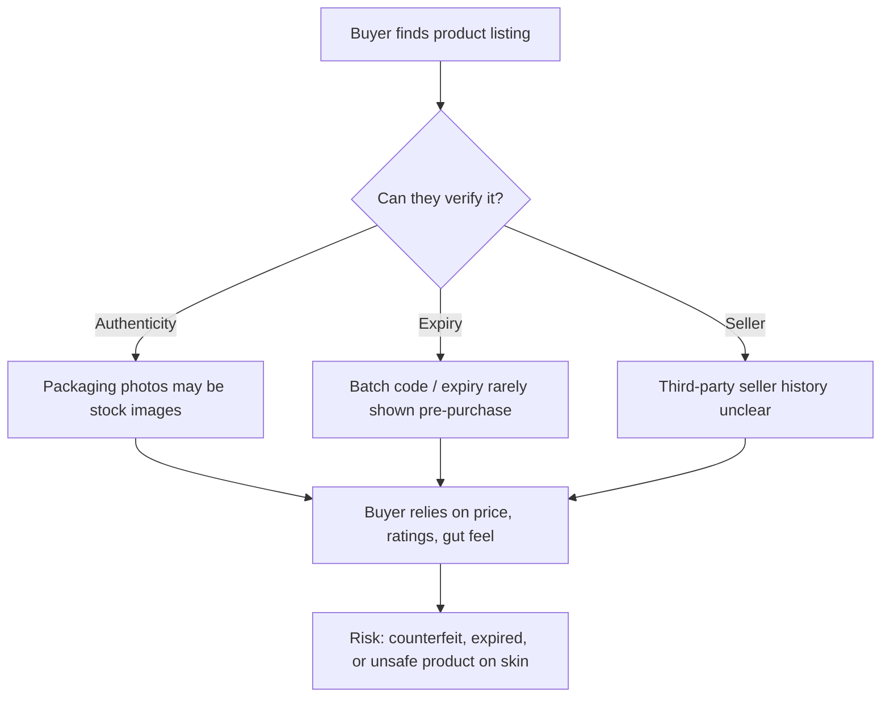

# 01 — Problem Discovery

| | |
|---|---|
| **Status** | ✅ Complete (v1) |
| **Owner** | @n3h4a |
| **Last updated** | 2026-10-20 |
| **Next review** | After Phase 4 user interviews |

---

## 1. Problem Statement

> **Online beauty and skincare buyers cannot reliably judge, before purchase, whether a product is authentic, within its shelf life, and sold by a trustworthy seller.**

### How Might We

> *How might we help an online beauty buyer get a clear, explainable trust signal about a product listing before they pay?*

---

## 2. Why This Problem

Beauty products differ from most counterfeit categories (bags, apparel) in one important way: **they are applied directly to the body.** A fake handbag is a financial loss; a fake serum, lipstick, or eye product is a potential health risk.

---

## 3. Evidence

| # | Evidence | Source | Strength |
|---|---|---|---|
| E1 | In a 2018 survey of 27,000+ Indian respondents, about **19%** said they had received a fake product from an e-commerce site in the previous six months. | [LocalCircles survey via Inc42 (Nov 2018)](https://inc42.com/buzz/about-1-in-5-online-shoppers-received-fake-products-survey) | Medium — large sample, but self-reported and **dated** |
| E2 | In the same survey, **cosmetics** and **fragrances/perfumes** were tied as the most-reported fake categories (35% each among those who received fakes). | Same as E1 | Medium — supports beauty as a high-risk category |
| E3 | The OECD and EUIPO estimated global trade in counterfeit goods at **USD 467 billion** and framed it as a consumer-safety risk. | [OECD press release (May 2025)](https://www.oecd.org/en/about/news/press-releases/2025/05/global-trade-in-fake-goods-reached-USD-467-billion-posing-risks-to-consumer-safety-and-compromising-intellectual-property.html) | Strong source, but **not beauty-specific** |

### Evidence gaps (to close in Phases 2–4)

- [ ] Recent (2024+) data specific to **beauty** counterfeits in online marketplaces.
- [ ] Data on **expired / near-expiry** products sold online — currently anecdotal.
- [ ] Primary evidence: how often target buyers *actually* worry about this, and what they do today.

> ⚠️ **Honest assessment:** the evidence supports that counterfeit beauty products exist at meaningful scale. It does **not yet** show that buyers would use a dedicated tool to address it. That is the key thing user research must test.

---

## 4. Who Is Affected

| Stakeholder | Pain | Initial hypothesis |
|---|---|---|
| **Online beauty buyers** | Uncertainty, wasted money, possible skin reactions | Primary user of VeriGlow-ai |
| **Genuine brands** | Revenue loss, reputational damage | Potential data partner / customer later |
| **Authorised sellers** | Undercut by counterfeit sellers | Benefit from visible trust signals |
| **Marketplaces** | Trust erosion, returns | Out of scope for MVP |

---

## 5. Current Workarounds

How buyers seem to cope today (hypotheses, to be validated):

1. Buying only from a brand's official store or website.
2. Reading reviews for complaints like "fake", "smells different", "no batch code".
3. Comparing packaging against images on brand websites after delivery.
4. Decoding batch codes on third-party "cosmetic calculator" sites.
5. Paying more to buy in a physical store.

Each workaround is **manual, fragmented, or happens after purchase** — this is the gap.

---

## 6. Assumptions

| ID | Assumption | Risk if wrong | How to test |
|---|---|---|---|
| A1 | Buyers worry about authenticity *before* purchase, not only after | High | Interviews |
| A2 | Buyers will take an extra step (paste a link, upload a photo) to get a trust signal | High | Interviews, prototype test |
| A3 | Useful trust signals can be derived from public listing data and photos | High | Feasibility spike in Phase 5 |
| A4 | Authenticity, expiry, and seller trust can be combined into one understandable signal | Medium | Prototype test |
| A5 | Young urban online shoppers are the best initial segment | Medium | Market research + interviews |

---

## 7. Scope Boundaries

**In scope for exploration**

- Skincare, makeup, and fragrance bought on online marketplaces.
- Pre-purchase and on-delivery verification.

**Out of scope (for now)**

- Building a marketplace or selling products.
- Legally certifying authenticity — VeriGlow-ai will provide a **risk signal**, not a guarantee.
- Pharmaceuticals and prescription skincare.

---

## 8. Success Signal for This Phase

Problem discovery is complete when the problem statement, evidence, assumptions, and open questions are documented and reviewed. ✅

## 9. Next Step

Proceed to [`02-market-research.md`](02-market-research.md) and [`03-competitor-analysis.md`](03-competitor-analysis.md).
