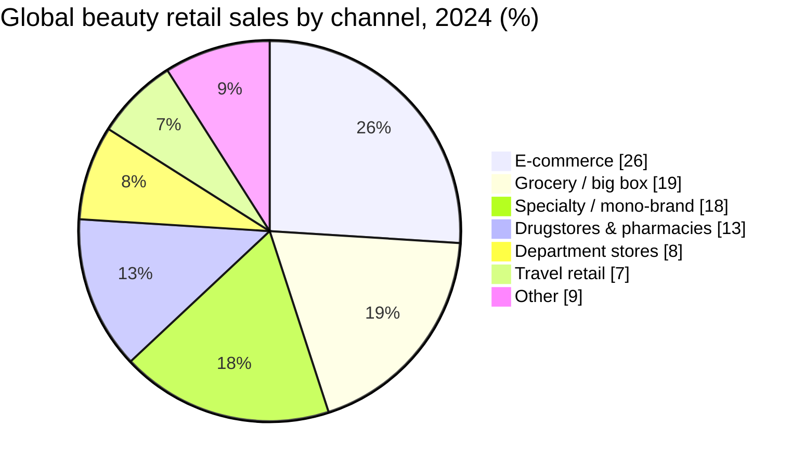
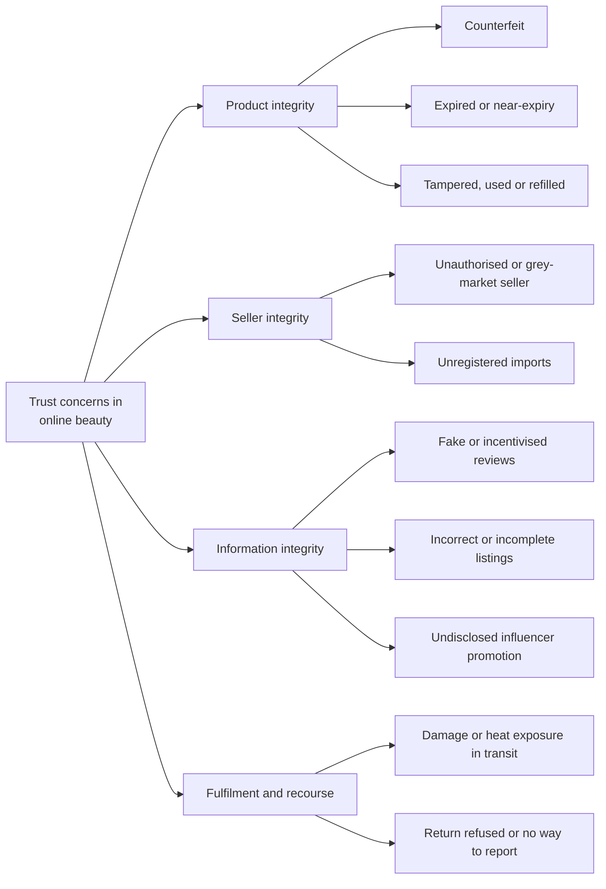
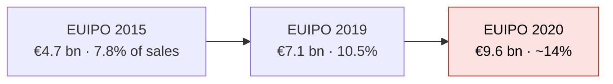
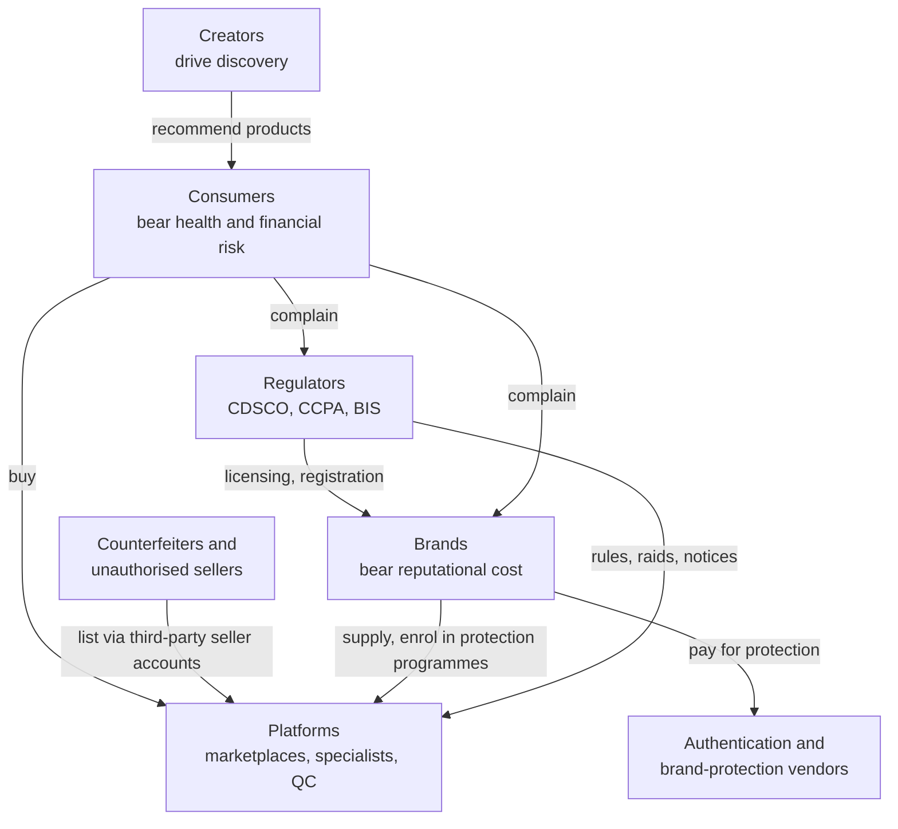
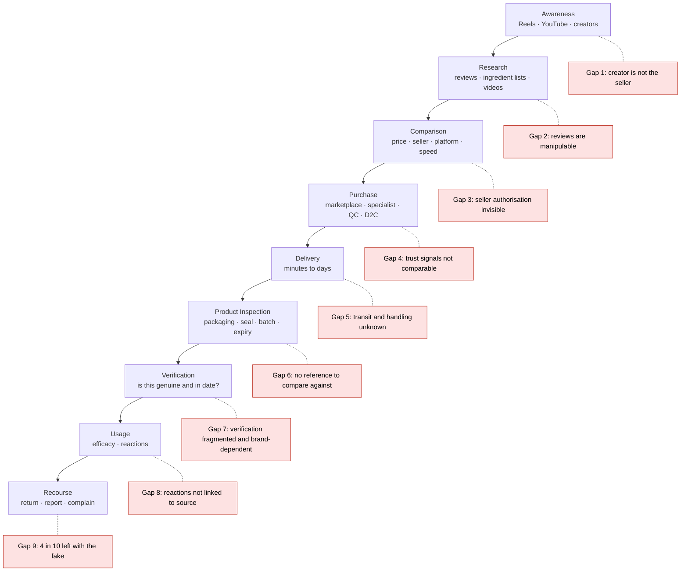
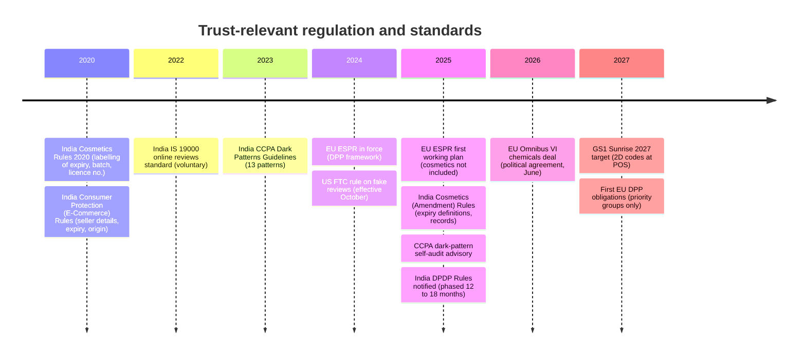

# 02 — Market Research: Online Beauty Authenticity & Trust

| Field | Value |
|---|---|
| **Project** | VeriGlow AI |
| **Phase** | 2 — Market Research |
| **Document** | `docs/01-research/02-market-research.md` |
| **Version** | 2.0 — revised after design review ([review log](./02-market-research-review.md)) |
| **Status** | Ready for executive review |
| **Research cut-off** | 20 October 2026 |
| **Depends on** | [`01-problem-discovery.md`](./01-problem-discovery.md) |
| **Feeds into** | `03-competitor-analysis.md`, `04-user-research.md`, `../02-product/PRD.md` |

> [!IMPORTANT]
> **Scope guardrail.** This document describes the *market*. It contains **no product ideas, features or technical solutions**. Where a finding seems to point at a solution, it is recorded as an *unmet need*, a *hypothesis* or an *open question*. Product decisions belong in the PRD and ADRs.

> [!NOTE]
> **How to read this document.** Every citation (e.g. [MKT-01]) is a clickable link to its source. Every material claim carries one evidence tag (§2.2), and every conclusion carries a confidence rating (§2.3). Executives can read §1, §12 and Appendix A in ten minutes; product and engineering should also read §5–§9.

---

## Table of Contents

1. [Executive Summary](#1-executive-summary)
2. [Methodology, Evidence Standards & Limitations](#2-methodology-evidence-standards--limitations)
3. [Definitions: What "Inauthentic" Means](#3-definitions-what-inauthentic-means)
4. [Industry Overview](#4-industry-overview)
5. [Online Beauty Shopping Trends](#5-online-beauty-shopping-trends)
6. [Consumer Trust Landscape](#6-consumer-trust-landscape)
7. [Counterfeit Cosmetics Market](#7-counterfeit-cosmetics-market)
8. [Stakeholders & Incentives](#8-stakeholders--incentives)
9. [Marketplace Analysis](#9-marketplace-analysis)
10. [Consumer Purchase Journey](#10-consumer-purchase-journey)
11. [Emerging Industry Trends](#11-emerging-industry-trends)
12. [Market Opportunities](#12-market-opportunities)
13. [The Case Against: Disconfirming Evidence](#13-the-case-against-disconfirming-evidence)
14. [Risks](#14-risks)
15. [Key Insights (Top 20)](#15-key-insights-top-20)
16. [Open Questions](#16-open-questions)
17. [References](#17-references)
- [Appendix A — Anticipated Executive Questions](#appendix-a--anticipated-executive-questions)
- [Appendix B — Changelog](#appendix-b--changelog)

---

## 1. Executive Summary

### 1.1 Four conclusions

| # | Conclusion | Confidence |
|---|---|---|
| **C1** | **The market is large, growing more slowly, and moving online; India is a priority growth market.** Core beauty is ~US$450 bn, growing ~5% a year to ~US$590 bn by 2030 [MKT-01], [MKT-02]. E-commerce rose from 10% (2015) to 26% (2024) of global beauty sales and is projected to reach ~31% by 2030, the largest channel [MKT-03]. Executives rank India and the Middle East as the most promising growth markets [MKT-01]. | **High** |
| **C2** | **Counterfeit exposure is material, but its true incidence in Indian *online beauty* has never been measured.** The best proxies are self-reported, cross-category, and often sponsored by organisations that sell anti-counterfeit services. Roughly 1 in 5 Indian online shoppers report receiving a counterfeit in the last 12 months (all categories) [CF-15], and cosmetics and fragrances are repeatedly named as top counterfeit categories [CF-11], [CF-15]. | **Medium** (direction) / **Low** (magnitude) |
| **C3** | **Trust breaks down most visibly *after* purchase — at inspection, verification and recourse.** Consumer-facing verification tools exist but are fragmented, opt-in and brand-by-brand (§11.2). Recourse often fails: 41% of Indian shoppers who received a fake were left with it, and 43% said they had no way to report it [CF-15]. | **Medium** |
| **C4** | **The decisive unknown is whether consumers will act.** Awareness is high but capability is low: ~69% say they cannot identify fakes [CF-12], [CF-22]. No evidence was found on whether consumers will take extra steps to verify, or whether they only want assurance. | **Low** (evidence gap) |

### 1.2 What this means for the next phase

> [!IMPORTANT]
> **Implications (research, not product):**
> 1. **Measure before building.** The magnitude of the problem for *beauty bought online in India* (Q1–Q4, §16) is unquantified. User research must produce India-specific, beauty-specific incidence data.
> 2. **Test the behavioural bet first.** Whether consumers will act on verification (Q6–Q8) determines whether any opportunity exists. It should be the first hypothesis tested.
> 3. **Competitor analysis must start from the strongest counter-case** (§13): inventory-led specialists, Amazon Transparency, and brand-owned verification already exist.

### 1.3 What changed in v2

The design review ([log](./02-market-research-review.md)) found that v1 overstated two "not found" claims, did not disclose sponsor bias in key surveys, conflated counterfeits with grey-market, expired and "dupe" products, and lacked problem sizing, a stakeholder view and a steelman against the opportunity. All are corrected below. No v1 finding was deleted; several were downgraded in confidence.

---

## 2. Methodology, Evidence Standards & Limitations

### 2.1 Approach

Desk research completed on 20 October 2026, using these public sources:

- consultancy reports (McKinsey/BoF, Redseer)
- intergovernmental and regulator publications (OECD/EUIPO, CDSCO, CCPA, FTC, HPRA, HK Consumer Council, European Commission summaries)
- company disclosures (Nykaa, Amazon, Flipkart)
- consumer surveys (LocalCircles, ASPA–CRISIL, MarkMonitor, Ipsos, Meta–GWI, YouGov)
- trade press

No primary research has been conducted yet.

### 2.2 Evidence tags (one per claim)

| Tag | Meaning |
|---|---|
| ✅ **Fact** | Stated by a primary source or reputable secondary reporting of one. Valid within that source's scope, geography and date. |
| 🟡 **Low-confidence** | Secondary, vendor-sponsored, aggregator, undated or methodologically unclear source. Directional only. |
| 🔶 **Assumption** | Analyst inference or judgment. Must be validated. |
| ❓ **Unknown** | Looked for and not found, or sources conflict. |

### 2.3 Confidence ratings (for conclusions)

| Rating | Criteria |
|---|---|
| **High** | Two or more independent, recent (≤3 years), relevant sources agree |
| **Medium** | One strong source, or several weaker sources pointing the same way |
| **Low** | A single, sponsored, dated or non-India source, or inference only |

### 2.4 Evidence-quality register

Many counterfeit statistics come from organisations that **benefit commercially from the problem being large**. This does not make them wrong, but it changes how much weight they can bear.

| Dataset | Publisher / sponsor | Sponsor interest | Method & sample | Geography | Data year | Bias risk | How we use it |
|---|---|---|---|---|---|---|---|
| OECD–EUIPO *Mapping Global Trade in Fakes 2025* [CF-01] | Intergovernmental | None | Customs-seizure data + trade statistics | Global | 2021 | Low (likely *under*-counts domestic fakes) | Macro scale |
| EUIPO IPR infringement reports [CF-04], [CF-05], [CF-06] | EU agency | None | Econometric lost-sales model | EU | 2015–2020 | Low–Med (method varies across editions) | Brand impact; trend direction only |
| McKinsey/BoF *State of Beauty 2025* [MKT-01], [MKT-07] | Consultancy | Low | 13,000+ consumer survey + market model | Global | 2024–25 | Low | Market size, channels |
| Redseer Brand Index [IND-04] | Consultancy | Low | Platform GMV across 1,500+ brands | India | 2026 | Low–Med (paywalled detail) | Quick-commerce sizing |
| ASPA–CRISIL *State of Counterfeiting in India 2025* [CF-16] | Association of authentication-solution providers, with CRISIL | **High** | n=1,639 urban consumers, 9 cities | India (urban) | 2025 | Med–High | India prevalence (upper-bound) |
| LocalCircles surveys (2018, 2022, 2025, 2026) [CF-11], [CF-13], [CF-15], [CF-14] | Civic social platform | Low | Opt-in online panel; large n (27k–102k); 2022 cosmetics panel 61% male | India | 2018–26 | Med (self-selection, self-report) | India prevalence, recourse |
| MarkMonitor Global Online Shopping Survey [CF-20] | Brand-protection vendor | **High** | n=4,401, 10 countries (no India) | US, EU, China | 2017 | Med–High; dated | Global context only |
| Ipsos for Smart Protection [CF-22] | Brand-protection vendor | **High** | Sample and country not stated in summary | ❓ | ~2021 ❓ | High | Capability gap (corroborative only) |
| Meta × GWI beauty study [CON-01], [CON-02] | Commissioned by Meta | **High** (on Meta-platform findings) | n≈2,000, ages 6–64, 74 cities | India | 2023 | Med; includes minors | Social discovery (direction) |
| Google × Kantar × WPP [CON-03] | Co-authored by Google | Med (on YouTube findings) | Survey | India | 2020 | Med; pre–quick commerce | Creator influence (dated) |
| YouGov dupes survey [CON-07] | Independent pollster | Low | n=1,181 US adults, nationally representative | US | 2025 | Low | Dupe vs. counterfeit distinction |
| National Consumer Helpline data [CF-28] | Government (Lok Sabha reply) | None | Administrative complaint counts | India | 2025 | Low, but **not normalised for platform volume** | Recourse signal only |

### 2.5 Limitations

> [!WARNING]
> - **No primary research.** All consumer data is third-party.
> - **"Suspected" is not "verified."** Prevalence figures reflect consumer belief, not lab confirmation. LocalCircles itself notes this for its 2018 results [CF-11].
> - **Category mismatch.** India data is mostly cross-category ("FMCG", "all online purchases"). FMCG includes food and home care.
> - **Geography mismatch.** Several health-hazard and capability findings come from the US, EU, UK, Ireland or Hong Kong. Transferability to India is assumed, not shown.
> - **Recency.** Some widely cited data is 2017–2018. Where newer India data exists (2022–2026), it is used as primary and older data is retained only as context.
> - **Paywalls.** Statista and full McKinsey, Redseer, IMARC and Ken Research reports were only partially accessible.

---

## 3. Definitions: What "Inauthentic" Means

v1 used "fake" loosely. Mixing up these categories inflates problem estimates and confuses later product decisions. The Indian legal terms come from the Drugs and Cosmetics Act framework referenced in regulator actions [REG-05], [REG-07].

| Term | Definition used in this document | Genuine brand product? | Typical harm | Example evidence |
|---|---|---|---|---|
| **Counterfeit** | Imitation bearing a brand's trademark without authorisation | No | Health, financial, brand | LAPD, UK seizures [CF-08], [CF-09] |
| **Spurious / adulterated / misbranded** (Indian legal terms) | Regulatory categories for products that impersonate, contain impermissible substances, or are mislabelled | Varies | Health, legal | DCGI notices to e-commerce platforms (2018) [REG-05] |
| **Unregistered import** | Product imported without the required CDSCO registration | Possibly genuine | Legal, unknown safety | CDSCO cancellations, 2026 [REG-07], [REG-08] |
| **Grey-market / unauthorised seller** | Genuine product sold outside the brand's authorised distribution | Usually yes | Storage, expiry, no brand support | Nykaa's anti–grey-market positioning [PLT-06] |
| **Expired / near-expiry** | Past or near "use before"/expiry date (defined in India's 2025 amendments) [REG-04] | Yes | Efficacy, irritation | HK audit [CF-24]; HPRA [CF-23] |
| **Tampered / used / refilled** | Genuine packaging with altered contents | Partly | Health | ❓ No prevalence data found |
| **Dupe** | A *different-brand* product marketed as similar, bought knowingly | No (and does not claim to be) | Usually none from deception | 9% of US adults knowingly bought dupes in 12 months [CON-07] |

> [!TIP]
> **Why this matters.** YouGov found that **9% of US adults knowingly bought dupes** in the past year, while **~13% unknowingly bought imitation makeup** [CON-07]. These are different consumers with different needs. Only the second group is defrauded. Indian equivalents are ❓ unknown (Q10).

---

## 4. Industry Overview

### 4.1 Global beauty market

| Metric | Value | Source | Tag |
|---|---|---|---|
| Market size (skincare, colour cosmetics, fragrance, haircare) | ~US$450 bn | [MKT-01] | ✅ |
| Growth 2022–24 | ~7% p.a. (inflation-driven price plus strong volume) | [MKT-02], [MKT-04] | ✅ |
| Forecast growth to 2030 | ~5% p.a. | [MKT-01] | ✅ |
| 2030 size | ~US$590 bn | [MKT-02] | ✅ |
| Largest segment | Skincare, ~40% of value | [MKT-02] | ✅ |
| Broader beauty & personal care (BPC), 2025 | ~US$639.5 bn (NIQ); ~US$677 bn (Statista) | via [MKT-05] | 🟡 |
| Online beauty sales, 2025 | ~US$257.5 bn | NIQ via [MKT-05] | 🟡 |

**Reading the numbers.** The ~US$450 bn and ~US$640–680 bn figures are not in conflict. They measure different scopes, and the broader BPC figures are **42–50% higher** because they add categories such as hygiene and oral care. A market number quoted without its scope should be rejected in review.

**Why growth is slowing.** McKinsey attributes the slowdown to saturation, macro uncertainty and a consumer who is value-conscious, sceptical of hype and focused on efficacy [MKT-04]. 🔶 A value-seeking consumer who compares prices across channels is also more likely to buy from lower-priced, less-controlled sellers — the point where authenticity risk concentrates.

### 4.2 Channel mix — the shift online

| Channel | 2015 | 2019 | 2024 | 2030F |
|---|---:|---:|---:|---:|
| E-commerce | 10% | 15% | 26% | 31% |
| Specialty / mono-brand | 19% | 19% | 18% | 18% |
| Grocery / big box | 24% | 21% | 19% | 18% |
| Drugstores & pharmacies | 16% | 15% | 13% | 12% |
| Department stores | 11% | 11% | 8% | 7% |
| Travel retail | 8% | 10% | 7% | 8% |

*Source: McKinsey [MKT-03]. ✅*

McKinsey attributes online growth to pure plays, e-tailers and a **resurgence of marketplaces** [MKT-02] ✅. Marketplaces are the channel type with the most third-party-seller exposure.

### 4.3 Major geographic markets

| Region | Outlook | Tag |
|---|---|---|
| United States | Attractive on size and fundamentals; forecasts clouded by political volatility [MKT-01], [MKT-04] | ✅ |
| China | Mid-term rebound below pre-pandemic growth [MKT-01] | ✅ |
| China, online share | Online reportedly ~87% of hair and skincare sales | 🟡 [MKT-06] |
| Europe | In line with global growth; volumes may be dampened [MKT-01] | ✅ |
| India & Middle East | Ranked most promising by executives [MKT-01] | ✅ |
| US, online share | ~41% of beauty sales online | 🟡 [MKT-06] |

### 4.4 India market sizing — triangulated

> [!CAUTION]
> Indian estimates vary with scope and vendor. Always quote a figure **with its scope**.

| Source | Scope | Current value | Forecast | Growth | Online share | Tag |
|---|---|---|---|---|---|---|
| Ken Research [IND-01] | BPC including hygiene, oral care, grooming | US$28.0 bn (2025) | US$42.1 bn (2031) | 7.03% CAGR | **10%** (2025) | 🟡 |
| IMARC [IND-02] | BPC | US$31.2 bn (2025) | — | 5.08% CAGR (2026–34) | — | 🟡 |
| Redseer Brand Index 2026 [IND-04] | BPC | ~US$25 bn | ~US$40 bn in five years | Stated 11–14% ❓ | QC ≈ 1 in 10 BPC purchases by 2031 | ✅ |
| Redseer × Peak XV, 2023 [IND-03] | BPC | — | US$30 bn by 2027 | 10% CAGR (2022–27) | **~33%** (US$10 bn) by 2027 | ✅ |
| ECDB [IND-08] | Personal-care **e-commerce** only | US$5.9 bn online revenue (2025) | — | 10–15% YoY | **15–20%** (2025) | 🟡 |

**Takeaways**
- ✅ Most sources put India's growth above the global ~5%. IMARC's 5.08% is the outlier.
- ❓ Redseer's own figures do not reconcile. Growing from ~US$25 bn to ~US$40 bn in five years implies ~10% CAGR, not 11–14%. The base-year definition probably differs; resolve this before quoting either number.
- ✅ Online-share estimates range from 10% to 33% depending on scope and year. 🔶 *Beauty* alone (excluding soap, oral care and hygiene) is likely more online than broad BPC.
- ✅ Per-capita BPC spend in India was ~US$14 versus ~US$38 in China, against ~US$313 in the highest-spending market cited (Redseer, 2023) [IND-03]. The headroom is large.

### 4.5 Problem-space sizing (illustrative, not a forecast)

> [!WARNING]
> **Every input below the first row is an assumption (🔶).** This is an order-of-magnitude frame to guide research, not a market forecast. Replace each input with primary data (Q1, Q5).

**Formula:** *Indian online beauty buyers per year × share who receive an inauthentic beauty product per year = buyers affected per year*

| Input | Low | High | Basis |
|---|---:|---:|---|
| Online BPC spend, India (2025) | US$2.5 bn | US$6.2 bn | ✅ BPC US$25–31 bn [IND-01], [IND-02], [IND-04] × online 10–20% [IND-01], [IND-08]. ECDB's direct estimate of US$5.9 bn falls inside the range [IND-08]. |
| Annual online beauty buyers | 30 m | 60 m | 🔶 Anchors: Nykaa alone had 19.7 m annual unique transacting beauty customers in FY26 [PLT-02]; quick commerce reaches 30 m+ BPC shoppers a month [IND-05]. Overlap unknown. |
| Share receiving an inauthentic beauty product per year | 5% | 20% | 🔶 Upper anchor: ~1 in 5 online shoppers received a counterfeit in 12 months, **all categories** [CF-15]. Beauty on inventory-led platforms is probably lower. |
| **Buyers affected per year** | **~1.5 m** | **~12 m** | 🔶 Output of the assumptions above |

**Why no value-at-risk figure?** No defensible input exists for the *share of online beauty spend* that is counterfeit. Publishing one would be fabrication. This is open question Q1.

### 4.6 Consumer demographics

| Dimension | Evidence | Tag |
|---|---|---|
| Internet reach, India | >1.0 bn internet subscribers (June 2025); >270 m online shoppers (2024) [IND-01] | 🟡 (vendor citing official data) |
| Gender, India | Women ≈ half of BPC market value (2023) [IND-09] | 🟡 |
| Generation | Gen Z most willing to "splurge" on beauty — survey of Brazil, France, Germany, UK and US only, **not India** [CON-06] | 🟡 |
| Influencer susceptibility, India | 56% of Gen Z and 65% of Gen Y say they are likely to buy influencer-recommended products (n=500, 2023) [CON-04] | ✅ |
| Geography, India | Purplle targets Tier-2/3 consumers; one profile claims ~80% of its revenue is from outside metros [PLT-16], [PLT-18] | 🟡 |

### 4.7 Future outlook

- ✅ Growth continues but decelerates globally; India and the Middle East are priority growth markets [MKT-01].
- ✅ E-commerce becomes the largest channel by 2030 [MKT-03].
- ✅ Quick commerce is forecast to grow from ~5% to **10–12% of Indian BPC by 2031** [IND-05].
- 🔶 Channel fragmentation will continue, so trust signals will stay platform-specific and non-comparable unless an industry standard emerges.

---

## 5. Online Beauty Shopping Trends

| Trend | Key evidence | Implication for trust | Tag |
|---|---|---|---|
| **Mobile shopping** | India's ~1 bn internet subscriptions are predominantly mobile [IND-01]; no beauty-specific mobile share found | 🔶 Smaller screens mean less listing detail is inspected | ❓ |
| **Social commerce** | 80% of surveyed Indian beauty shoppers discover brands on social media; 47% via Instagram Reels; ~1 in 3 bought via Reels. Meta-commissioned study [CON-01], [CON-02] | Discovery happens *before* any marketplace trust signal is seen. Treat the Meta-specific shares cautiously. | 🟡 |
| **Influencer-driven purchasing** | 81% engage with YouTube beauty creators and 26% bought after a video (Google co-authored, 2020) [CON-03]; ~70% of beauty-content viewers follow influencers [CON-02] | Trust transfers from creator to product, but the creator is not the seller | 🟡 |
| **Product reviews** | 45% of Indian beauty shoppers say good reviews influence them, and 45% say authenticity matters [CON-01] | Reviews are a trust proxy that can itself be manipulated (§6) | 🟡 |
| **Live commerce** | India live commerce ~US$4.8 bn (2024), only ~3.8% of the global total; still niche [CON-05]. Flipkart ran a 100-hour beauty livestream framed around safety and authenticity concerns [PLT-26] | Platforms use live video partly as a *trust* tool | ✅ |
| **Quick commerce** | Top three QC platforms ≈ US$1 bn annualised BPC, ~90% YoY, 30 m+ monthly shoppers [IND-05]; premium/masstige is 59% of QC BPC spend vs. 37% overall [IND-06]; QC makeup ≈ 2.2× Amazon's in July 2026 (one month, one comparator) [IND-07] | High-value beauty is moving to a fast-growing channel; see §9.2 for its trust profile | ✅ |
| **Subscription models** | No reliable India beauty-subscription data found | 🔶 Likely low relevance in India | ❓ |
| **AI shopping assistants** | Amazon Rufus (US rollout July 2024) [TEC-06]; L'Oréal Beauty Genius (2025, WhatsApp version planned 2026) [TEC-07]; Nykaa AI beauty profiles [PLT-01] | A new intermediary in the trust chain (§11) | ✅ |

### 5.1 Consumer expectations

- ✅ **Value and proof.** Consumers are value-conscious and sceptical of efficacy claims [MKT-04].
- ✅ **Speed.** Quick-commerce adoption shows consumers accept minutes-level delivery for beauty [IND-05].
- 🟡 **Authenticity as a criterion.** It is a stated purchase criterion for ~45% of Indian beauty shoppers [CON-01].
- 🟡 **Willingness to pay.** Indian consumers *state* an average 9% premium for guaranteed-genuine products across all categories, higher in pharmaceuticals and agriculture [CF-17]. 🔶 Stated willingness to pay usually overstates actual behaviour, and beauty is not broken out.
- 🔶 **Delegated responsibility.** Consumers expect platforms and brands, not themselves, to guarantee authenticity. Indirect support: 69% said they "just trust" platforms because they cannot identify fakes [CF-12], and 34% said brands are responsible for protecting them [CF-21].

---

## 6. Consumer Trust Landscape

### 6.1 Why consumers hesitate — taxonomy

### 6.2 Concern-by-concern evidence

| Concern | Evidence | Evidence strength | Tag |
|---|---|---|---|
| **Counterfeit products** | **Most recent, largest:** ~1 in 5 Indian online shoppers received a counterfeit in 12 months; cosmetics and fragrances among the most-cited categories (LocalCircles, >102k responses, published Jan 2025) [CF-15]. **Cosmetics-specific:** 34% of households bought fake cosmetics over three years, 12% online and 22% offline (LocalCircles 2022) [CF-13]. **Context:** 19% received a fake in six months, fragrances 35% and cosmetics 35% (LocalCircles 2018) [CF-11]. In a 2026 LocalCircles survey (n=4,300; scope and base unclear), 30% reported buying fake cosmetics [CF-14]. | **Medium-strong** — consistent direction, all self-reported | ✅ |
| **Expired / near-expiry** | India requires expiry dates on e-commerce listings pre-purchase [REG-01], and imported cosmetics must have >6 months' shelf life remaining at import [REG-03]. A Hong Kong audit of 58 online stores found **one** showing an expiry date for a surveyed product [CF-24]. Ireland: 60% of adults disregard expiry/PAO symbols [CF-23]. | **Weak for India** — regulation implies a problem; no India prevalence data | ❓ |
| **Fake reviews** | India's IS 19000:2022 review standard is voluntary [REG-09]; the CCPA has called purchased reviews "fraud reviews" [REG-10]; the US FTC banned fake and AI-generated reviews, with penalties ~US$51,744 per violation in 2024, inflation-indexed [REG-11], [REG-12] | **Strong regulatory signal**; no beauty-specific prevalence | ✅ |
| **Unauthorised sellers / grey market** | Nykaa explicitly rejects grey-market sourcing [PLT-06]; Flipkart Brand Assure targets sellers falsely claiming "authorised" status [PLT-23]; DCGI raids (2018) found unlicensed and unregistered imported cosmetics on e-commerce platforms [REG-05], [REG-06]; CDSCO cancelled an importer's registrations in Aug 2026 over unregistered cosmetics sold online [REG-07] | **Strong** | ✅ |
| **Product tampering** | No beauty-specific prevalence data found | **Gap** | ❓ |
| **Incorrect listings** | E-commerce Rules require accurate seller descriptions and images [REG-02]; the HK audit found >50% of online stores lacked ingredient lists [CF-24]; "wrong product delivered" was the second-largest Indian e-commerce complaint category in 2025 (75,426 complaints, all categories) [CF-28] | **Moderate** | ✅ |
| **Delivery & recourse** | 41% of those who received a fake were left with it because of return policies or not complaining; 43% had no way to report fakes [CF-15]; 45% who received a fake cosmetic online could not return it [CF-13]; >5.1 lakh e-commerce complaints to the National Consumer Helpline in 2025, +14% YoY, with counterfeit a listed but uncounted category [CF-28]. Heat and transit damage: no data. | **Moderate-strong** for recourse; **gap** for transit | ✅ |
| **Health reactions** | 1 in 6 households reported an allergic reaction or severe ailment from cosmetics over three years (cause not isolated to fakes) [CF-13]; 22% reported allergic reactions over three years (2026) [CF-14] | **Moderate** (association, not causation) | ✅ |

> [!IMPORTANT]
> **Offline is not "safe" by default — and the online/offline split is contested.** In 2022, more households reported fake cosmetics from physical stores (22%) than online (12%) [CF-13]. ASPA–CRISIL 2025 was reported as finding ~53% of counterfeit purchases online, across all categories [CF-18] 🟡. The answer probably depends on category, city tier and platform type (Q2).

### 6.3 Consumer capability gap

| Finding | Source | Tag |
|---|---|---|
| 69% did not know how to identify a fake and trusted platforms "blindly"; only 16% claimed they could | LocalCircles 2018 [CF-12] | ✅ |
| 72% aware of counterfeit risk, yet 69% find fakes hard or impossible to identify | Vendor-sponsored, sample not stated [CF-22] | 🟡 |
| ~13% of US adults unknowingly bought imitation makeup in the past year | YouGov 2025 [CON-07] | ✅ (US) |
| Investigators say counterfeit makeup is harder to tell from the real product than fake shoes or handbags | TV investigation [CF-25] | 🟡 |
| 78% believed publishing seller details would reduce fakes | LocalCircles 2018 [CF-11] | ✅ |

**Synthesis:** awareness is high and capability is low, so responsibility is delegated to platforms and brands. When that delegation fails, recourse fails 4 in 10 times [CF-15]. 🔶

---

## 7. Counterfeit Cosmetics Market

### 7.1 Scale

| Indicator | Value | Data year | Source | Tag |
|---|---|---|---|---|
| Global trade in counterfeits | US$467 bn (2.3% of world trade) | 2021 | OECD/EUIPO [CF-01], [CF-02] | ✅ |
| Counterfeit imports into the EU | €117 bn (4.7% of EU imports) | 2021 | [CF-02] | ✅ |
| Cosmetics | Named among increasingly prevalent *hazardous* fakes, often shipped in small parcels sold online | 2021–22 | [CF-01], [CF-03] | ✅ |
| EU cosmetics & personal-care lost sales | €4.7 bn (7.8% of sales) → €7.1 bn (10.5%) → €9.6 bn (just over 14%) | 2015 / 2019 / 2020 reports | EUIPO [CF-05], [CF-06], [CF-04] | ✅ (see caveat) |
| US Customs (CBP) | >2,000 shipments of counterfeit beauty products seized in one year; fake personal-care items said to be more common than knockoff handbags | 2016–17 | [CF-07] | ✅ (dated) |
| Amazon, global, all categories | >15 m counterfeit products seized and disposed of | 2025 | [PLT-19] | ✅ |
| India, all categories | 35% of urban consumers purchased or encountered fakes in the past year; 89% ever; 74% think it is increasing | 2025 (n=1,639) | ASPA–CRISIL [CF-16], [CF-17] | 🟡 (sponsor interest) |
| India, FMCG including personal care | 27% encountered counterfeit FMCG in the past year | 2025 | [CF-17] | 🟡 |

> [!NOTE]
> **EUIPO trend caveat.** The three EUIPO editions use evolving methods and should not be read as a precise time series. The *direction* — rising losses, and the 2020 report naming cosmetics as the sector with the largest increase [CF-04] — is the defensible takeaway. Roughly doubling over five years is indicative only.

> [!NOTE]
> **No credible estimate exists of the value of India's counterfeit-cosmetics market** ❓. Treat any rupee figure seen in the media as unverified until it is traced to a method.

### 7.2 Category risk profile

| Category | Counterfeiting evidence | Health severity if fake | Consumer verifiability | Tag |
|---|---|---|---|---|
| **Fragrance** | Top category in India surveys [CF-11]; Flipkart created a perfume-specific authentication seal [PLT-25]; UK fake-perfume factory raid [CF-26] | Medium 🔶 (skin contact, mostly not ingested) | Low — scent is hard to judge remotely 🔶 | ✅ / 🔶 |
| **Colour cosmetics** (lipstick, palettes, eyeliner, mascara, foundation) | LAPD and UK Trading Standards seizures of MAC, Urban Decay, NARS, Kylie Cosmetics and Benefit lookalikes [CF-08], [CF-09]; 32% of online counterfeit victims bought fake makeup [CF-20] | High — lead, bacteria; eye area [CF-07], [CF-08] | Low [CF-25] | ✅ |
| **Skincare** | 25% of online counterfeit victims bought fake skincare [CF-20]; CDSCO raids found unapproved "new-generation" serums [REG-06] | Medium–High 🔶 (daily use, large surface area) | Very low 🔶 | ✅ / 🔶 |
| **Sun care** | 16% bought fake sun care [CF-20]; counterfeit sunscreen reported with little or no SPF [CF-10] | High — invisible failure of protection | Very low 🔶 | ✅ |
| **Hair colour & treatments** | CDSCO cancelled registrations over spurious imported hair colour and a straightener with high formaldehyde [REG-08] | High (chemical exposure) | Low 🔶 | ✅ |

🔶 **Pattern:** counterfeiters target high-recognition, high-margin, socially amplified SKUs — the same SKUs influencers promote most. Sun care and skincare combine high harm with the lowest verifiability.

### 7.3 Health impact

| Hazard | Evidence | Tag |
|---|---|---|
| Heavy metals | Fake lipstick with ~15× the lead of the genuine product and eyeshadow ~4× (CBS testing) [CF-07]; UK seizure with up to 19× permitted lead, plus mercury, cadmium and copper [CF-09] | ✅ |
| Microbial contamination | LAPD-seized products tested positive for bacteria and animal faeces; risk of eye infection from eye products [CF-08] | ✅ |
| Ineffective protection | Counterfeit sunscreen with little or no SPF [CF-10] | ✅ |
| Adverse reactions | Rashes, swelling and chemical burns reported by users of fakes [CF-07] | ✅ |
| Population signal, India | 1 in 6 households reported reactions or ailments from cosmetics over three years (not attributed to fakes) [CF-13] | ✅ |

### 7.4 Financial impact

- **Consumers.** Counterfeits are on average ~22% cheaper than genuine products in India (all categories), yet only 36% of buyers name price as the main reason for buying one [CF-17] 🟡. 🔶 This *suggests* many purchases are not deliberate bargain-hunting, but the evidence is mixed: 31% admitted knowingly buying fakes in the 2024 ASPA–CRISIL study [CF-19], and 20% bought fakes intentionally in a vendor study [CF-22].
- **Brands.** EU cosmetics lost just over 14% of sector sales in 2020 [CF-04] ✅.
- **Governments.** EUIPO estimated up to €15 bn a year in lost EU public revenue across sectors [CF-04] ✅.
- **Platforms.** Amazon reports investing >US$1 bn and thousands of staff against fraud and counterfeits (2024) [PLT-20] ✅.

### 7.5 Brand impact

- 🟡 40% of consumers who discover they bought a fake complain directly to the **brand** [CF-20].
- 🟡 ~1 in 5 would stop buying the official brand after unintentionally buying a fake [CF-22]; ~1 in 3 in another vendor report [CF-27].
- 🔶 Brands absorb reputational cost for fakes sold by actors they do not control. This misaligned incentive is examined in §8.

---

## 8. Stakeholders & Incentives

v1 analysed consumers and platforms but not the wider system. Who bears the cost of inauthentic products, and who is paid to reduce it, decides how any market in this space can function.

| Stakeholder | What they want | What they pay or lose today | Evidence | Tag |
|---|---|---|---|---|
| Consumers | Genuine, in-date product at a fair price; easy recourse | Health risk; 41% stuck with fakes [CF-15] | §6 | ✅ |
| Marketplaces | Assortment, price and GMV *with* customer trust | >US$1 bn a year (Amazon) [PLT-20]; regulatory notices [REG-05] | §9 | ✅ |
| Inventory-led specialists | Trust as differentiation | Working capital and margin for owned inventory 🔶 | [PLT-05], [PLT-15] | ✅ / 🔶 |
| Brands | Control of distribution and reputation | Lost sales (EU cosmetics ~14%) [CF-04]; complaints land on them [CF-20] | §7.5 | ✅ |
| Regulators | Safe products; fair trade practices | Enforcement capacity | [REG-07], [REG-13] | ✅ |
| Authentication vendors | Large, visible problem | — (paid by brands) | ASPA, MarkMonitor, MarqVision publish prevalence data [CF-16], [CF-20], [CF-27] | ✅ |
| Creators | Engagement and commissions | Reputation if they recommend fakes 🔶 | — | 🔶 |
| Counterfeiters | Margin on low-cost copies | Seizures, account removal, prosecution [PLT-19] | §7.1 | ✅ |

**Insight.** 🔶 Brands and platforms both pay to fight counterfeits, but **the consumer — who bears the health risk — is the only stakeholder with no direct tool or contract in the system.** The flip side matters just as much: anyone building in this space depends on data held by brands and platforms (R-ADO-4, §14).

---

## 9. Marketplace Analysis

### 9.1 Business-model logic — why trust strategies differ

| Model | Who owns inventory? | Trust lever | Economic trade-off | Examples |
|---|---|---|---|---|
| **Open marketplace** | Third-party sellers (plus some first-party) | Seller vetting, brand registries, takedowns, serialisation | Maximises assortment and price competition; inherits seller risk | Amazon, Flipkart |
| **Inventory-led specialist** | Platform buys from brands or authorised distributors | Sourcing control plus an "authentic" guarantee | Trades capital and margin for control and trust 🔶 | Nykaa (beauty), Tira |
| **Hybrid, shifting to inventory** | Mixed | Owned brands plus controlled inventory | Purplle attributes its FY25 improvement to moving from marketplace to inventory-owned [PLT-15] — evidence that control has economic value | Purplle |
| **Mono-brand / D2C** | Brand | Direct provenance | Highest trust, narrowest assortment 🔶 | Brand websites and stores |
| **Prestige multi-brand** | Retailer | Curated brand relationships | Premium positioning | Sephora |
| **Quick commerce** *(adjacent)* | Dark-store inventory | ❓ No public authenticity programme found in targeted search | Speed first; premium mix rising [IND-06] | Blinkit, Zepto, Instamart |

### 9.2 Platform profiles

#### Amazon (global; including amazon.in)

| Dimension | Findings | Tag |
|---|---|---|
| Trust mechanisms | Brand Registry; Project Zero (brand self-service takedown plus serialisation); Counterfeit Crimes Unit; Transparency unit-level serialisation [PLT-21], [PLT-19] | ✅ |
| Consumer-facing verification | Customers can scan Transparency codes with the Amazon Shopping app or the Transparency app; 90,000+ brands enrolled; protection in 10 countries (May 2026) [PLT-22]. **Whether India is among the 10 countries is unknown.** | ✅ / ❓ |
| Enforcement scale | 2025: >15 m counterfeits seized; >32,000 bad actors pursued since 2020 across 14 countries; >2.7 bn units verified via Transparency [PLT-19]. 2024: >99% of suspected infringing listings blocked proactively [PLT-20] | ✅ |
| Strengths | Scale of investment; brand tooling; law-enforcement referrals; AI assistant (Rufus) | ✅ |
| Weaknesses | Authenticity depends on the seller in a mixed model; DCGI notice over alleged spurious cosmetics (2018) [REG-05]; India-specific beauty enforcement metrics not published | ✅ / ❓ |
| Recourse signal | 91,248 National Consumer Helpline complaints in 2025, all categories, not normalised for order volume [CF-28] | ✅ |
| Consumer perception | 20% named Amazon as shipping the most fakes — the lowest of four platforms named (LocalCircles 2018, dated) [CF-11] | 🟡 |

#### Flipkart

| Dimension | Findings | Tag |
|---|---|---|
| Trust mechanisms | **F-Assured** badge (since 2016; oriented to quality and delivery speed, not authenticity certification) [PLT-24]; **Brand Assure** IP programme [PLT-23] | 🟡 |
| Authenticity measures | >11,000 brands in Brand Assure by Dec 2025; >10 m listings actioned and 13,000 sellers removed (Oct 2024–Oct 2025, all categories), as reported by a brand-protection vendor citing Flipkart [PLT-23]; "Brand Authenticated" seal on 2,000+ luxury perfumes (launch date unverified) [PLT-25]; 100-hour beauty livestream [PLT-26] | 🟡 / ✅ |
| Strengths | Reach; video-commerce investment; precedent for category-specific authenticity labels (perfume) | ✅ |
| Weaknesses | Large third-party seller base; historic brand litigation over fakes (Skechers, 2017) [PLT-27]; named alongside Meesho as a platform where sellers allegedly ship different products under no-return policies [CF-15] | ✅ |
| Recourse signal | ~1.3 lakh helpline complaints in 2025, the highest of any platform, not normalised [CF-28] | ✅ |
| Consumer perception | 22% named Flipkart as shipping the most fakes (2018) [CF-11] | 🟡 |

#### Nykaa

| Dimension | Findings | Tag |
|---|---|---|
| Trust mechanisms | Inventory-led beauty model; "Nykaa Guarantee" — products sourced directly from brands or authorised distributors (company filing, date of statement not verified) [PLT-04], [PLT-05]; explicit anti–grey-market positioning [PLT-06] | ✅ |
| Authenticity measures | Brand-signed sourcing certificates, per an executive interview [PLT-07]; seller onboarding requires trademark, regulatory and import documents [PLT-08] | 🟡 |
| Scale (FY26) | Beauty GMV ₹14,954 cr (+27% YoY); 19.7 m annual unique transacting beauty customers; 1.89 bn visits; 313 stores in 99 cities; 200+ global brands added [PLT-01], [PLT-02], [PLT-03] | ✅ |
| Strengths | Authenticity is core to positioning; omnichannel presence; luxury and K-beauty onboarding | ✅ |
| Weaknesses | No evidence found of consumer-side, unit-level verification ❓; growing owned-brand portfolio (House of Nykaa GMV ₹3,176 cr) could create perceived conflicts 🔶 [PLT-03]; its trust does not transfer when the same SKU is bought elsewhere 🔶 | ❓ / 🔶 |
| Recourse signal | ~3,400 helpline complaints in 2025, not normalised [CF-28] | ✅ |
| Consumer perception | Trade press positions Nykaa as the authenticity-first alternative to marketplaces [PLT-09]; no independent recent perception survey found | 🟡 / ❓ |

#### Tira (Reliance Retail)

| Dimension | Findings | Tag |
|---|---|---|
| Trust mechanisms | Omnichannel beauty retailer launched April 2023 [PLT-11]; app markets "100% authentic products" and a luxury tier, Tira Red [PLT-10] | ✅ |
| Authenticity measures | Sourcing policy not published in sources reviewed | ❓ |
| Strengths | Reliance Retail scale; operates Sephora's India business since Nov 2023 [PLT-13]; reported exclusive brands (e.g., Fenty) [PLT-12] | ✅ / 🟡 |
| Weaknesses | Newer entrant with limited public operating data. The ~28-store figure comes from a source that also lists Nykaa at 331 stores against Nykaa's own 313 [PLT-12], [PLT-01], so treat it as unreliable | 🟡 |
| Consumer perception | No independent data found | ❓ |

#### Purplle

| Dimension | Findings | Tag |
|---|---|---|
| Trust mechanisms | Hybrid: third-party marketplace plus owned brands (Faces Canada, Good Vibes, DermDoc and others) [PLT-16] | ✅ |
| Authenticity measures | Shifted from marketplace seller to an inventory-owned and controlled model [PLT-15]; an "authenticity guarantee" appears only in secondary profiles [PLT-17] | ✅ / 🟡 |
| Scale | FY25 operating revenue ₹1,367 cr (~2× YoY); owned brands 82.5% of operating revenue [PLT-15], [PLT-16] | ✅ |
| Strengths | Value positioning; Tier-2/3 reach; reported IPO plans (2024 reports; current status unverified) | ✅ / 🟡 |
| Weaknesses | 🔶 Revenue is dominated by owned brands, so multi-brand authenticity is a shrinking part of the proposition | 🔶 |
| Consumer perception | No independent data found | ❓ |

#### Sephora

| Dimension | Findings | Tag |
|---|---|---|
| Trust mechanisms | Global prestige retailer; Reliance Beauty & Personal Care holds exclusive Indian rights and took over 26 stores in 13 cities in Nov 2023 [PLT-13] | ✅ |
| Authenticity measures | Not published in sources reviewed | ❓ |
| Strengths | Prestige curation; experiential retail; exclusive brand distribution (e.g., Rare Beauty in India at acquisition) [PLT-14] | ✅ |
| Weaknesses | 🔶 Overlapping positioning with Tira under the same parent; current India scale not verified | 🔶 / ❓ |
| Consumer perception | No India-specific data found | ❓ |

#### Official brand stores (D2C websites and outlets)

| Dimension | Findings | Tag |
|---|---|---|
| Trust mechanisms | Direct provenance from the rights holder; some brands run their own consumer verification (e.g., Rasasi perfumes: holographic label plus QR scan returning valid, repeat-scan or fake) [TEC-10] | ✅ |
| Strengths | Brand websites were the **most trusted** online channel (89%) versus marketplaces (74%) in a 10-country survey [CF-21] | 🟡 (2017, no India) |
| Weaknesses | Counterfeit lookalike websites are a known fraud vector, per UK police guidance [CF-26]; 🔶 narrower assortment and fewer discounts | ✅ / 🔶 |
| Consumer perception | 🔶 High trust, lower convenience | 🔶 |

#### Quick commerce (adjacent channel)

| Dimension | Findings | Tag |
|---|---|---|
| Scale | ~5% of Indian BPC; ~US$1 bn annualised; ~90% YoY; 59% premium/masstige spend [IND-05], [IND-06] | ✅ |
| Authenticity measures | None published in sources reviewed (targeted search, Oct 2026) | ❓ |
| Recourse signal | About one-third of users were unhappy with the returns and refund policies of every QC platform; Zepto had the lowest return-preference score (<6%) [CF-15]; 5,774 (Zepto) and 5,102 (Blinkit) helpline complaints in 2025, not normalised [CF-28] | ✅ |
| Risk | 🔶 Premium beauty is moving into a channel whose authenticity and expiry controls are undocumented | 🔶 |

### 9.3 Side-by-side comparison

| Platform | Model | Primary authenticity lever | Consumer-visible trust signal | Unit-level consumer verification | Public enforcement data | Independent perception data |
|---|---|---|---|---|---|---|
| Amazon | Marketplace + first-party | Registry, Project Zero, Transparency, CCU | Seller identity; Transparency codes | ✅ For enrolled brands (India coverage ❓) | ✅ Extensive (global) | 🟡 Dated |
| Flipkart | Marketplace | Brand Assure; category seals | F-Assured; "Brand Authenticated" (perfume) | ❓ | 🟡 Vendor-reported | 🟡 Dated |
| Nykaa | Inventory-led (beauty) | Sourcing control | "Nykaa Guarantee" | ❓ | ❓ | ❓ |
| Tira | Inventory-led 🔶 | ❓ | "100% authentic" claim | ❓ | ❓ | ❓ |
| Purplle | Hybrid → inventory-owned | Controlled inventory, owned brands | ❓ | ❓ | ❓ | ❓ |
| Sephora (India) | Prestige retailer | ❓ | Brand reputation | ❓ | ❓ | ❓ |
| Brand stores | D2C | Direct provenance | Brand domain | Some brands (e.g., [TEC-10]) | n/a | 🟡 Highest trust (2017) |
| Quick commerce | Dark-store | ❓ | ❓ | ❓ | ❓ | ❓ |

> [!TIP]
> **Analyst read (🔶 hypothesis for `03-competitor-analysis.md`).** The market has converged on two *platform-asserted* trust strategies: **"trust our sourcing"** (Nykaa, Tira, increasingly Purplle) and **"trust our enforcement"** (Amazon, Flipkart). Unit-level verification exists where a **brand** opts in (Amazon Transparency, brand QR labels), not where the **consumer** needs it. Coverage is therefore uneven, and most consumers cannot tell which tool, if any, applies to the product in their hand.

> [!CAUTION]
> **Do not rank platforms by helpline complaint counts.** The NCH figures [CF-28] are not normalised for order volume or category mix. Flipkart's 1.3 lakh complaints and Nykaa's ~3,400 mainly reflect scale.

---

## 10. Consumer Purchase Journey

The brief specifies eight stages. v2 adds a ninth, **Recourse**, because the strongest Indian evidence of harm (41–45% of affected consumers left with fakes) sits there [CF-13], [CF-15].

### 10.1 Journey map with trust gaps

### 10.2 Stage-by-stage analysis

Severity scale (🔶 analyst judgment, to be re-scored after user research): **Very high** = strong evidence of frequent harm and no adequate remedy; **High** = evidence of harm or a structural gap; **Medium** = plausible gap with weak evidence; **Unknown** = no data.

| Stage | Consumer question | Evidence | Trust gap | Severity |
|---|---|---|---|---|
| **Awareness** | "Is this product worth it?" | 80% discover on social media [CON-01] | 🔶 Creators recommend a *product*, not a *seller*; links may land on any listing | Medium |
| **Research** | "Do real people like it?" | 45% influenced by reviews [CON-01]; fake reviews regulated in India and US [REG-09], [REG-11] | 🔶 Reviews pooled at listing level may not reflect the seller who ships the unit | High |
| **Comparison** | "Where is it cheapest, fastest, safest?" | Fakes ~22% cheaper [CF-17]; QC capturing premium spend [IND-06] | Seller authorisation rarely shown in a standard way ❓; trust signals differ by platform | High |
| **Purchase** | "Can I trust this checkout?" | E-commerce Rules mandate display of seller name, address and ratings [REG-01] | 🔶 Disclosed is not the same as verified; consumers lack the means to interpret seller data | Medium |
| **Delivery** | "Did it arrive intact?" | No heat or transit data ❓; "wrong product delivered" = 75,426 complaints [CF-28] | Handling invisible; substitution risk | Unknown / Medium |
| **Product Inspection** | "Does this look right?" | ~69% cannot identify fakes [CF-12], [CF-22]; makeup fakes hard to distinguish [CF-25] | 🔶 No trusted reference for packaging, batch format or expiry at hand | **Very high** |
| **Verification** | "Is it genuine and in date?" | Tools exist but are brand-by-brand (Transparency, brand QR, batch-date decoders) [PLT-22], [TEC-10], [TEC-09]; expiry rarely displayed in HK audit [CF-24] | Fragmented, opt-in coverage; consumers do not know which tool applies | **Very high** |
| **Usage** | "Is this reaction normal?" | 1 in 6 households reported reactions [CF-13] | Reactions not traceable to unit or seller | High |
| **Recourse** | "Can I get my money back and stop this seller?" | 41% left with fakes; 43% had no way to report [CF-15]; 45% could not return a fake cosmetic [CF-13] | Return policies and reporting channels fail at scale | **Very high** |

---

## 11. Emerging Industry Trends

### 11.1 Maturity scale

| Level | Definition |
|---|---|
| **Nascent** | Regulation drafted or pilots only; no consumer reach |
| **Emerging** | Live deployments with limited coverage or opt-in only |
| **Scaling** | Broadly deployed by major players; consumers increasingly encounter it |
| **Mainstream** | Default consumer expectation |

### 11.2 Verification landscape — what exists today (concepts, not solutions)

v1 claimed no consumer-facing verification mechanism existed. **That was wrong.** Mechanisms exist, but they verify different things.

| Mechanism | What it actually verifies | Who controls it | Consumer access | Coverage | Tag |
|---|---|---|---|---|---|
| Product barcode (GTIN) | Product *type* identity; GS1 India links barcode integrity to buying from authorised sources [TEC-11] | Brand / GS1 | Any scanner; GS1 India's Smart Consumer App says it can verify authenticity, but its method is not documented [TEC-11] | Near-universal | ✅ / ❓ |
| Unit serialisation (Amazon Transparency) | Validity of a *unit-level* code | Brand + Amazon | Amazon Shopping or Transparency app [PLT-22] | 90k+ brands, 10 countries; India ❓ | ✅ |
| Brand-specific QR + hologram | Unit code validity, with repeat-scan detection | Individual brand | Phone camera, e.g., Rasasi [TEC-10] | Brand by brand | ✅ |
| Batch-code decoders | Estimated *manufacture date* only — **not authenticity** | Third party | Websites such as CheckFresh [TEC-09] | Many brands | ✅ |
| Platform guarantees | Platform's sourcing assertion | Platform | Implicit at purchase | Per platform | ✅ |

🔶 **Implication.** "Verification" covers at least four different claims: product identity, unit validity, freshness and sourcing. Each has a different owner. Consumers have no single way to know which one applies to a given product.

### 11.3 Trend maturity

| Trend | Adoption evidence | Maturity (beauty) | Tag |
|---|---|---|---|
| **AI shopping assistants** | Amazon Rufus to all US app users (July 2024) [TEC-06]; L'Oréal Beauty Genius, WhatsApp version planned for 2026 [TEC-07]; Nykaa AI beauty profiles [PLT-01]. No evidence that assistants surface seller-authenticity signals ❓ | **Scaling** (discovery) | ✅ |
| **Visual search / virtual try-on** | Nykaa Muse virtual try-on [PLT-01]; Beauty Genius selfie analysis and AR [TEC-07]; photo-based authenticity in luxury watches (Hublot on Aura) [TEC-05] | **Scaling** for discovery; **Nascent** for authentication | ✅ / 🟡 |
| **Digital Product Passports** | EU ESPR in force 18 July 2024 [REG-16]. **Cosmetics are not in the first ESPR working plan (April 2025)** [REG-15]; analysts expect cosmetics no earlier than 2027 and more likely ~2030 [REG-16]. The GS1 note listing "cosmetics, Q2 2026" [REG-17] refers to a revision of the Cosmetic Products Regulation, not a DPP 🔶. The EU "Omnibus VI" chemicals deal (political agreement 16 June 2026, pending formal adoption) allows limited digital labelling for very small packs [REG-18]. | **Nascent** (cosmetics) | ✅ |
| **QR / 2D codes** | GS1 Sunrise 2027 targets 2D codes at point of sale by 31 Dec 2027 (voluntary) [TEC-01], [TEC-02]; Transparency >2.7 bn units [PLT-19]; India reportedly considered QR codes on branded cosmetics in 2024, status unknown [CF-19] | **Emerging** | ✅ / ❓ |
| **Blockchain authentication** | Aura Blockchain Consortium (LVMH, Prada, Cartier; 2021), with beauty among its use cases [TEC-03], [TEC-04] | **Emerging (luxury only)** | ✅ |
| **Supply-chain transparency** | India's 2025 Cosmetics Rules amendments require batch and raw-material records kept ≥3 years or 6 months after batch expiry [REG-04] | **Emerging** (regulation-led) | ✅ |
| **Smart packaging** | Industry discussion (ASPA conference session on FMCG smart packaging, 2026) [TEC-08]; no beauty adoption data | **Nascent** | 🟡 |
| **Consumer education** | Regulators advise buying from verified dealers [REG-06]; HPRA guidance on expiry and PAO [CF-23]; the capability gap persists [CF-12] | **Fragmented** | ✅ |

### 11.4 Regulatory and standards timeline

*Sources: [REG-01], [REG-03], [REG-04], [REG-09], [REG-11], [REG-12], [REG-13], [REG-14], [REG-15], [REG-18], [TEC-01]. ✅*

### 11.5 Interpretation

- ✅ **Identity infrastructure is arriving through retail standards (GS1) and EU regulation, not through beauty-specific consumer demand.** For cosmetics, the EU DPP is at least several years away [REG-15], [REG-16].
- 🔶 Between 2027 and 2030, more beauty units *may* carry standards-based 2D codes. That would change the cost and feasibility landscape for any trust-related offering. Adoption by Indian beauty brands is unknown ❓.
- 🔶 AI assistants are becoming a new decision layer. Whether they will incorporate seller-authenticity signals is not evidenced.

---

## 12. Market Opportunities

> [!NOTE]
> These are framed as **unmet needs, gaps and conditions** — not solutions. "Need evidence" and "action evidence" are scored separately because a real need does not prove consumers will act on it.

### 12.1 Unmet customer needs

| # | Unmet need | Need evidence | Evidence consumers will act | Source |
|---|---|---|---|---|
| N1 | Confirm a *delivered unit* is genuine, whatever the platform or brand | **High** — ~69% cannot identify fakes; existing tools are fragmented | **Unknown** | [CF-12], §11.2 |
| N2 | Recourse that works when a fake is suspected | **High** — 41–45% left with the fake; 43% had no way to report | **Medium** — people complain to brands (40%) and regulators (5.1 lakh helpline complaints) | [CF-13], [CF-15], [CF-20], [CF-28] |
| N3 | See expiry / remaining shelf life before purchase | **Medium** — mandated in India; rarely shown in the HK audit; India compliance unknown | **Unknown** | [REG-01], [CF-24] |
| N4 | Know whether a specific seller is authorised | **Medium–High** — grey-market and unregistered imports documented | **Low–Medium** — 78% *believe* seller disclosure helps | [REG-05], [REG-07], [CF-11] |
| N5 | Portable trust across fragmented channels | **Medium** 🔶 | **Unknown** | §9.3 |
| N6 | Link adverse reactions to product and seller | **Low–Medium** | **Unknown** | [CF-13], [CF-14] |

### 12.2 Market gaps

| Gap | Description | Tag |
|---|---|---|
| G1 — Post-purchase trust | Platform investment concentrates before listing (seller vetting, takedowns). Inspection, verification and recourse have the weakest support and the strongest harm evidence. | 🔶 (supported by §10) |
| G2 — Quick-commerce trust | Fast-growing, premium-skewed channel with undocumented authenticity controls and weak returns satisfaction | ✅ / ❓ |
| G3 — Semantic fragmentation | "Authentic", "authorised", "assured" and "verified" mean different things on different platforms and tools | ✅ (§11.2) |
| G4 — India-specific data | No credible estimate of India's counterfeit-cosmetics value; online/offline split contested | ✅ (gap confirmed) |
| G5 — Tier-2/3 consumers | Value-seeking and newer to online shopping; possibly less able to spot fakes. Evidence is thin. | 🔶 |

### 12.3 Hypothesised consumer segments (to validate — not personas)

| Segment | Why it may matter | Evidence anchor | Key test (§16) |
|---|---|---|---|
| Premium fragrance and makeup buyers on marketplaces | Highest price gap and counterfeit focus | [CF-11], [PLT-25] | Q4, Q7 |
| Creator-led impulse buyers (Gen Z / Gen Y) | Discovery off-platform; high influencer susceptibility | [CON-01], [CON-04] | Q6 |
| Quick-commerce convenience buyers | Fast-growing, premium-skewed, weak recourse | [IND-06], [CF-15] | Q4, Q12 |
| Tier-2/3 value seekers | Price-sensitive; possibly lower capability | [PLT-18] 🟡 | Q5 |
| Knowing dupe / fake buyers | **Likely not addressable** — they are not deceived | [CON-07], [CF-19] | Q10 |

### 12.4 Favourable conditions

- 🟡 Stated willingness to pay a ~9% premium for guaranteed-genuine products (all categories) [CF-17].
- ✅ Regulatory momentum on disclosure, reviews, dark patterns and data protection in India [REG-01], [REG-09], [REG-13], [REG-14].
- 🟡 Brands bear reputational cost of fakes, so their incentives align with consumers' [CF-20], [CF-22].
- ✅ Unit-level identity standards are maturing (GS1 Sunrise 2027) [TEC-01].

---

## 13. The Case Against: Disconfirming Evidence

> [!WARNING]
> This team intends to build in this space, which creates a risk of **motivated reasoning**. This section deliberately states the strongest case that the opportunity is smaller than it appears. Each point must be answered by evidence in later phases, not by argument.

| # | Counter-argument | Evidence | What would change our mind |
|---|---|---|---|
| 1 | **Incumbents already solve it for those who care.** Authenticity-sensitive buyers can use inventory-led specialists. | Nykaa: 19.7 m annual beauty customers [PLT-02]; Purplle moving to inventory control [PLT-15] | Evidence that specialist customers still experience inauthentic or expired products, or still feel unsure |
| 2 | **The problem may be mostly offline.** | 22% offline vs. 12% online for fake cosmetics (2022) [CF-13] | India beauty data showing online share of exposure rising or dominant |
| 3 | **Marketplace enforcement is improving.** | >99% of suspected infringing listings blocked proactively; ~35% fewer valid brand notices since 2020 [PLT-20]. Caveat: fewer notices could also mean brands report less. | Rising complaint or seizure trends in beauty specifically |
| 4 | **Verification already exists where brands want it.** | Amazon Transparency, brand QR labels [PLT-22], [TEC-10] | Evidence of low coverage among India's top beauty SKUs, or low consumer awareness of these tools |
| 5 | **Consumers may not act.** | Awareness–action gap noted by ASPA–CRISIL [CF-16]; 31% knowingly bought fakes [CF-19] | Behavioural evidence that consumers take verification steps when offered |
| 6 | **The headline numbers are inflated by sponsors.** | §2.4 register: several key surveys come from vendors that sell anti-counterfeit services | Independent, representative India beauty data confirming prevalence |

---

## 14. Risks

These are risks to **any new entrant in the beauty trust and authenticity space**, not to a specific product.

**Scales (🔶 analyst judgment):** *Likelihood* — High = more likely than not within 24 months; Medium = plausible; Low = unlikely. *Impact* — High = could invalidate the opportunity; Medium = materially raises cost or delay; Low = manageable.

### 14.1 Regulatory risks

| ID | Risk | Likelihood | Impact |
|---|---|---|---|
| R-REG-1 | **Liability for authenticity statements.** Publicly calling a product or seller fake (or genuine) could create defamation, trademark or consumer-protection exposure 🔶 | Medium | High |
| R-REG-2 | **Classification as an "e-commerce entity."** Depending on the business model, obligations under India's E-commerce Rules could apply [REG-01] 🔶 | Medium | Medium |
| R-REG-3 | **Personal data.** India's DPDP Rules were notified on 14 Nov 2025, with major obligations (notices, consent managers) phased in over 12–18 months [REG-14] | High | Medium |
| R-REG-4 | **Cosmetics regulation.** Import registration, licensing and labelling rules change (e.g., 2025 amendments) [REG-03], [REG-04] | Medium | Medium |
| R-REG-5 | **Review standard becomes mandatory.** IS 19000 is voluntary but could be made mandatory [REG-09] | Low–Medium | Medium |

### 14.2 Market risks

| ID | Risk | Likelihood | Impact |
|---|---|---|---|
| R-MKT-1 | **Incumbent sufficiency** (§13 #1) | Medium | High |
| R-MKT-2 | **Platform extension.** Marketplaces could bring serialisation programmes like Transparency to Indian beauty [PLT-22] | Medium | High |
| R-MKT-3 | **Offline-dominant problem** (§13 #2) | Medium | Medium |
| R-MKT-4 | **Shrinking online problem** (§13 #3) | Medium | Medium |

### 14.3 Adoption risks

| ID | Risk | Likelihood | Impact |
|---|---|---|---|
| R-ADO-1 | **Intent–action gap.** Consumers may not take extra steps [CF-16] | High | High |
| R-ADO-2 | **Deliberate buyers.** 31% knowingly bought fakes (2024) [CF-19]; 9% of US adults knowingly bought dupes [CON-07]. These segments will not value authenticity. | High | Medium |
| R-ADO-3 | **Trust in a new intermediary.** Unknown how consumers weigh a third party against a platform or brand ❓ | Medium | High |
| R-ADO-4 | **Data dependency.** Authoritative data (authorised-seller lists, serial codes) is held by brands and platforms; access is not guaranteed ❓ | High | High |

### 14.4 Technology risks (market-level, not design)

| ID | Risk | Likelihood | Impact |
|---|---|---|---|
| R-TEC-1 | **Indistinguishable fakes.** Makeup fakes are hard to tell from genuine products [CF-25] | High | High |
| R-TEC-2 | **Standards fragmentation.** GS1 Sunrise, Transparency, brand QR systems and the EU DPP progress on different timelines [TEC-01], [REG-15] | Medium | Medium |
| R-TEC-3 | **Adversarial adaptation.** Counterfeiters adopt new techniques to avoid detection (OECD) [CF-01] | High | Medium |
| R-TEC-4 | **Copyable identifiers.** Product-level barcodes and static QR codes can be copied; only unit-level, server-checked codes detect duplication (e.g., repeat-scan states [TEC-10]) 🔶 | High | Medium |

### 14.5 Operational risks

| ID | Risk | Likelihood | Impact |
|---|---|---|---|
| R-OPS-1 | **Data freshness.** Authorised-seller lists, packaging versions and batch formats change often 🔶 | High | Medium |
| R-OPS-2 | **Dispute handling.** Disputes between consumers, sellers and brands need process and accountability 🔶 | Medium | High |
| R-OPS-3 | **Evidence quality.** Decisions based on self-reported, sponsored data may be miscalibrated (§2.4) | High | Medium |

---

## 15. Key Insights (Top 20)

| # | Insight | So what | Confidence |
|---|---|---|---|
| 1 | Core beauty is ~US$450 bn, growing ~5% to ~US$590 bn by 2030 [MKT-01], [MKT-02] | Large but maturing; growth must come from share shifts | High |
| 2 | E-commerce is 26% of global beauty sales (2024), heading to ~31% by 2030 [MKT-03] | Trust problems scale with the channel | High |
| 3 | India and the Middle East are executives' top growth markets [MKT-01] | India focus is defensible | High |
| 4 | India BPC estimates span US$25–31 bn; online share estimates 10–33% [IND-01], [IND-02], [IND-03], [IND-04], [IND-08] | Always quote with scope; Redseer figures need reconciling | Medium |
| 5 | Discovery is social: ~80% discover beauty brands on social media (Meta-commissioned) [CON-01] | Trust formation starts off-platform | Medium |
| 6 | Quick commerce: ~5% of Indian BPC, ~90% YoY, 59% premium spend [IND-05], [IND-06] | A fast-growing channel with undocumented authenticity controls | High (scale) / Low (controls) |
| 7 | Counterfeits were ~US$467 bn (2.3%) of world trade; cosmetics are among the growing hazardous fakes [CF-01] | The macro problem is real and recognised | High |
| 8 | EUIPO reports show EU cosmetics losses rising to ~14% of sector sales (2020) [CF-04] | Brands have a measurable stake | Medium (method changes) |
| 9 | ~1 in 5 Indian online shoppers received a counterfeit in 12 months (all categories) [CF-15] | Exposure is common online | Medium |
| 10 | Cosmetics and fragrances are repeatedly named top counterfeit categories in India [CF-11], [CF-15] | Beauty is over-represented | Medium |
| 11 | Fakes have tested at ~15× the lead of genuine lipstick, plus bacteria [CF-07], [CF-08] | Harm is physical, not just financial | High (non-India) |
| 12 | Fake cosmetics are bought offline too; one survey found more offline [CF-13] | An online-only lens may miss most harm | Medium |
| 13 | ~69% of consumers cannot identify fakes [CF-12], [CF-22] | Self-inspection is not a viable safeguard | Medium |
| 14 | Recourse fails: 41% left with fakes; 43% had no way to report [CF-15] | The strongest harm evidence sits after purchase | Medium |
| 15 | Price is the main motive for only 36% of counterfeit buyers [CF-17] | Many purchases may be accidental, though 31% buy knowingly [CF-19] | Low |
| 16 | Stated premium for guaranteed-genuine products is ~9% (all categories) [CF-17] | Willingness to pay is stated, not proven | Low |
| 17 | Platforms split into "trust our sourcing" vs. "trust our enforcement" (§9) | Both are platform-asserted and non-portable | Medium |
| 18 | Unit-level verification exists but only where brands opt in (Transparency, brand QR) [PLT-22], [TEC-10] | Coverage, not existence, is the gap | Medium |
| 19 | India regulates disclosure, reviews, dark patterns and data, not verification [REG-01], [REG-09], [REG-13], [REG-14] | No regulatory mandate for consumer verification | High |
| 20 | Cosmetics are not in the EU's first DPP working plan; GS1 Sunrise targets end-2027 [REG-15], [TEC-01] | Standards-driven identity for beauty is years away | High |

---

## 16. Open Questions

> [!IMPORTANT]
> Answer these, or explicitly accept them as risks, **before product design begins**. Priority: **P0** blocks the go/no-go decision; **P1** shapes scope; **P2** refines later.

### 16.1 Problem magnitude

| # | Question | Priority | Method / owner doc |
|---|---|---|---|
| Q1 | What share of *beauty* purchased online in India is inauthentic — verified, not suspected — and what share of spend does that represent? | P0 | Brand or lab data; `04-user-research.md` |
| Q2 | Is exposure to fake beauty products in India higher online or offline (2025–26)? | P0 | Obtain the full ASPA–CRISIL report; survey |
| Q3 | How common are expired or near-expiry deliveries in Indian beauty e-commerce? | P1 | Survey plus listing audit |
| Q4 | How does exposure differ by channel (marketplace, specialist, QC, social)? | P0 | User research |
| Q5 | Does exposure skew by city tier and age? | P1 | User research |

### 16.2 Consumer behaviour

| # | Question | Priority | Method |
|---|---|---|---|
| Q6 | When consumers suspect a fake, what do they actually do today? | P0 | Interviews |
| Q7 | Will consumers spend effort to verify, or do they only want assurance? | P0 | Interviews; behavioural test design later |
| Q8 | Whom do consumers trust most to vouch for authenticity: platform, brand, regulator, creator or independent third party? | P1 | Survey |
| Q9 | Is the stated ~9% premium real for *beauty*? | P2 | Survey with price anchors |
| Q10 | How large is the knowing dupe/fake segment in Indian beauty? | P1 | Survey |

### 16.3 Ecosystem

| # | Question | Priority | Method |
|---|---|---|---|
| Q11 | What are Tira's, Sephora India's and Purplle's authenticity policies? | P1 | `03-competitor-analysis.md` |
| Q12 | Do quick-commerce platforms have authenticity or expiry controls for beauty? | P1 | Competitor analysis; platform policies |
| Q13 | Which top Indian beauty brands publish authorised-seller lists or use serialisation, and is Amazon Transparency available in India? | P0 | Desk research; brand outreach |
| Q14 | Which third-party authenticity services already operate in Indian beauty, and how do GS1 India's tools work? | P1 | Competitor analysis |
| Q15 | How do platforms handle counterfeit complaints and returns in practice (SLA, burden of proof)? | P1 | Policy review; mystery shopping |

### 16.4 Regulatory & standards

| # | Question | Priority | Method |
|---|---|---|---|
| Q16 | What is the legal exposure of publicly assessing a product's authenticity in India? | P0 | Legal review |
| Q17 | Which DPDP obligations apply, and from what date in the phased rollout? | P1 | Legal review |
| Q18 | Will cosmetics enter a later ESPR working plan, or get digital-information duties through the Cosmetic Products Regulation? | P2 | European Commission sources |
| Q19 | Has India acted on the reported proposal for QR codes on branded cosmetics? | P2 | DoCA and BIS records |
| Q20 | How compliant are Indian beauty listings with mandatory expiry-date display? | P1 | Listing audit |

---

## 17. References

> **Quality:** A = primary or official (regulator, intergovernmental body, company filing, original consultancy publication); B = reputable press reporting a primary source; C = secondary, vendor, aggregator or undated — directional only. All links accessed 20 Oct 2026. Citation IDs in the text link directly to these URLs.

### Market (MKT)

| ID | Source | Quality |
|---|---|---|
| MKT-01 | McKinsey — [*State of Beauty 2025*](https://www.mckinsey.com/industries/consumer-packaged-goods/our-insights/state-of-beauty-2025) | A |
| MKT-02 | McKinsey — [*A close look at the global beauty industry in 2025*](https://www.mckinsey.com/industries/consumer-packaged-goods/our-insights/a-close-look-at-the-global-beauty-industry-in-2025) | A |
| MKT-03 | McKinsey — [*An e-commerce glow-up* (chart)](https://www.mckinsey.com/featured-insights/charts/an-e-commerce-glow-up) | A |
| MKT-04 | CosmeticsDesign — [McKinsey finds beauty growth slowing (Jun 2025)](https://www.cosmeticsdesign.com/Article/2025/06/24/mckinsey-company-finds-beauty-growth-slowing-while-value-pressures-climb-in-2025) | B |
| MKT-05 | ClickPost — [Beauty e-commerce market (cites NIQ, Statista)](https://www.clickpost.ai/blog/beauty-industry-ecommerce-market) | C |
| MKT-06 | IADS summary of Forbes — [Social and e-commerce drive >50% of beauty sales](https://www.iads.org/articles-reports/social-and-e-commerce-now-drive-more-than-50-of-beauty-sales-globally) | C |
| MKT-07 | eMarketer — [E-commerce channels shine as traditional beauty retail loses lustre](https://www.emarketer.com/content/ecommerce-channels-shine-traditional-beauty-retail-loses) | B |

### India market (IND)

| ID | Source | Quality |
|---|---|---|
| IND-01 | Ken Research — [India Beauty and Personal Care Market](https://www.kenresearch.com/india-beauty-and-personal-care-market) | C |
| IND-02 | IMARC Group — [India BPC market (Nov 2025)](https://imarcgroup.com/beauty-personal-care-market-india) | C |
| IND-03 | YourStory — [Redseer × Peak XV BPC report (Sep 2023)](https://social.yourstory.com/2023/09/india-beauty-personal-care-cosmetics-report-redseer-peak-xv) | B |
| IND-04 | Redseer — [*The Redseer Brand Index* (JFM 2026)](https://redseer.com/reports/the-redseer-brand-index/) | A |
| IND-05 | Indian Retailer — [BPC on quick commerce (Redseer)](https://indianretailer.com/article/fashion-beauty/retail-trends/beauty-personal-care-quick-commerce-top-75-brands-drive-75) | B |
| IND-06 | BW Retail World — [Premium = 59% of beauty QC spend](https://bwretailworld.com/sector/e-commerce-marketplaces/premium-products-make-up-59-of-beauty-quick-commerce-spending) | B |
| IND-07 | Indiantelevision — [QC makeup vs. Amazon (1DigitalStack, 2026)](https://indiantelevision.com/iworld/quick-commerce-makeup-sales-hit-rs-938-crore-in-july-2026/) | B |
| IND-08 | ECDB — [India personal care e-commerce](https://ecdb.com/resources/sample-data/market/in/personal-care) | C |
| IND-09 | Allied Market Research — [India BPC market](https://alliedmarketresearch.com/india-beauty-and-personal-care-market-A324630) | C |

### Consumer behaviour (CON)

| ID | Source | Quality |
|---|---|---|
| CON-01 | Social Samosa — [Meta × GWI beauty & fashion study (2023)](https://www.socialsamosa.com/report/ar-content-creators-and-social-media-boosting-beauty-and-fashion-purchases-in-india-meta-report-1701950) | B |
| CON-02 | Entrepreneur India — [Meta × GWI methodology and findings](https://india.entrepreneur.com/news-and-trends/facebook-instagram-reels-influence-beauty-purchases-in/465719) | B |
| CON-03 | exchange4media — [Google, Kantar & WPP beauty study](https://www.exchange4media.com/digital-news/9-of-10-beauty-consumers-influenced-by-digital-108822.html) | B |
| CON-04 | GlobalData — [Indian consumers and celebrity/influencer beauty (2023)](https://www.globaldata.com/media/consumer/rising-image-consciousness-among-consumers-draws-international-celebrity-beauty-brands-india-says-globaldata/) | A |
| CON-05 | Storyboard18 — [Live commerce hasn't cracked India](https://www.storyboard18.com/digital/despite-1-trillion-creator-led-influence-live-commerce-hasnt-cracked-india-88665.htm) | B |
| CON-06 | Statista — [McKinsey State of the Consumer 2026: beauty splurging by generation](https://www.statista.com/statistics/1663588/personal-care-and-beauty-splurging-by-generation/) | C |
| CON-07 | YouGov — [What's behind the rise of duped makeup products? (2025)](https://yougov.com/en-us/articles/51945-whats-behind-the-rise-of-duped-makeup-products) | A |

### Counterfeits, trust & recourse (CF)

| ID | Source | Quality |
|---|---|---|
| CF-01 | OECD — [Global trade in fake goods reached USD 467 bn (May 2025)](https://www.oecd.org/en/about/news/press-releases/2025/05/global-trade-in-fake-goods-reached-USD-467-billion-posing-risks-to-consumer-safety-and-compromising-intellectual-property.html) | A |
| CF-02 | OEPM — [Summary of OECD/EUIPO 2025](https://www.oepm.es/cs/OEPMSite/contenidos/Revista_InfoPYM/2025/Mayo/en/noticia4.html) | A |
| CF-03 | Hespress — [OECD/EUIPO on cosmetics sources and small parcels](https://en.hespress.com/110288-110288.html) | B |
| CF-04 | World IP Review — [EUIPO 2020 Status Report](https://www.worldipreview.com/trademark/eu-losing-15bn-annually-to-counterfeiting-19757) | B |
| CF-05 | EUIPO (OHIM) — [Alicante News, Mar 2015 (cosmetics study)](https://euipo.europa.eu/tunnel-web/secure/webdav/guest/document_library/contentPdfs/about_ohim/alicante_news/alicantenewsMarch2015_en.pdf) | A |
| CF-06 | PETOŠEVIĆ — [EUIPO 2019 Status Report](https://www.petosevic.com/node/4151) | B |
| CF-07 | CBS News — [Fake makeup can be a health hazard](https://cbsnews.com/news/fake-makeup-health-hazard-us-customs-and-border-protection) | B |
| CF-08 | ScienceAlert — [LAPD counterfeit makeup seizure](https://www.sciencealert.com/?p=37194) | B |
| CF-09 | SecuringIndustry — [UK Trading Standards hazardous cosmetics](https://www.securingindustry.com/cosmetics-and-personal-care/hazardous-counterfeit-cosmetics-seized-in-uk/s106/a2265) | B |
| CF-10 | The Fashion Law — [Counterfeit cosmetics seizure; sunscreen SPF](https://www.thefashionlaw.com/?p=1172) | B |
| CF-11 | Inc42 — [LocalCircles: 1 in 5 online shoppers received fakes (Nov 2018)](https://inc42.com/buzz/about-1-in-5-online-shoppers-received-fake-products-survey) | B |
| CF-12 | Entrackr — [LocalCircles 2018 (identification ability)](https://entrackr.com/?p=25148) | B |
| CF-13 | Free Press Journal — [LocalCircles cosmetics survey (Dec 2022)](https://www.freepressjournal.in/mumbai/cosmetics-purchase-an-unhealthy-practice) | B |
| CF-14 | News Karnataka — [LocalCircles cosmetics survey (Aug 2026)](https://newskarnataka.com/bengaluru/fake-cosmetics-raise-growing-concern-among-bengaluru-consumers/23082026/) | B |
| CF-15 | YourStory — [LocalCircles: shoppers unhappy with returns and counterfeits (Jan 2025)](https://cwv.yourstory.com/2025/01/shoppers-unhappy-return-policies-counterfeit-goods-ecommerce-platforms) | B |
| CF-16 | Autocar Pro — [ASPA–CRISIL *State of Counterfeiting in India 2025*](https://www.autocarpro.in/news/one-in-three-indians-encountered-counterfeit-products-in-the-past-year-survey-finds-131654?amp=1) | B |
| CF-17 | Angel One — [ASPA–CRISIL 2025 (premium, price motive)](https://www.angelone.in/news/economy/nearly-35-of-urban-consumers-in-india-bought-fake-products-in-the-last-year-report) | B |
| CF-18 | The Week — [ASPA–CRISIL 2025 (online share of purchases)](https://www.theweek.in/news/biz-tech/2026/03/16/35-pc-indians-encountered-fake-products-in-1-year-online-platforms-account-for-53-pc-purchases-report.amp.html) | B |
| CF-19 | Apparel Resources — [ASPA–CRISIL Jan 2024; QR codes for cosmetics under consideration](https://apparelresources.com/?p=277164) | B |
| CF-20 | CosmeticsDesign — [MarkMonitor Global Online Shopping Survey 2017](https://www.cosmeticsdesign.com/Article/2017/07/19/Counterfeit-makeup-and-skin-care-problematic-for-consumers-and-brands-shows-MarkMonitor-data) | B |
| CF-21 | CosmeticOBS — [MarkMonitor 2017 (channels; trust by channel)](https://cosmeticobs.com/en/articles/market-70/25-of-online-shoppers-have-been-duped-into-buying-fake-cosmetics-4010) | B |
| CF-22 | SecuringIndustry — [Ipsos for Smart Protection: fake cosmetics online](https://www.securingindustry.com/cosmetics-and-personal-care/one-in-five-consumers-bought-fake-cosmetics-online-last-year/s106/a13574) | C |
| CF-23 | HPRA (Ireland) — [Cosmetics expiry and counterfeit survey](https://www.hpra.ie/news-events/news/article/six-in-ten-irish-adults-use-cosmetics-beyond-their-expiry-or-recommended-shelf-life) | A |
| CF-24 | Consumer Council (Hong Kong) — [Online stores for facial skincare](https://www.consumer.org.hk/en/press-release/p-549-online-stores-for-facial-skincare-products) | A |
| CF-25 | Paramount Press Express — [Inside Edition counterfeit makeup tests](https://www.paramountpressexpress.com/cbs-media-ventures/releases/print?id=31724) | C |
| CF-26 | Fox News — [UK PIPCU warning on fake perfume and websites](https://www.foxnews.com/lifestyle/knockoff-perfume-cosmetics-may-contain-arsenic-rat-poison-detectives-warn.amp) | B |
| CF-27 | MarqVision — [Fake cosmetics report (2025)](https://www.marqvision.com/brand-protection/fake-cosmetics-report) | C |
| CF-28 | Inc42 — [5.1 lakh complaints against e-commerce platforms in 2025 (NCH, Lok Sabha reply)](https://inc42.com/buzz/5-1-lakh-complaints-filed-against-ecommerce-platforms-in-2025-govt/) | B |

### Platforms (PLT)

| ID | Source | Quality |
|---|---|---|
| PLT-01 | Nykaa — [FY26 results press release (NSE, May 2026)](https://nsearchives.nseindia.com/corporate/NYKAA_21052026164843_Final.pdf) | A |
| PLT-02 | Multibagg — [Nykaa FY26 segment metrics](https://www.multibagg.ai/market-pulse/articles/nykaa-fy26-margins-94581) | C |
| PLT-03 | Inc42 — [Nykaa Q4 FY26](https://inc42.com/?p=558857) | B |
| PLT-04 | Nykaa press release on BSE — [Nykaa Guarantee](https://bseindia.com/xml-data/corpfiling/AttachHis/1cd08ecd-d0f9-4c14-8bcf-dda6d7defee6.pdf) | A |
| PLT-05 | The Ken — [Nykaa's inventory model in cosmetics (Apr 2022)](https://the-ken.com/tradetricks/nykaa-hates-the-marketplace-model-in-cosmetics-but-loves-it-in-apparel/) | B |
| PLT-06 | CosmeticsDesign-Asia — [Nykaa grey-market positioning (2018)](https://cosmeticsdesign-asia.com/Article/2018/02/14/Nykaa-launches-luxury-Soap-Story-bath-bars) | B |
| PLT-07 | The Goan — [Nykaa executive interview on sourcing](https://englishnews.thegoan.net/story.php?id=57296) | B |
| PLT-08 | Unicommerce — [Selling on Nykaa (documentation)](https://unicommerce.com/blog/how-to-sell-on-nykaa/) | C |
| PLT-09 | Textile Excellence — [Nykaa authenticity positioning](https://news.textileexcellence.com/nykaa-spotlight-on-authenticity-possibilities-approach) | C |
| PLT-10 | Tira — [App Store listing (Reliance Retail)](https://apps.apple.com/app/id1619767136) | A |
| PLT-11 | Indian Retailer — [Reliance unveils Tira](https://indianretailer.com/news/reliance-retail-unveils-omnichannel-beauty-retail-platform-tira) | B |
| PLT-12 | GrabOn — [Nykaa vs. Tira (2026)](https://www.grabon.in/indulge/nykaa-guide/nykaa-vs-tira/) | C |
| PLT-13 | Reliance Retail — [Sephora ties up with RRVL (Nov 2023)](https://rilstaticasset.akamaized.net/sites/default/files/2023-11/SEPHORA-TIES-UP-WITH-RRVL.pdf) | A |
| PLT-14 | Madhyamam — [Reliance acquires Sephora India](https://english.madhyamam.com/business/reliance-acquires-sephora-retail-division-from-arvind-fashions-for-rs-99-crore-1224955) | B |
| PLT-15 | Inc42 — [Purplle FY25](https://inc42.com/buzz/purplle-trims-fy25-net-loss-by-44-to-%E2%82%B969-4-cr/) | B |
| PLT-16 | Entrackr — [Purplle FY25 revenue composition](https://entrackr.com/fintrackr/purplle-doubles-operating-revenue-to-rs-1367-cr-in-fy25-losses-shrink-11023664) | B |
| PLT-17 | ValueForStartups — [Purplle profile](https://valueforstartups.in/purple) | C |
| PLT-18 | Lapaas Voice — [Purplle business model canvas](https://voice.lapaas.com/startup/purplle/business-model/) | C |
| PLT-19 | Retail Insider — [Amazon Trustworthy Shopping Experience Report (2025 data)](https://retail-insider.com/retail-insider/2026/04/amazon-focused-on-protecting-the-shopping-experience/) | B |
| PLT-20 | Amazon — [Trustworthy Shopping (2024 Brand Protection figures)](https://trustworthyshopping.aboutamazon.com/en-uk) | A |
| PLT-21 | Amazon — [Counterfeit policy and programmes](https://aboutamazon.com/about-us/public-policy/counterfeits) | A |
| PLT-22 | Amazon — [Transparency programme (May 2026 figures)](https://sell.amazon.com/brand-registry/transparency) | A |
| PLT-23 | Red Points — [Flipkart Brand Assure guide (cites Flipkart figures)](https://www.redpoints.com/blog/brand-infringement-flipkart/) | C |
| PLT-24 | WareIQ — [Flipkart Assured badge](https://wareiq.com/?p=7755) | C |
| PLT-25 | Beebom — [Flipkart "Project Authenticated" for perfumes](https://beebom.com/flipkart-project-authenticated-luxury-perfumes/amp/) | B |
| PLT-26 | Indian Retailer — [Flipkart 100-hour beauty livestream (2025)](https://www.indianretailer.com/news/retail-india-news-flipkart-sets-record-with-100-hour-beauty-livestream-during-glam-fest-2025) | B |
| PLT-27 | Inc42 — [Skechers case against Flipkart (2017)](https://inc42.com/buzz/ecommerce-flipkart-amazon-fake/) | B |

### Regulation (REG)

| ID | Source | Quality |
|---|---|---|
| REG-01 | Udayavani — [Consumer Protection (E-Commerce) Rules 2020 notified](https://www.udayavani.com/english-news/govt-notifies-new-rules-for-e-commerce-entities) | B |
| REG-02 | IndiaLaw — [Summary of E-Commerce Rules 2020](https://www.indialaw.in/blog/civil/consumer-protection-e-commerce-rules/) | C |
| REG-03 | SCC Online — [India cosmetics labelling and import (Cosmetics Rules 2020)](https://library.scconline.org/v072n05/70) | B |
| REG-04 | ChemLinked — [India Cosmetics (Amendment) Rules 2025](https://cosmetic.chemlinked.com/news/cosmetic-news/india-publishes-2025-amendments-to-the-cosmetics-rules-2020) | B |
| REG-05 | Medical Dialogues — [DCGI notice to Amazon and Flipkart (2018)](https://business.medicaldialogues.in/sale-of-spurious-cosmetics-dcgi-issues-notice-to-amazon-flipkart) | B |
| REG-06 | Hindustan Times (PressReader) — [CDSCO raids on illegal cosmetics (Oct 2018)](https://www.pressreader.com/india/hindustan-times-lucknow/20181007/281878709322556) | B |
| REG-07 | Medical Dialogues — [CDSCO cancels import registrations (Aug 2026)](https://medicaldialogues.in/amp/news/industry/pharma/cdsco-cancels-skintl-enterprises-cosmetic-import-registrations-over-unregistered-products-labelling-violations-178618) | B |
| REG-08 | Medical Dialogues — [CDSCO cancels hair-colour import registration (Feb 2026)](https://medicaldialogues.in/news/industry/pharma/cdsco-cancels-registration-linked-to-hair-colour-imports-163755) | B |
| REG-09 | Vikaspedia (Govt. of India) — [IS 19000:2022 fake-reviews framework](https://en.vikaspedia.in/viewcontent/social-welfare/social-awareness/consumer-education/centre-launches-framework-for-safeguarding-and-protecting-consumer-interest-from-fake-and-deceptive-reviews-in-e-commerce?lgn=en) | A |
| REG-10 | Business Today — [Government norms on fake reviews (Nov 2022)](https://www.businesstoday.in/latest/corporate/story/govt-announces-new-norms-to-curb-fake-online-reviews-of-products-services-353634-2022-11-21) | B |
| REG-11 | US FTC — [Final rule banning fake reviews and testimonials (Aug 2024)](https://www.ftc.gov/news-events/news/press-releases/2024/08/federal-trade-commission-announces-final-rule-banning-fake-reviews-testimonials) | A |
| REG-12 | Wilson Sonsini — [FTC rule: effective date and penalties](https://wsgr.com/en/insights/ftc-issues-final-rule-banning-fake-and-misleading-consumer-reviews-and-testimonials.html) | B |
| REG-13 | Mondaq — [CCPA Guidelines on Dark Patterns (2026 overview)](https://www.mondaq.com/ccpas-guidelines-on-dark-patterns-an-overview/1844140) | B |
| REG-14 | Deccan Herald — [Centre notifies DPDP Rules; phased 12–18 months (Nov 2025)](https://www.deccanherald.com/amp/story/india%2Fcentre-notifies-dpdp-rules-implementation-planned-in-phases-spread-over-12-18-months-3798465) | B |
| REG-15 | Sidley Austin — [European Commission releases ESPR priority products (Apr 2025)](https://www.sidley.com/ja/insights/newsupdates/2025/04/european-commission-releases-list-of-priority-products) | B |
| REG-16 | Sustainable Jungle — [DPP timeline (cites Mintel on cosmetics)](https://sustainablejungle.beehiiv.com/p/digital-product-passports-what-your-brand-needs-to-know) | C |
| REG-17 | GS1 Support — [ESPR first working plan product groups](https://support.gs1.org/support/solutions/articles/43000758747-which-sectors-does-the-espr-s-digital-product-passport-target-first-) | A |
| REG-18 | Next in Beauty — [EU approves cosmetic reform of Omnibus VI (Jun 2026)](https://www.nextinbeautymag.com/en/business/topical/the-agreement-that-rewrites-the-rules-of-the-game-the-eu-approves-the-cosmetic-reform-of-omnibus-vi_2853_102.html) | B |

### Technology & standards (TEC)

| ID | Source | Quality |
|---|---|---|
| TEC-01 | GS1 — [Industry endorsement: QR Codes with GS1 standards (Sunrise 2027)](https://gs1.org/sites/gs1/files/2024-06/global-industry-endorsement-statement-qr-codes-with-gs1-standards.pdf) | A |
| TEC-02 | Unitag — [GS1 Digital Link and the Sunrise 2027 deadline](https://www.unitag.io/blog/gs1-digital-link-vs-qr-code-what-brands-and-printers-need-to-know-before-sunrise-2027/) | C |
| TEC-03 | UN SDG Partnerships — [Aura Blockchain Consortium](https://sdgs.un.org/partnerships/aura-blockchain-consortium) | A |
| TEC-04 | FashionUnited — [LVMH, Prada, Cartier form Aura (Apr 2021)](https://fashionunited.uk/news/business/lvmh-prada-and-cartier-join-forces-to-form-blockchain-consortium/2021042055099) | B |
| TEC-05 | 2Luxury2 — [Aura / Hublot photo-based authenticity](https://www.2luxury2.com/category/luxury-look/beauty-spa-perfumes-make-up/page/84/) | C |
| TEC-06 | Modern Retail — [AI shopping assistants cheat sheet (Aug 2025)](https://www.modernretail.co/operations/chatbot-cheatsheet-a-guide-to-the-ai-assistants-from-walmart-loreal-amazon-and-more/) | B |
| TEC-07 | Chain Drug Review — [L'Oréal Paris Beauty Genius](https://chaindrugreview.com/meet-beauty-genius-the-first-ai-beauty-assistant-from-loreal-paris) | B |
| TEC-08 | FoodTechBiz — [ASPA TAF Connect 2026 (smart packaging session)](https://www.foodtechbiz.com/events/aspas-taf-connect-2026-mumbai-sees-strong-brand-turnout-unveils-crisil-counterfeiting-report) | B |
| TEC-09 | CheckFresh — [Cosmetics batch-code date checker](https://www.checkfresh.com/john-frieda.html) | A |
| TEC-10 | Rasasi — [Product authenticity verification](https://rasasistore.com/pages/product-authenticity) | A |
| TEC-11 | GS1 India — [Understanding barcodes and product authentication](https://gs1india.org/?p=749866) | A |

> [!NOTE]
> **Claims deliberately excluded** because they could not be traced to a primary source or conflicted across reports:
> - "Social commerce drives 68% of global beauty sales." Secondary summaries [MKT-06] conflict with NIQ's apparent framing that ~68% of *online* purchases are *influenced* by social feeds [MKT-05].
> - Any rupee value for India's counterfeit-cosmetics market.

---

## Appendix A — Anticipated Executive Questions

| Question | Evidence-backed answer |
|---|---|
| **How big is the problem in India, in rupees?** | Unknown, and we will not invent a number. We can bound *people* affected (~1.5–12 m online buyers a year, assumption-driven, §4.5), but no defensible counterfeit-share-of-spend exists (Q1). |
| **Isn't Nykaa already the answer?** | Possibly, for its 19.7 m customers [PLT-02]. That is the leading counter-case (§13 #1). The open question is whether specialist customers still face inauthentic, expired or unverifiable products, and what happens on the channels they also use (QC, marketplaces, social). |
| **Doesn't Amazon Transparency already let consumers verify products?** | Yes, for enrolled brands in 10 countries [PLT-22]. India coverage and enrolment by Indian beauty brands are unknown (Q13). The gap is coverage and consistency, not existence. |
| **Why trust your counterfeit statistics?** | Treat them as directional. Several come from organisations that sell anti-counterfeit services (§2.4), and all are self-reported. That is why primary research is the next step. |
| **Is this an online or offline problem?** | Both, and the split is contested: 12% online vs. 22% offline for fake cosmetics in 2022 [CF-13], against reports of ~53% online across categories in 2025 [CF-18]. |
| **Where is the strongest evidence of harm?** | Post-purchase recourse: 41% of Indian shoppers who received a fake were left with it, and 43% had no way to report [CF-15]. |
| **What could kill this opportunity?** | Consumers not acting on verification (R-ADO-1), no access to brand or platform data (R-ADO-4), or incumbents extending their programmes (R-MKT-2). |
| **What do you need next?** | Answers to the P0 questions (Q1, Q2, Q4, Q6, Q7, Q13, Q16) through user research, competitor analysis and a legal review. |

---

## Appendix B — Changelog

| Version | Date | Change |
|---|---|---|
| 1.0 | 2026-10-20 | First full draft |
| 2.0 | 2026-10-20 | Revised after design review ([log](./02-market-research-review.md)). Corrected the overstated "no consumer verification exists" claim; resolved the EU DPP cosmetics timing; verified DPDP Rules status; corrected the per-capita attribution. Added an evidence-quality register with sponsor bias, definitions, problem-space sizing, stakeholder map, verification landscape, category risk profile, a ninth journey stage (Recourse), hypothesised segments, a "case against" section, defined scales, prioritised open questions, clickable thematic citations and Appendix A. Added data: LocalCircles 2025 (102k), NCH complaints 2025, YouGov dupes 2025, Amazon Transparency consumer scanning, Rasasi brand QR, CheckFresh, GS1 India, Omnibus VI. |
| 2.0.1 | 2026-10-20 | Metadata: phase corrected to "2 — Market Research" to match the master project guide. No content change. |

<!-- Citation link definitions: citation IDs in the text resolve to these URLs. -->
[MKT-01]: https://www.mckinsey.com/industries/consumer-packaged-goods/our-insights/state-of-beauty-2025
[MKT-02]: https://www.mckinsey.com/industries/consumer-packaged-goods/our-insights/a-close-look-at-the-global-beauty-industry-in-2025
[MKT-03]: https://www.mckinsey.com/featured-insights/charts/an-e-commerce-glow-up
[MKT-04]: https://www.cosmeticsdesign.com/Article/2025/06/24/mckinsey-company-finds-beauty-growth-slowing-while-value-pressures-climb-in-2025
[MKT-05]: https://www.clickpost.ai/blog/beauty-industry-ecommerce-market
[MKT-06]: https://www.iads.org/articles-reports/social-and-e-commerce-now-drive-more-than-50-of-beauty-sales-globally
[MKT-07]: https://www.emarketer.com/content/ecommerce-channels-shine-traditional-beauty-retail-loses
[IND-01]: https://www.kenresearch.com/india-beauty-and-personal-care-market
[IND-02]: https://imarcgroup.com/beauty-personal-care-market-india
[IND-03]: https://social.yourstory.com/2023/09/india-beauty-personal-care-cosmetics-report-redseer-peak-xv
[IND-04]: https://redseer.com/reports/the-redseer-brand-index/
[IND-05]: https://indianretailer.com/article/fashion-beauty/retail-trends/beauty-personal-care-quick-commerce-top-75-brands-drive-75
[IND-06]: https://bwretailworld.com/sector/e-commerce-marketplaces/premium-products-make-up-59-of-beauty-quick-commerce-spending
[IND-07]: https://indiantelevision.com/iworld/quick-commerce-makeup-sales-hit-rs-938-crore-in-july-2026/
[IND-08]: https://ecdb.com/resources/sample-data/market/in/personal-care
[IND-09]: https://alliedmarketresearch.com/india-beauty-and-personal-care-market-A324630
[CON-01]: https://www.socialsamosa.com/report/ar-content-creators-and-social-media-boosting-beauty-and-fashion-purchases-in-india-meta-report-1701950
[CON-02]: https://india.entrepreneur.com/news-and-trends/facebook-instagram-reels-influence-beauty-purchases-in/465719
[CON-03]: https://www.exchange4media.com/digital-news/9-of-10-beauty-consumers-influenced-by-digital-108822.html
[CON-04]: https://www.globaldata.com/media/consumer/rising-image-consciousness-among-consumers-draws-international-celebrity-beauty-brands-india-says-globaldata/
[CON-05]: https://www.storyboard18.com/digital/despite-1-trillion-creator-led-influence-live-commerce-hasnt-cracked-india-88665.htm
[CON-06]: https://www.statista.com/statistics/1663588/personal-care-and-beauty-splurging-by-generation/
[CON-07]: https://yougov.com/en-us/articles/51945-whats-behind-the-rise-of-duped-makeup-products
[CF-01]: https://www.oecd.org/en/about/news/press-releases/2025/05/global-trade-in-fake-goods-reached-USD-467-billion-posing-risks-to-consumer-safety-and-compromising-intellectual-property.html
[CF-02]: https://www.oepm.es/cs/OEPMSite/contenidos/Revista_InfoPYM/2025/Mayo/en/noticia4.html
[CF-03]: https://en.hespress.com/110288-110288.html
[CF-04]: https://www.worldipreview.com/trademark/eu-losing-15bn-annually-to-counterfeiting-19757
[CF-05]: https://euipo.europa.eu/tunnel-web/secure/webdav/guest/document_library/contentPdfs/about_ohim/alicante_news/alicantenewsMarch2015_en.pdf
[CF-06]: https://www.petosevic.com/node/4151
[CF-07]: https://cbsnews.com/news/fake-makeup-health-hazard-us-customs-and-border-protection
[CF-08]: https://www.sciencealert.com/?p=37194
[CF-09]: https://www.securingindustry.com/cosmetics-and-personal-care/hazardous-counterfeit-cosmetics-seized-in-uk/s106/a2265
[CF-10]: https://www.thefashionlaw.com/?p=1172
[CF-11]: https://inc42.com/buzz/about-1-in-5-online-shoppers-received-fake-products-survey
[CF-12]: https://entrackr.com/?p=25148
[CF-13]: https://www.freepressjournal.in/mumbai/cosmetics-purchase-an-unhealthy-practice
[CF-14]: https://newskarnataka.com/bengaluru/fake-cosmetics-raise-growing-concern-among-bengaluru-consumers/23082026/
[CF-15]: https://cwv.yourstory.com/2025/01/shoppers-unhappy-return-policies-counterfeit-goods-ecommerce-platforms
[CF-16]: https://www.autocarpro.in/news/one-in-three-indians-encountered-counterfeit-products-in-the-past-year-survey-finds-131654?amp=1
[CF-17]: https://www.angelone.in/news/economy/nearly-35-of-urban-consumers-in-india-bought-fake-products-in-the-last-year-report
[CF-18]: https://www.theweek.in/news/biz-tech/2026/03/16/35-pc-indians-encountered-fake-products-in-1-year-online-platforms-account-for-53-pc-purchases-report.amp.html
[CF-19]: https://apparelresources.com/?p=277164
[CF-20]: https://www.cosmeticsdesign.com/Article/2017/07/19/Counterfeit-makeup-and-skin-care-problematic-for-consumers-and-brands-shows-MarkMonitor-data
[CF-21]: https://cosmeticobs.com/en/articles/market-70/25-of-online-shoppers-have-been-duped-into-buying-fake-cosmetics-4010
[CF-22]: https://www.securingindustry.com/cosmetics-and-personal-care/one-in-five-consumers-bought-fake-cosmetics-online-last-year/s106/a13574
[CF-23]: https://www.hpra.ie/news-events/news/article/six-in-ten-irish-adults-use-cosmetics-beyond-their-expiry-or-recommended-shelf-life
[CF-24]: https://www.consumer.org.hk/en/press-release/p-549-online-stores-for-facial-skincare-products
[CF-25]: https://www.paramountpressexpress.com/cbs-media-ventures/releases/print?id=31724
[CF-26]: https://www.foxnews.com/lifestyle/knockoff-perfume-cosmetics-may-contain-arsenic-rat-poison-detectives-warn.amp
[CF-27]: https://www.marqvision.com/brand-protection/fake-cosmetics-report
[CF-28]: https://inc42.com/buzz/5-1-lakh-complaints-filed-against-ecommerce-platforms-in-2025-govt/
[PLT-01]: https://nsearchives.nseindia.com/corporate/NYKAA_21052026164843_Final.pdf
[PLT-02]: https://www.multibagg.ai/market-pulse/articles/nykaa-fy26-margins-94581
[PLT-03]: https://inc42.com/?p=558857
[PLT-04]: https://bseindia.com/xml-data/corpfiling/AttachHis/1cd08ecd-d0f9-4c14-8bcf-dda6d7defee6.pdf
[PLT-05]: https://the-ken.com/tradetricks/nykaa-hates-the-marketplace-model-in-cosmetics-but-loves-it-in-apparel/
[PLT-06]: https://cosmeticsdesign-asia.com/Article/2018/02/14/Nykaa-launches-luxury-Soap-Story-bath-bars
[PLT-07]: https://englishnews.thegoan.net/story.php?id=57296
[PLT-08]: https://unicommerce.com/blog/how-to-sell-on-nykaa/
[PLT-09]: https://news.textileexcellence.com/nykaa-spotlight-on-authenticity-possibilities-approach
[PLT-10]: https://apps.apple.com/app/id1619767136
[PLT-11]: https://indianretailer.com/news/reliance-retail-unveils-omnichannel-beauty-retail-platform-tira
[PLT-12]: https://www.grabon.in/indulge/nykaa-guide/nykaa-vs-tira/
[PLT-13]: https://rilstaticasset.akamaized.net/sites/default/files/2023-11/SEPHORA-TIES-UP-WITH-RRVL.pdf
[PLT-14]: https://english.madhyamam.com/business/reliance-acquires-sephora-retail-division-from-arvind-fashions-for-rs-99-crore-1224955
[PLT-15]: https://inc42.com/buzz/purplle-trims-fy25-net-loss-by-44-to-%E2%82%B969-4-cr/
[PLT-16]: https://entrackr.com/fintrackr/purplle-doubles-operating-revenue-to-rs-1367-cr-in-fy25-losses-shrink-11023664
[PLT-17]: https://valueforstartups.in/purple
[PLT-18]: https://voice.lapaas.com/startup/purplle/business-model/
[PLT-19]: https://retail-insider.com/retail-insider/2026/04/amazon-focused-on-protecting-the-shopping-experience/
[PLT-20]: https://trustworthyshopping.aboutamazon.com/en-uk
[PLT-21]: https://aboutamazon.com/about-us/public-policy/counterfeits
[PLT-22]: https://sell.amazon.com/brand-registry/transparency
[PLT-23]: https://www.redpoints.com/blog/brand-infringement-flipkart/
[PLT-24]: https://wareiq.com/?p=7755
[PLT-25]: https://beebom.com/flipkart-project-authenticated-luxury-perfumes/amp/
[PLT-26]: https://www.indianretailer.com/news/retail-india-news-flipkart-sets-record-with-100-hour-beauty-livestream-during-glam-fest-2025
[PLT-27]: https://inc42.com/buzz/ecommerce-flipkart-amazon-fake/
[REG-01]: https://www.udayavani.com/english-news/govt-notifies-new-rules-for-e-commerce-entities
[REG-02]: https://www.indialaw.in/blog/civil/consumer-protection-e-commerce-rules/
[REG-03]: https://library.scconline.org/v072n05/70
[REG-04]: https://cosmetic.chemlinked.com/news/cosmetic-news/india-publishes-2025-amendments-to-the-cosmetics-rules-2020
[REG-05]: https://business.medicaldialogues.in/sale-of-spurious-cosmetics-dcgi-issues-notice-to-amazon-flipkart
[REG-06]: https://www.pressreader.com/india/hindustan-times-lucknow/20181007/281878709322556
[REG-07]: https://medicaldialogues.in/amp/news/industry/pharma/cdsco-cancels-skintl-enterprises-cosmetic-import-registrations-over-unregistered-products-labelling-violations-178618
[REG-08]: https://medicaldialogues.in/news/industry/pharma/cdsco-cancels-registration-linked-to-hair-colour-imports-163755
[REG-09]: https://en.vikaspedia.in/viewcontent/social-welfare/social-awareness/consumer-education/centre-launches-framework-for-safeguarding-and-protecting-consumer-interest-from-fake-and-deceptive-reviews-in-e-commerce?lgn=en
[REG-10]: https://www.businesstoday.in/latest/corporate/story/govt-announces-new-norms-to-curb-fake-online-reviews-of-products-services-353634-2022-11-21
[REG-11]: https://www.ftc.gov/news-events/news/press-releases/2024/08/federal-trade-commission-announces-final-rule-banning-fake-reviews-testimonials
[REG-12]: https://wsgr.com/en/insights/ftc-issues-final-rule-banning-fake-and-misleading-consumer-reviews-and-testimonials.html
[REG-13]: https://www.mondaq.com/ccpas-guidelines-on-dark-patterns-an-overview/1844140
[REG-14]: https://www.deccanherald.com/amp/story/india%2Fcentre-notifies-dpdp-rules-implementation-planned-in-phases-spread-over-12-18-months-3798465
[REG-15]: https://www.sidley.com/ja/insights/newsupdates/2025/04/european-commission-releases-list-of-priority-products
[REG-16]: https://sustainablejungle.beehiiv.com/p/digital-product-passports-what-your-brand-needs-to-know
[REG-17]: https://support.gs1.org/support/solutions/articles/43000758747-which-sectors-does-the-espr-s-digital-product-passport-target-first-
[REG-18]: https://www.nextinbeautymag.com/en/business/topical/the-agreement-that-rewrites-the-rules-of-the-game-the-eu-approves-the-cosmetic-reform-of-omnibus-vi_2853_102.html
[TEC-01]: https://gs1.org/sites/gs1/files/2024-06/global-industry-endorsement-statement-qr-codes-with-gs1-standards.pdf
[TEC-02]: https://www.unitag.io/blog/gs1-digital-link-vs-qr-code-what-brands-and-printers-need-to-know-before-sunrise-2027/
[TEC-03]: https://sdgs.un.org/partnerships/aura-blockchain-consortium
[TEC-04]: https://fashionunited.uk/news/business/lvmh-prada-and-cartier-join-forces-to-form-blockchain-consortium/2021042055099
[TEC-05]: https://www.2luxury2.com/category/luxury-look/beauty-spa-perfumes-make-up/page/84/
[TEC-06]: https://www.modernretail.co/operations/chatbot-cheatsheet-a-guide-to-the-ai-assistants-from-walmart-loreal-amazon-and-more/
[TEC-07]: https://chaindrugreview.com/meet-beauty-genius-the-first-ai-beauty-assistant-from-loreal-paris
[TEC-08]: https://www.foodtechbiz.com/events/aspas-taf-connect-2026-mumbai-sees-strong-brand-turnout-unveils-crisil-counterfeiting-report
[TEC-09]: https://www.checkfresh.com/john-frieda.html
[TEC-10]: https://rasasistore.com/pages/product-authenticity
[TEC-11]: https://gs1india.org/?p=749866
