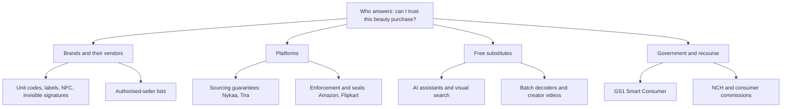
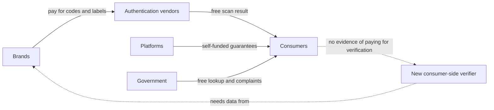
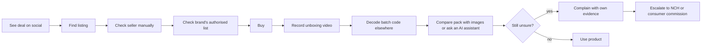

# 03 — Competitor Analysis: Online Beauty Authenticity & Purchase Trust

| Field | Value |
|---|---|
| **Project** | VeriGlow AI |
| **Phase** | 3 — Competitor Analysis |
| **Document** | `docs/01-research/03-competitor-analysis.md` |
| **Version / status** | **v2.0 — decision draft**; supersedes v1.0 after red-team review ([`03-competitor-analysis-review.md`](./03-competitor-analysis-review.md)) |
| **Research cut-off** | 20 October 2026 |
| **Owner / reviewers** | Product (owner) · Engineering, Design (reviewers) |
| **Decision requested** | Approve **STOP of the current thesis** and a **4-week, no-build validation gate** (§13) |
| **Depends on** | [`01-problem-discovery.md`](./01-problem-discovery.md), [`02-market-research.md`](./02-market-research.md) |
| **Feeds into** | `04-user-research.md`, `../07-decisions/ADR-0001` *(go/no-go)* |
| **Citation keys** | `C#` = this document's references (§16) · `R#` = references in `02-market-research.md` |

> [!IMPORTANT]
> **Scope guardrail.** This document analyses the competitive landscape. It contains **no VeriGlow features, designs or technical solutions**. Directions in §13 are stated as *customer and problem hypotheses*, not products.

---

## Table of Contents

0. [Decision Memo (one page)](#0-decision-memo-one-page)
1. [Executive Summary](#1-executive-summary)
2. [Research Scope & Method](#2-research-scope--method)
3. [Competitor Selection](#3-competitor-selection)
4. [Individual Competitor Analysis](#4-individual-competitor-analysis)
5. [Business Models & Incentives](#5-business-models--incentives)
6. [Feature Comparison Matrix](#6-feature-comparison-matrix)
7. [Customer Pain Points](#7-customer-pain-points)
8. [SWOT Analysis](#8-swot-analysis)
9. [Market Gaps](#9-market-gaps)
10. [Why Existing Solutions Fall Short — and Where They Are Good Enough](#10-why-existing-solutions-fall-short--and-where-they-are-good-enough)
11. [Risk Assessment](#11-risk-assessment)
12. [Key Insights (Top 20)](#12-key-insights-top-20)
13. [Go / Pivot / Stop Recommendation](#13-go--pivot--stop-recommendation)
14. [How This Analysis Could Be Wrong](#14-how-this-analysis-could-be-wrong)
15. [Additional Research Plan](#15-additional-research-plan)
16. [References](#16-references)
17. [Appendix A — Search Log](#appendix-a--search-log)
18. [Changelog](#changelog)

---

## 0. Decision Memo (one page)

> [!CAUTION]
> **Recommendation: STOP the current thesis** — *a consumer-facing app that helps Indian online beauty buyers verify product authenticity.* **Do not proceed to a PRD.** A pivot is permitted **only** if a 4-week, no-build validation gate (§13.3) passes. **On current evidence the idea is not fundable.**

**Why — three reasons, each evidenced:**

1. **The data that makes an answer trustworthy belongs to brands, and brands already buy it from someone else.** Every high-assurance verifier found depends on brand-applied markers or brand data: Amazon Transparency, HiddenTag, Authena, Ennoventure, OLNICA and Veritas. At least 13 vendors already sell this capability to brands. Brand-independent methods cannot prove a cosmetic is genuine: batch codes can be printed by anyone, a barcode identifies a product not a unit, and a camera cannot see the formula. *(§4, §6.3)*
2. **No paying customer is evident for a consumer-side verifier.** In this market brands pay for authentication; consumers get it free (platform guarantees, GS1 Smart Consumer, batch decoders). Paid consumer authentication exists only in luxury resale (LegitApp, Entrupy). *(§5)*
3. **The most likely substitute is free and already installed.** General-purpose AI assistants and visual search can already examine a photo of a pack. A public test on counterfeit lip tints showed partial success and real errors. A new "AI" verifier must clearly beat that, without the brand data that would make it decisive. *(§4.5)*

**What v1.0 got wrong:** it recommended pivoting to "end-to-end purchase trust" (authenticity + freshness + seller authorisation + recourse). Each of those components has the same dependency: freshness needs brand batch data, authorisation needs brand lists, and recourse is controlled by platforms and the National Consumer Helpline. Widening scope multiplied the dependencies. *(§13.2)*

**What would reverse this decision:**
- **≥2 of 5** Indian beauty brands interviewed are willing to share batch or seller data, or to co-pilot.
- **≥30%** of target-segment buyers doubted a beauty purchase in the past 3 months *and* took a costly action.
- Free AI assistants perform **poorly** on a controlled genuine-vs-fake test set.
- A **named payer** states willingness to pay.

These thresholds are team-set decision rules, not evidence. *(§13.3)*

---

## 1. Executive Summary

| # | Finding | Confidence |
|---|---|---|
| 1 | **The authentication layer is crowded and brand-funded.** ≥13 vendors sell unit-level authentication (codes, labels, NFC, invisible signatures, AI packaging checks) to brands, including Indian players Ennoventure, Acviss, Genefied and Checko. Investors continue to fund *brand-side* tech (Veritas, $1.75 m pre-seed, Oct 2026). | ✅ |
| 2 | **Consumer verification exists only where brands enrol.** Amazon Transparency (India accepts only Amazon-issued codes), HiddenTag and Authena all return a result only for enrolled products. Beauty enrolment in India is unknown. | ✅ / ❓ |
| 3 | **Platforms compete on asserted trust, not provable trust.** Nykaa, Tira and Flipkart (perfume seal) assert sourcing integrity. None was found giving buyers an independent check of the delivered unit. | ✅ / ❓ |
| 4 | **Brand-independent tools are low-assurance for cosmetics:** batch decoders, GTIN lookup, photo review, general-purpose AI. | ✅ / 🔶 |
| 5 | **Complaints are rising.** E-commerce complaints to India's National Consumer Helpline (NCH) rose from 2,24,592 (2021) to 5,11,198 (2025). Counterfeit complaints rose from 4,238 to 15,762. Refund/replacement refusals nearly doubled from 2024 to 2025. *These figures cover all e-commerce, not beauty.* | ✅ |
| 6 | **"Genuine but compromised" stock is real and defeats authentication by design.** This covers expired, relabelled and badly stored goods: a relabelling racket was exposed in June 2026, and dark-store raids found expired goods and cosmetics stored with food. | ✅ (existence) / ❓ (prevalence) |
| 7 | **Quick commerce is partly brand-supplied.** Innisfree and Laneige announced official launches on Zepto and Blinkit in 2025. Sourcing risk there is lower than v1.0 implied; storage and freshness risk remain unaddressed. | ✅ |
| 8 | **The threat is five problems, not one:** counterfeit, grey-market, non-compliant, compromised and mis-fulfilled. They have different owners and legal status. Parallel imports may be legal in India, so "unauthorised" ≠ "fake". | ✅ |
| 9 | **No evidence was found that consumers pay for beauty authentication.** | ❓ |
| 10 | **Market classification:** the authentication tech layer is *moderately competitive and consolidating*; consumer verification is *emerging but structurally constrained*; "high opportunity" is **not demonstrated**. | 🔶 |

---

## 2. Research Scope & Method

### 2.1 Threat taxonomy (used to tag every finding)

| Code | Threat | Definition | Typical owner of the fix | Legal status (India) |
|---|---|---|---|---|
| **T1** | Counterfeit | Not made by the rights-holder | Brand, enforcement | Illegal (trademark, Drugs & Cosmetics Act) |
| **T2** | Grey-market / unauthorised | Genuine product sold outside the brand's authorised channel, e.g. a parallel import | Brand distribution policy | **Unsettled**; practitioners describe it as a grey area [C73] |
| **T3** | Non-compliant | Lacks import registration or licence, or makes false origin claims | CDSCO / regulator | Illegal [C53][C57] |
| **T4** | Compromised genuine | Expired, relabelled, tampered or heat-damaged genuine stock | Seller, fulfilment, regulator | Relabelling is illegal; poor storage is a quality failure |
| **T5** | Mis-fulfilled | Wrong item, swapped or missing contents, refund refused | Platform | Consumer-protection issue |

> [!NOTE]
> v1.0 blurred T1–T4. Separating them matters. A signal that a seller is *unauthorised* (T2) does **not** establish that a product is *fake* (T1). Treating it as if it did creates defamation and trademark exposure (R-REG-1).

### 2.2 Competitor categories

| Category | Definition | Examples |
|---|---|---|
| **Direct** | Primary job is letting a **consumer** check a specific beauty or fragrance unit | HiddenTag, Amazon Transparency (consumer scan), Authena, AuthNow, Veritas |
| **Indirect** | Platforms whose trust programmes reduce the *need* to verify | Amazon, Flipkart, Meesho, Myntra, Nykaa, Tira, Tata CLiQ Palette, Purplle, Sephora, quick commerce |
| **Substitutes** | What consumers use *instead* | General-purpose AI assistants and visual search, brand authorised-seller lists, batch decoders, GS1 Smart Consumer, ingredient apps, expert photo services, creator "real vs fake" content, recourse channels (NCH, consumer commissions, card chargebacks) |
| **Marketplace trust mechanisms** | Vetting, registries, badges, guarantees, returns | Brand Registry, Brand Assure, F-Assured, Nykaa Guarantee, Project Authenticated |
| **Authentication technologies** | B2B tech applied at manufacture | Ennoventure, Acviss, Genefied, Checko, Cypheme, OLNICA, KaiosID, Scantrust, Authentic Vision, EDGYN, Gerresheimer × TruTag |

### 2.3 Method and evidence standard

| Item | Detail |
|---|---|
| Method | Desk research on 20 Oct 2026: company pages, app-store listings, parliamentary records, regulator alerts, trade press, complaint portals, secondary profiles. ~40 web queries (Appendix A). No app installs or interviews. |
| Evidence tags | ✅ verified (cited, A/B source) · 🟡 low-confidence (C source, vendor claim, single anecdote, or a figure that cannot be re-verified) · 🔶 analyst assumption · ❓ searched, not found (≠ absent) |
| Source mix | 77 references: see §16 for A/B/C grading. **C-grade sources are excluded from §0 and §1.** |
| Platform comparisons | NCH complaint counts are used **only** for trend and within-platform category mix, **never** to rank platforms. Absolute counts scale with order volume, and no denominator was available. |

### 2.4 Limitations

> [!WARNING]
> - **Absence claims are bounded by the search log** (Appendix A). They are English-only, include no Hindi or regional sources, and involve no hands-on app testing.
> - **Community sources not mined.** Targeted Reddit searches returned no citable threads; YouTube and app reviews were not coded. → §15 item 5.
> - **No brand, seller or platform voices.** The decisive variable, data access, is untested. → §15 item 1.
> - **NCH data is all-category e-commerce**, and its categories changed across years. The Nykaa dashboard figures [C3] were captured from a public page that now requires login and **cannot be re-verified** (🟡).
> - **"Authenticate App":** the only app under that exact name is OLNICA's business-facing field app [C15]. If a different product was intended, §4.3 must be revisited.

---

## 3. Competitor Selection

| # | Competitor | Type | Relevance (why it is here) |
|---|---|---|---|
| 1 | Amazon | Indirect + direct | Only Indian marketplace found with consumer-scannable unit codes [C4] |
| 2 | Flipkart | Indirect | Created a beauty-specific seal (perfumes) [C7]; top NCH volume every year 2021–25 [C1] |
| 3 | **Meesho** *(added)* | Indirect | #3 by NCH complaints in 2025 (29,284) [C1]; reseller model with 60K+ suppliers; FIR over fake luxury goods (2021) [C64] |
| 4 | **Myntra** *(added)* | Indirect | #4 by NCH complaints in 2025 (25,384) [C1]; ran a 2026 beauty campaign [C75] |
| 5 | Nykaa | Indirect | Category leader; authenticity is its core claim [C8] |
| 6 | Tira | Indirect | Reliance; "sourced straight from brands" claim [C10]; runs Sephora India (R22) |
| 7 | **Tata CLiQ Palette** *(added)* | Indirect | Tata group beauty platform; direct Nykaa/Tira peer [C76] — *identified, not profiled in depth* |
| 8 | Purplle | Indirect | Value, Tier-2/3 positioning (R26) |
| 9 | Sephora (India) | Indirect | Prestige benchmark (R22) |
| 10 | Official brand websites | Indirect + substitute | Publish the authorised-seller lists consumers are told to check [C54][C56] |
| 11 | Quick commerce | Indirect | ~5% of Indian beauty & personal care (R12); NCH top-10 in 2025 [C1]; brands launching officially [C70][C71] |
| 12 | Authenticate App (OLNICA) | Authentication tech | Named in brief [C15] |
| 13 | HiddenTag | Direct | Closest analogue *in design* to a consumer beauty verifier [C12] |
| 14 | Ennoventure | Authentication tech | Bengaluru R&D; India focus [C17][C18] |
| 15 | **Acviss, Genefied, Checko** *(added)* | Authentication tech | Indian vendors: QR, blockchain, AI [C66] |
| 16 | Cypheme | Authentication tech | AI packaging analysis [C22] |
| 17 | Authena | Direct + tech | NFC; detects opened seals; fragrance focus [C24] |
| 18 | **Veritas** *(added)* | Direct + tech | NFC chip incl. perfume bottles; funded Oct 2026 [C68] |
| 19 | **General-purpose AI assistants & visual search** *(added)* | Substitute | Free, installed, multimodal; tested on fake cosmetics [C69] |
| 20 | GS1 Smart Consumer | Substitute | Government-backed barcode lookup [C28][C29] |
| 21 | Batch-code decoders | Substitute | De facto DIY freshness tool [C32][C33] |
| 22 | Ingredient apps (Yuka etc.) | Substitute | Mass adoption of *information* trust [C35][C36] |
| 23 | LegitApp / Entrupy | Substitute | The only paid consumer authentication model found [C39][C40] |
| 24 | **Sproxil** *(added)* | Precedent | Consumer scratch-code verification; launched in India in 2011 [C67] |
| 25 | **Recourse channels** *(added)* | Substitute | NCH, consumer commissions, chargebacks — the de facto "recourse" competitors [C1] |

---

## 4. Individual Competitor Analysis

*Each profile uses the same ten fields. Scale and enforcement metrics already in `02-market-research.md §7` are referenced (R#), not repeated. "Perception" never uses absolute complaint counts as a trust ranking (§2.3).*

### 4.1 Horizontal marketplaces

#### Amazon (amazon.in)

| Field | Finding | Tag |
|---|---|---|
| Overview | Global marketplace; mixed first-party and third-party model in India (R27, R28) | ✅ |
| Target users | Mass-market, multi-category shoppers | ✅ |
| Value proposition | Selection, price, speed; trust through enforcement rather than curation | 🔶 |
| Trust features | Brand Registry, Project Zero, Counterfeit Crimes Unit (R27). **Transparency:** a unique code on every unit of an enrolled brand; India accepts only Amazon-issued codes; customers scan in the Amazon Shopping or Transparency app and get a pass/fail result [C4], regardless of where the unit was bought [C5] | ✅ |
| Strengths | The only Indian marketplace found with consumer unit-level verification; >US$1 bn anti-fraud spend (R28) | ✅ |
| Weaknesses | Covers enrolled brands only; beauty enrolment in India unknown; the consumer scan app was US-only at the 2019 India launch [C6] (current India availability stated by Amazon [C4], not tested); verification is Amazon-branded, not neutral | ❓ / 🔶 |
| Perception | In the NCH top-10 every year 2021–25 [C1]; press cases put the burden of proof on the buyer (electronics) [C49]; dated 2018 survey ranked it least-cited of four platforms for fakes [C60] | ✅ / 🟡 |
| Pricing | Free to consumers; Transparency is brand-paid (India rates not public) | ✅ / ❓ |
| Reach | Transparency available in 10 countries including India [C4] | ✅ |
| Limitations | An unregistered, heavy-metal cream was listed on Amazon and four other platforms in Sept 2026 [C53] (T3) | ✅ |

#### Flipkart

| Field | Finding | Tag |
|---|---|---|
| Overview | India's largest marketplace (Walmart group) | ✅ |
| Target users | Mass market, strong Tier-2/3 presence | 🔶 |
| Value proposition | Price, reach, sale events | 🔶 |
| Trust features | F-Assured; Brand Assure (R29); **Project Authenticated:** ~2,000 luxury perfume listings with a "Brand Authenticated" seal certifying the *seller* is brand-approved [C7] | ✅ |
| Strengths | Category-specific seal precedent; brand partnerships | ✅ |
| Weaknesses | Seal certifies seller authorisation (T2), not the unit (T1/T4); perfume only | ✅ |
| Perception | NCH top-10 every year (volume-driven) [C1] | ✅ |
| Pricing | Free to consumers | ✅ |
| Reach | India | ✅ |
| Limitations | DCGI notice over alleged spurious cosmetics (2018) [C57]; listed the cream flagged by CDSCO (2026) [C53] | ✅ |

#### Meesho *(added in v2)*

| Field | Finding | Tag |
|---|---|---|
| Overview | Reseller and social-commerce marketplace; 60K+ small manufacturers and wholesalers (2021) [C64] | ✅ |
| Target users | Value-seeking, Tier-2/3, first-time online shoppers | 🔶 |
| Value proposition | Lowest prices; unbranded and value goods | 🔶 |
| Trust features | Supplier quality checks, supplier training, takedowns, delisting of repeat offenders (company statement) [C64] | 🟡 |
| Strengths | Reach into segments specialists don't serve | 🔶 |
| Weaknesses | FIR filed against its founders over alleged fake luxury goods (2021; not cosmetics) [C64][C65]; listed the CDSCO-flagged cream (2026) [C53] | ✅ |
| Perception | #3 by NCH complaints in 2025 (29,284) [C1] | ✅ |
| Pricing | Free to consumers | ✅ |
| Reach | India | ✅ |
| Limitations | Beauty share of GMV and beauty-specific counterfeit exposure not found ❓ | ❓ |

#### Myntra *(added in v2)*

| Field | Finding | Tag |
|---|---|---|
| Overview | Flipkart-group fashion platform expanding into beauty; 2026 beauty campaign [C75] | 🟡 |
| Target users | Fashion-led, younger urban shoppers | 🔶 |
| Value proposition | Fashion + beauty discovery | 🔶 |
| Trust features | No beauty-specific authenticity policy found | ❓ |
| Strengths | Audience overlap with beauty's core buyers | 🔶 |
| Weaknesses | Beauty is a newer category | 🔶 |
| Perception | #4 by NCH complaints in 2025 (25,384; all categories) [C1] | ✅ |
| Pricing | Free to consumers | ✅ |
| Reach | India | ✅ |
| Limitations | Not profiled in depth; follow-up in §15 | — |

### 4.2 Beauty specialists, prestige retail, brands and quick commerce

#### Nykaa

| Field | Finding | Tag |
|---|---|---|
| Overview | Listed, beauty-first omnichannel retailer; holds its own inventory in beauty (R16–R20) | ✅ |
| Target users | Beauty-engaged urban shoppers; luxury via Nykaa Luxe | ✅ |
| Value proposition | Curated assortment + guaranteed authenticity | ✅ |
| Trust features | **Nykaa Guarantee:** products sourced from the brand or authorised retailers [C8]; executive cited brand-signed sourcing certificates [C9] | ✅ / 🟡 |
| Strengths | Brands name it as an authorised seller (e.g., COSRX India) [C55]; authenticity *is* the brand | ✅ |
| Weaknesses | No consumer-side unit check found; trust does not carry over when the same SKU is bought elsewhere | ❓ / 🔶 |
| Perception | NCH top-10 in 2025 [C1]. Dashboard capture (Jan–Sep 2025): fake-product grievances **51** vs wrong-product **275** vs refund/replacement refused **302** [C3] *(cannot be re-verified)*; complaint-portal cases of tampered parcels and rejected video evidence [C43][C44] | ✅ / 🟡 |
| Pricing | Free to consumers | ✅ |
| Reach | India; ~313 stores (R18) | ✅ |
| Limitations | The guarantee is a promise; in disputes the evidentiary burden appears to sit with the buyer | 🔶 |

#### Tira (Reliance Retail)

| Field | Finding | Tag |
|---|---|---|
| Overview | Omnichannel beauty retailer (2023); Reliance also operates Sephora India (R22, R23) | ✅ |
| Target users | Urban, premium-leaning | 🔶 |
| Value proposition | Premium curation, exclusives (R24) | 🟡 |
| Trust features | Claims every product is authentic and sourced straight from brands [C10]; Reliance group signed the government "Safety Pledge" [C1] | ✅ |
| Strengths | Group scale and capital | ✅ |
| Weaknesses | No published sourcing or verification policy found | ❓ |
| Perception | No independent perception data | ❓ |
| Pricing | Free to consumers | ✅ |
| Reach | India | ✅ |
| Limitations | Claim-based trust only | 🔶 |

#### Purplle

| Field | Finding | Tag |
|---|---|---|
| Overview | Value beauty platform; owned brands ~82.5% of revenue (R26) | ✅ |
| Target users | Value-seeking, Tier-2/3 (R26) | 🟡 |
| Value proposition | Affordable beauty; owned brands | ✅ |
| Trust features | Shift to an inventory-owned model (R25) | ✅ |
| Strengths | Price leadership; small-town reach | 🟡 |
| Weaknesses | Multi-brand authenticity is a shrinking share of the proposition | 🔶 |
| Perception | Complaint-portal cases: seal-broken items with returns refused; a near-expiry product delivered [C45][C46] | 🟡 |
| Pricing | Free to consumers | ✅ |
| Reach | India | ✅ |
| Limitations | No consumer verification mechanism found | ❓ |

#### Sephora (India)

| Field | Finding | Tag |
|---|---|---|
| Overview | LVMH prestige retailer; India business run by Reliance since Nov 2023 (R22) | ✅ |
| Target users | Prestige buyers | ✅ |
| Value proposition | Prestige curation; experiential retail | ✅ |
| Trust features | Named as authorised retailer on *global/US* brand lists (SK-II, IT Cosmetics) [C56] — **India listing not verified** | ✅ / ❓ |
| Strengths | Borrowed trust from the rights-holders | 🔶 |
| Weaknesses | Small India footprint; overlap with Tira under the same parent | 🔶 |
| Perception | No India data | ❓ |
| Pricing | Free | ✅ |
| Reach | Global; India via Reliance | ✅ |
| Limitations | Authorised status is brand- and country-specific | 🔶 |

#### Official brand websites

| Field | Finding | Tag |
|---|---|---|
| Overview | Rights-holder D2C sites and consumer-protection statements | ✅ |
| Target users | Loyalists; anyone checking where it is safe to buy | 🔶 |
| Value proposition | Direct provenance | ✅ |
| Trust features | Authorised-seller lists and counterfeit warnings (COSRX, SK-II, IT Cosmetics) [C54][C55][C56] | ✅ |
| Strengths | The **only** party that knows what is genuine; highest-trust channel in surveys (R51) | ✅ |
| Weaknesses | Two live COSRX pages name different Indian sellers (possibly stale content) [C54][C55]; lookalike sites are a fraud vector (R-FOX) | ✅ / 🔶 |
| Perception | Brand guidance pushes checking work onto consumers [C61] | 🟡 |
| Pricing | Free | ✅ |
| Reach | Brand-dependent | ✅ |
| Limitations | No cross-brand view | 🔶 |

#### Quick commerce (Blinkit, Zepto, Instamart)

| Field | Finding | Tag |
|---|---|---|
| Overview | 10–30-minute delivery from dark stores (R12) | ✅ |
| Target users | Urban convenience buyers; beauty spend skews premium (R13) | ✅ |
| Value proposition | Speed | ✅ |
| Trust features | **Brands launch officially:** Innisfree on Blinkit (Jan 2025) [C74] and Zepto (Feb 2025) [C70]; Laneige "official launch" on Zepto (Feb 2025) [C71]. No platform-level beauty authenticity or freshness programme found | ✅ / ❓ |
| Strengths | Purchase frequency and habit | 🔶 |
| Weaknesses | Regulators found expired goods, and cosmetics stored with food, in dark stores [C50][C51] (T4) | ✅ |
| Perception | Zepto and Blinkit entered the NCH top-10 in 2025 [C1]; complaint of an expired retinol serum with refund refused (Sept 2026) [C47] | ✅ / 🟡 |
| Pricing | Free (delivery/platform fees) | ✅ |
| Reach | Metros and large cities | 🟡 |
| Limitations | **Sourcing risk partly mitigated by brand-official supply; storage and freshness risk unaddressed** | 🔶 |

### 4.3 Authentication platforms

#### Authenticate App (OLNICA)

| Field | Finding | Tag |
|---|---|---|
| Overview | French brand-protection firm: visible/invisible markers, molecular tracers, connected detectors [C15] | ✅ |
| Target users | **Brand staff and field operators** (login issued by OLNICA or the brand) [C15] | ✅ |
| Value proposition | Court-grade evidence against counterfeiters | ✅ |
| Trust features | iOS app plus Bluetooth "Pocket Lab" device; brand dashboard [C15] | ✅ |
| Strengths | Forensic-grade assurance | 🔶 |
| Weaknesses | Requires proprietary hardware and brand-applied tracers | ✅ |
| Perception | Too few store ratings to display [C15] | ✅ |
| Pricing | B2B, not public | ❓ |
| Reach | India presence not found | ❓ |
| Limitations | Illustrates the trade-off: **high assurance requires hardware and enrolment** | 🔶 |

#### HiddenTag (CK&B, South Korea)

| Field | Finding | Tag |
|---|---|---|
| Overview | Image-watermarked smart labels for beauty brands, marketed since at least 2017 [C11] | ✅ |
| Target users | K-beauty and fashion consumers; brands pay | ✅ / 🟡 |
| Value proposition | Scan label → authenticity result → shop genuine in-app [C12] | ✅ |
| Trust features | Label scan; "Report Counterfeit" with final determination; product registration; store reviews; genuine-only store [C12][C13] | ✅ |
| Strengths | Closest analogue **in design** to a consumer beauty verifier; named brands Clio, 3CE, Aekyung [C12] | ✅ |
| Weaknesses | Label-dependent; its own listings claim different scales (300+ vs 1,000+ companies) [C12][C13] | ✅ |
| Perception | Low rating volume [C13][C14] — **actual scan volume unknown** | 🟡 |
| Pricing | Free app; B2B label fees not public | ❓ |
| Reach | Korea-centric with a Global app [C13]; India adoption not found | ❓ |
| Limitations | Value collapses outside enrolled brands | 🔶 |

#### Ennoventure

| Field | Finding | Tag |
|---|---|---|
| Overview | US HQ, Bengaluru R&D, founded 2018 [C17][C18] | ✅ |
| Target users | **Brands** in FMCG, pharma, agrochemicals, luxury [C18] | ✅ |
| Value proposition | Invisible cryptographic signature in existing artwork; no new ink, hardware or line change [C18][C20] | ✅ |
| Trust features | Smartphone scan; serialised encryption and encrypted QR (2023) [C19]; brand decides consumer visibility [C20] | ✅ |
| Strengths | Low deployment friction; India priority market [C17]; accessibility option [C20] | ✅ |
| Weaknesses | Consumer experience is brand-controlled | ✅ |
| Perception | No consumer data | ❓ |
| Pricing | B2B SaaS, not public | ❓ |
| Reach | US, Europe, India, Africa, Middle East [C18]; says India's smartphone ubiquity and digital-verification push suit its model [C63] | 🟡 |
| Limitations | $5 m Series A (2021) [C17]; a later $8.9 m round appears only in a C-grade source [C21] | ✅ / 🟡 |

#### Acviss, Genefied, Checko *(added in v2)*

| Vendor | Technology | Customer | Beauty evidence | Tag |
|---|---|---|---|---|
| Acviss | QR, blockchain, AI | B2B (pharma, electronics, FMCG) with consumer-engagement tools | None found | 🟡 [C66] |
| Genefied | QR, blockchain, IoT | Mixed: supply chain + consumer loyalty | None found | 🟡 [C66] |
| Checko | AI-embedded QR | Brands; warranty and incentive programmes; electronics focus | None found | 🟡 [C66] |

*Implication:* Indian brands already have **local** authentication vendors to choose from. 🔶

#### Cypheme · Authena · Veritas

| Field | Cypheme | Authena | Veritas *(added)* |
|---|---|---|---|
| Overview | Paris, 2015; smartphone neural-network packaging check [C22] 🟡 | Swiss, 2018; NFC/QR tags; separate sector apps [C24] ✅ | US; NFC chip with tamper-detection wire; works through glass incl. perfume bottles [C68] ✅ |
| Target users | Brands (cosmetics among sectors) | Fragrance/cosmetics buyers + brands | Brands + owners (luxury, perfume, jewellery) |
| Value proposition | Authenticate packaging without special hardware | Tap → history, certificates, proof | Tap → history and proof of ownership |
| Trust features | Image analysis; market intelligence | **Opened-seal detection**; photo-search fallback [C24] | Secure response per tap; tamper detection [C68] |
| Strengths | Possibly low marginal cost 🔶 | Tamper detection fits T4 | Fresh funding; hard-to-clone hardware |
| Weaknesses | ~$1.3 m raised; last recorded round 2018 [C23] 🟡 | Enrolled brands only [C24] | Per-unit chip cost suits high-value goods 🔶 |
| Perception | None found | None found | Early-stage |
| Pricing | B2B | Free app; B2B tags | B2B; $1.75 m pre-seed (Oct 2026) [C68] |
| Reach | Europe 🔶 | Europe 🔶 | US 🔶 |
| Limitations | Requires brand enrolment 🔶 | NFC on Indian beauty packs not evidenced ❓ | Unlikely to be economical for mass beauty SKUs 🔶 |

### 4.4 Substitutes and precedents

#### GS1 India — Smart Consumer

| Field | Finding | Tag |
|---|---|---|
| Overview | GS1 India app linked to the Department of Consumer Affairs; launched Dec 2016 [C29][C30] | ✅ |
| Target users | All Indian consumers | ✅ |
| Value proposition | Scan an `890` barcode → brand-supplied product data, licences, consumer-care contact, complaints [C28][C29] | ✅ |
| Trust features | Licence validation; ratings and reviews [C31]; FSSAI directed food firms to upload licence and expiry data [C28] | ✅ |
| Strengths | Government-backed neutrality; national data repository; free | ✅ |
| Weaknesses | Identifies the **product (GTIN), not the unit** — a fake with a copied barcode returns the same data | 🔶 |
| Perception | Only usage figure is undated and from early launch (~12,000 scans) [C30] — **not a valid adoption signal today** | 🟡 |
| Pricing | Free; brands pay GS1 for codes | ✅ |
| Reach | India; 890-prefix only [C28] | ✅ |
| Limitations | Media framing it as a fake/original checker [C62] overstates what a GTIN lookup can prove; cosmetics data coverage unknown | 🔶 / ❓ |

#### Batch decoders · ingredient apps · expert authentication

| Field | Batch decoders (CheckFresh etc.) | Ingredient apps (Yuka etc.) | LegitApp / Entrupy |
|---|---|---|---|
| Value proposition | Estimate a product's age from its batch code [C32][C33] | Ingredient-risk score [C38] | Expert/AI authentication of luxury goods [C39][C40] |
| Assurance for T1 | **None** — codes can be invented [C34] 🟡 | None — not designed for it | Low for cosmetics (formula invisible) 🔶 |
| Scale | Small (one iOS app: 3 ratings) [C33] | Yuka 65 m+ (May 2025) [C36]; >73 m claimed early 2026 [C35] 🟡 | LegitApp claims 2.5 m users [C39] 🟡 |
| Pricing | Free | Freemium (~$10–20/yr) [C38] 🟡 | Paid per check; Entrupy ~$16–24 per luxury check, $10 pay-as-you-go [C40] |
| Criticism / change | — | Industry questions the scoring's scientific basis [C37] | Entrupy moved to device-free phone capture for bags (May 2026) [C41] 🟡 |
| Takeaway | Brand-independent but low assurance | Consumers scan beauty habitually **when the answer is instant, free and informational** 🔶 | **Consumers pay for authentication only in luxury resale**, where external craftsmanship cues exist 🔶 |

#### Sproxil — Indian precedent *(added in v2)*

| Field | Finding | Tag |
|---|---|---|
| Model | Scratch-off one-time code on the pack → SMS/app → genuine or suspicious reply; call centre for reports [C67] | ✅ |
| India | Launched June 2011 after a $1.8 m Acumen investment [C67] | ✅ |
| Who paid | Brands (named clients include J&J and GSK) [C67] | ✅ |
| Outcome | Current status not documented in the source; most recent dated item 2017 [C67] | ❓ |
| Why it matters | A consumer-verification-as-a-service model **already entered India 15 years ago**, brand-paid and pharma-led. Its trajectory is the most relevant precedent and is **unknown**. | 🔶 |

### 4.5 General-purpose AI assistants and visual search *(added in v2 — highest-priority substitute)*

| Field | Finding | Tag |
|---|---|---|
| Overview | Gemini, ChatGPT, Claude; Google Lens / visual search | ✅ |
| Target users | Everyone with a smartphone | ✅ |
| Value proposition | Photograph a pack and ask whether it looks genuine; compare against images online | 🔶 |
| Evidence | Public test (Aug 2026): Gemini was given genuine and counterfeit Rhode lip tints. It caught typos and inconsistencies, but read glare as print defects and invented details. A commenter disputed whether it classified all items correctly [C69] | 🟡 |
| Strengths | Free; zero install; improving fast; multilingual | 🔶 |
| Weaknesses | No access to brand data; hallucination risk; no accountability | 🟡 / 🔶 |
| Perception | Unknown in India | ❓ |
| Pricing | Free tiers | ✅ |
| Reach | Global | ✅ |
| Limitations | Same ceiling as any brand-independent method: **cannot prove T1 for a visually perfect fake** | 🔶 |

> [!WARNING]
> **Implication for an "AI" verifier.** Without brand data, a new AI verifier is competing with free assistants on the *same* inputs: a photo plus public images. Its edge would have to come from proprietary reference data. That data comes from brands, which is the same dependency again. 🔶

### 4.6 Other authentication vendors

| Vendor | What it does | Tag |
|---|---|---|
| AuthNow (US, 2025) | Consumer app; code database + invisible digital watermark on the QR [C16] | 🟡 |
| Gerresheimer × TruTag | Invisible microparticles in glass packaging; smartphone-decodable (2023) [C26][C27] | ✅ |
| KaiosID (Switzerland) | Packaging identification for perfumes & cosmetics [C42] | 🟡 |
| Authentic Vision (Austria) | Holographic fingerprint, smartphone-verified [C42] | 🟡 |
| Scantrust | Secure QR; acquired Trust Codes (Feb 2026) — consolidation [C42] | 🟡 |
| EDGYN (France) | Digital authentication for perfumes & cosmetics [C42] | 🟡 |

---

## 5. Business Models & Incentives

*Added in v2 — the question v1.0 never asked: **who pays, who benefits, who resists?***

| Player type | Who pays | What they gain from authenticity verification | What they lose / resist | Tag |
|---|---|---|---|---|
| **Brands** | Pay vendors per code, label or SaaS (Transparency, HiddenTag, Ennoventure, Sproxil) | Revenue protection, safety, reputation (40% complain to the brand; ~20% stop buying, R50/R52) | Publicising counterfeits can hurt the brand 🔶; grey-market channels may help volume 🔶 | ✅ / 🔶 |
| **Platforms** | Fund internally (Amazon >US$1 bn, R28) | Conversion, regulatory compliance, fewer disputes | **Third-party "fake/unauthorised" labels on their sellers**; return fraud makes them sceptical of buyer claims [C59] | ✅ / 🔶 |
| **Authentication vendors** | Brands pay them | Sell more enrolments | Consumer-side neutral layers could commoditise their scan endpoint 🔶 | 🔶 |
| **Consumers** | Pay nothing for verification today; pay a stated ~9% premium for *guaranteed-genuine products* (R47), **not** for verification services | Safety, money | Effort at the moment of doubt; possibly low frequency | ✅ / ❓ |
| **Government** | Taxpayer (GS1 Smart Consumer, NCH, BIS IS 19598:2026 voluntary standard) [C1][C29] | Consumer protection | — | ✅ |

> [!IMPORTANT]
> **Implication:** a new consumer-side entrant has **no evidenced payer**. Brands pay vendors they already have. Platforms build in-house. Consumers get verification free. Monetisation routes (affiliate, brand subscriptions, platform licensing) either create conflicts of interest or turn the entrant into **one more B2B vendor in a crowded field**. 🔶

---

## 6. Feature Comparison Matrix

**Legend:** ✅ provides · 🟡 partial/limited scope · ⬜ none found in this research (≠ absent) · ❓ not checked · — not applicable.
*Every cell was checked to the same standard: a cited public source or an obvious public UI convention (e.g., review sections on retail sites, marked ✅ without citation).*

### 6.1 Platforms and retailers

| Capability | Amazon | Flipkart | Meesho | Myntra | Nykaa | Tira | Purplle | Sephora IN | Quick comm. | Brand sites |
|---|:-:|:-:|:-:|:-:|:-:|:-:|:-:|:-:|:-:|:-:|
| Barcode verification¹ | ⬜ | ⬜ | ⬜ | ⬜ | ⬜ | ⬜ | ⬜ | ⬜ | ⬜ | ⬜ |
| QR / unit-code verification² | 🟡 enrolled brands | ⬜ | ⬜ | ⬜ | ⬜ | ⬜ | ⬜ | ❓ | ⬜ | 🟡 some brands |
| Batch number lookup | 🟡 brand-optional | ⬜ | ⬜ | ⬜ | ⬜ | ⬜ | ⬜ | ⬜ | ⬜ | ⬜ |
| Seller verification³ | ✅ | ✅ | 🟡 [C64] | ❓ | ✅ (R-UC) | ❓ | ❓ | — 1P | ❓ | — |
| Authorised-seller identification⁴ | ❓ | 🟡 perfume [C7] | ⬜ | ❓ | 🟡 platform claim | 🟡 platform claim | ⬜ | 🟡 global lists | 🟡 brand launches [C70] | ✅ |
| Customer reviews | ✅ | ✅ | ✅ | ✅ | ✅ | ✅ | ✅ | ✅ | 🟡 | 🟡 |
| Image recognition⁵ | ⬜ | ⬜ | ⬜ | ⬜ | ⬜ | ⬜ | ⬜ | ⬜ | ⬜ | ⬜ |
| AI assistance | ✅ (R70) | ❓ | ❓ | ❓ | ✅ (R16) | ❓ | ❓ | ❓ | ❓ | 🟡 (R71) |
| Ingredient transparency | 🟡 listing-dependent | 🟡 | 🟡 | 🟡 | 🟡 | 🟡 | 🟡 | 🟡 | 🟡 | ✅ |
| Manufacturing info | 🟡 | 🟡 | 🟡 | 🟡 | 🟡 | 🟡 | 🟡 | 🟡 | 🟡 | ✅ |
| Expiry verification⁶ | 🟡 display only | 🟡 display only | 🟡 display only | 🟡 display only | 🟡 display only | 🟡 display only | 🟡 display only | ❓ | ⬜ | ⬜ |
| Purchase-confidence indicators | 🟡 Transparency badge [C4] | ✅ F-Assured, seal | ❓ | ❓ | ✅ Nykaa Guarantee | ✅ "100% authentic" | ❓ | 🟡 brand halo | ⬜ | ✅ |

*"Display only" means India's E-Commerce Rules require expiry to be shown before purchase (R55); compliance was not audited and the delivered unit is not verified. Ingredient and manufacturing rows are 🟡 because they depend on what each listing contains (R54, R-IL).*

### 6.2 Verification tools and substitutes

| Capability | Transparency | HiddenTag | Authena | Ennoventure | Veritas | Cypheme | OLNICA | Smart Consumer | Batch decoders | Yuka | LegitApp | AI assistants |
|---|:-:|:-:|:-:|:-:|:-:|:-:|:-:|:-:|:-:|:-:|:-:|:-:|
| **Assurance for T1 (counterfeit)** | High* | High* | High* | High* | High* | Med* | Very high* | Low | None | None | Low (beauty) | Low |
| **Requires brand enrolment** | Yes | Yes | Yes | Yes | Yes | Yes 🔶 | Yes | Data upload | No | No | No | No |
| Barcode verification¹ | ⬜ | ⬜ | ⬜ | ⬜ | ⬜ | ⬜ | ⬜ | 🟡 product-level | ⬜ | 🟡 ingredients | ⬜ | 🟡 via visual search |
| QR / unit-code verification² | ✅ | ✅ | ✅ | ✅ | ✅ NFC | ⬜ | 🟡 device | 🟡 2D codes | ⬜ | ⬜ | ⬜ | ⬜ |
| Batch number lookup | 🟡 | ⬜ | ⬜ | ⬜ | ⬜ | ⬜ | ⬜ | ⬜ | ✅ date estimate | ⬜ | ⬜ | ⬜ |
| Seller verification³ | — | 🟡 store reviews | ⬜ | ⬜ | ⬜ | ⬜ | ⬜ | ⬜ | ⬜ | ⬜ | ⬜ | ⬜ |
| Authorised-seller identification⁴ | ⬜ | 🟡 in-app store | ⬜ | ⬜ | ⬜ | ⬜ | ⬜ | ⬜ | ⬜ | ⬜ | ⬜ | ⬜ |
| Customer reviews | — | ✅ | ⬜ | ⬜ | ⬜ | ⬜ | ⬜ | ✅ [C31] | ⬜ | ⬜ | ⬜ | ⬜ |
| Image recognition⁵ | ⬜ | ✅ watermark | 🟡 photo search | ✅ | ⬜ | ✅ | ⬜ | ⬜ | ⬜ | ⬜ | ✅ | 🟡 [C69] |
| AI assistance | ⬜ | ⬜ | ⬜ | ✅ vendor claim | ⬜ | ✅ vendor claim | ⬜ | ⬜ | ⬜ | ⬜ | ✅ | ✅ |
| Ingredient transparency | ⬜ | ⬜ | 🟡 certificates | ⬜ | ⬜ | ⬜ | ⬜ | ✅ brand-supplied | ⬜ | ✅ | ⬜ | 🟡 |
| Manufacturing info | 🟡 | 🟡 | ✅ history | 🟡 | ✅ history | ❓ | ⬜ | ✅ | 🟡 | ⬜ | ⬜ | ⬜ |
| Expiry verification⁶ | ⬜ | ⬜ | ⬜ | ⬜ | ⬜ | ⬜ | ⬜ | 🟡 food only | 🟡 age estimate | ⬜ | ⬜ | ⬜ |
| Tamper / opened detection | ⬜ | ⬜ | ✅ | ⬜ | ✅ | ⬜ | ⬜ | ⬜ | ⬜ | ⬜ | ⬜ | ⬜ |
| Purchase-confidence indicators | ✅ pass/fail | ✅ | ✅ | 🟡 brand-controlled | ✅ | ❓ | ⬜ | 🟡 licence check | 🟡 | ✅ score | ✅ certificate | 🟡 |

\* *Assurance applies only to enrolled units, and only if codes cannot be cloned at scale. Static printed QR codes can be copied [C25]; NFC chips with per-tap cryptographic responses are harder to clone [C68]. Ratings are analyst judgment (🔶).*

¹ Scanning a GS1 barcode (GTIN) — identifies the product, not the unit. ² Unit-level code, label, tag or signature checked against a database. ³ Platform vetting of sellers before listing. ⁴ Telling the buyer, before purchase, whether *this* seller is authorised by *this* brand in India. ⁵ Image analysis *for authenticity* (try-on and discovery excluded). ⁶ Verifying the **delivered unit** is in date.

### 6.3 Assurance ladder (replaces v1.0's positioning quadrant)

| Rung | What the method can prove | Examples | Needs brand? | Defeated by |
|---|---|---|---|---|
| 5 | This exact unit was issued by the brand **and** has not been opened | Authena NFC, Veritas | Yes | Brand not enrolled; chip cost on mass SKUs |
| 4 | This exact unit's code was issued by the brand | Transparency, HiddenTag, Ennoventure, Sproxil | Yes | Not enrolled; cloned printed codes |
| 3 | This seller is authorised by the brand | Brand lists, Flipkart seal | Yes | Stale lists; swaps after dispatch; T2 ≠ T1 |
| 2 | This *product* exists and its data is X | GS1 Smart Consumer | Data upload | Copied barcode |
| 1 | The pack *looks* consistent; the batch code decodes to a date | Batch decoders, LegitApp, AI assistants | No | Good fakes; relabelled genuine stock (T4); invented codes |
| 0 | Someone *says* it is genuine | Platform guarantees, reviews | No | Anything |

> [!IMPORTANT]
> **The whitespace v1.0 found is a constraint, not an opportunity.** No consumer-facing method reaches rung 4 or above without brand enrolment. For cosmetics, that is a property of the problem: the value is in the formula, and printed codes can be copied. It is not a gap a competitor has overlooked. 🔶

---

## 7. Customer Pain Points

### 7.1 Government complaint data (all e-commerce — directional only)

| NCH e-commerce grievance category | 2021 | 2023 | 2024 | 2025 |
|---|---:|---:|---:|---:|
| **Total e-commerce complaints** | 2,24,592 | 4,46,133 | 4,40,187 | 5,11,198 |
| Sale of spurious / fake / counterfeit product | 4,238 | 9,538 | — | 15,762 |
| Delivery of wrong product | *(in defective row)* | 60,200 | 60,242 | 75,426 |
| Replacement / refund not provided as per policy | 6,276† | 12,210† | 33,428 | 61,056 |
| Delivery of defective / damaged product | 48,816‡ | 59,102 | 58,181 | 60,969 |

*Source: Lok Sabha Unstarred Q. 4041, answered 12 Aug 2026 [C1]. "—" = not among the categories reported that year. † label covered replacement only. ‡ combined defective + wrong. One press report described the 2025 total as quick-commerce complaints [C2]; the primary source labels it total e-commerce **including** quick commerce.*

**What this data supports (✅):** counterfeit complaints rose ~3.7× from 2021 to 2025 while total complaints rose ~2.3×. Like-for-like refund/replacement refusals rose ~1.8× from 2024 to 2025.

**What it does *not* support (v1.0 over-read):** ranking counterfeits below other failure modes *in beauty*. The data is all-category, counterfeits are under-detected (69% can't identify fakes, R43/R52), and a fake can be filed as "wrong" or "defective". **No decision in this document rests on the ~3% counterfeit share.**

### 7.2 Pain-point clusters

| # | Cluster | Threat | Evidence | Evidence quality |
|---|---|---|---|---|
| P1 | "I suspect a fake but can't prove it" | T1 | 45% couldn't return a suspected fake cosmetic (R44); buyer told to obtain brand-service-centre proof (electronics) [C49]; brands push checking onto buyers [C61]; a Bloomberg writer could not tell whether her own COSRX serum was real [C72] | Survey + press + anecdote |
| P2 | Wrong, swapped or tampered item | T5 / T4 | 75,426 wrong-product complaints in 2025 [C1]; tampered high-value perfume parcel [C43]; video evidence rejected [C44] | Gov data + anecdotes |
| P3 | Expired, near-expiry or relabelled stock | T4 | Relabelling racket sold via Instagram "90% off" reels (Jun 2026) [C52] — *the "₹500 cr" figure is an unverified headline*; dark-store raids [C50][C51]; expired serum (Sept 2026) [C47]; near-expiry delivery [C46] | Investigation + regulator + anecdotes; **prevalence unknown** |
| P4 | Returns refused / category non-returnable | T5 | 61,056 refund/replacement refusals in 2025 [C1]; non-returnable beauty item after wrong delivery [C48]; return blocked citing "past history" [C45] | Gov data + anecdotes |
| P5 | Unregistered or unsafe product listed as genuine | T3 | CDSCO alert: unregistered creams with heavy metals on Amazon, Flipkart, Meesho, Tata 1mg and Snapdeal, listed as "Made in India" (Sept 2026) [C53]; DCGI notices (2018) [C57] | Regulator |
| P6 | Can't tell which seller is authorised | T2 | Two COSRX pages list different Indian sellers [C54][C55]; Flipkart seal covers perfume only [C7] | Primary, but thin |
| P7 | Fakes leak from offline into the same supply | T1 | Kohima police seizure of fake Lakmé (Apr 2026) [C58]; more households reported fakes offline than online (R44) | Press + survey |

### 7.3 Verified vs assumed

| Statement | Status |
|---|---|
| Counterfeit, wrong-product and refund-refusal complaints are rising in Indian e-commerce | ✅ [C1] |
| Relabelled and expired cosmetics are actively sold, including via social channels | ✅ existence [C52] · ❓ prevalence |
| Unregistered cosmetics pass marketplace vetting | ✅ [C53] |
| The same complaint mix holds for **beauty** | 🔶 — no beauty split exists |
| Many fake buyers never complain because they never detect it | 🔶 (consistent with R43/R52) |
| Platforms refuse claims partly to defend against return fraud | 🔶 — seller-forum claims only [C59] |
| Consumers would act on a verification result | ❓ — **untested; decisive** |
| Indian beauty communities show the same clusters | ❓ — not mined |

### 7.4 Disconfirming evidence *(added in v2)*

| Evidence that **weakens** the opportunity | Source | Effect |
|---|---|---|
| Premium brands supply quick commerce through official launches | [C70][C71] | Reduces T1 risk in QC; T4 remains |
| Nykaa's dashboard capture shows few fake-product grievances relative to other types | [C3] 🟡 | Specialist buyers may already feel protected (incumbent sufficiency) |
| NCH disposed of all 2021–25 complaints and facilitated ₹91 cr in refunds (Apr 2025–Jun 2026) | [C1] | A free government recourse channel exists and is used |
| Free AI assistants can already catch some packaging inconsistencies | [C69] 🟡 | Raises the bar for any paid or new verifier |
| Brands keep funding vendors; new vendors keep raising money | [C66][C68] | The capability exists; the bottleneck is enrolment, not technology |
| India issued a voluntary standard (IS 19598:2026) covering authenticity and anti-counterfeiting | [C1] | Platforms may self-improve under regulatory pressure |

---

## 8. SWOT Analysis

*The five competitors most likely to make a new entrant unnecessary.*

#### 8.1 Amazon

| **Strengths** | **Weaknesses** |
|---|---|
| Rung-4 consumer verification already live in India [C4]; >US$1 bn anti-fraud spend (R28) | Enrolled brands only; 3P exposure; ecosystem-branded |
| **Opportunities** | **Threats** |
| Extend Transparency across Indian beauty; GS1 Sunrise 2027 2D codes could cut enrolment cost (R74) 🔶 | CDSCO/CCPA action [C1][C53] |

#### 8.2 Nykaa

| **Strengths** | **Weaknesses** |
|---|---|
| Authenticity is the brand; owns inventory; named authorised by brands [C55] | Platform-locked trust; no buyer-side proof; dispute handling criticised [C43][C44] |
| **Opportunities** | **Threats** |
| Make its sourcing verifiable to buyers 🔶 | Tira/Sephora (Reliance); quick commerce taking premium spend (R13) |

#### 8.3 Flipkart

| **Strengths** | **Weaknesses** |
|---|---|
| Reach; seal precedent [C7]; Brand Assure scale (R29) | Seal covers seller and perfume only; large 3P base |
| **Opportunities** | **Threats** |
| Extend the seal to skincare and makeup 🔶; adopt IS 19598:2026 [C1] | Regulatory scrutiny [C53][C57] |

#### 8.4 General-purpose AI assistants

| **Strengths** | **Weaknesses** |
|---|---|
| Free, installed, multimodal, multilingual, improving quickly | Hallucinations and false alarms [C69]; no brand data; no accountability |
| **Opportunities** | **Threats** |
| Could integrate brand or GS1 data and leap to rung 2–4 🔶 | Liability if users act on wrong verdicts 🔶 |

#### 8.5 B2B authentication vendors (HiddenTag, Ennoventure, Acviss and peers)

| **Strengths** | **Weaknesses** |
|---|---|
| Proven tech; brand budgets; local Indian vendors [C66]; low-friction options [C20] | Each is brand-specific; consumer UX is fragmented across vendors |
| **Opportunities** | **Threats** |
| Rising counterfeit complaints [C1]; GS1 Sunrise 2027 (R74) | Consolidation [C42]; platform in-house programmes |

---

## 9. Market Gaps

> [!NOTE]
> Each gap names its **structural dependency** (who must cooperate for a high-assurance answer) and **who could close it fastest**. A gap that only an incumbent can close is not an entrant opportunity.

### 9.1 Unmet needs

| # | Unmet need | Evidence | Dependency | Fastest closer |
|---|---|---|---|---|
| U1 | Confidence about units from **non-enrolled** brands | Every rung-4+ method needs enrolment (§6.3) | **Brands** | Brands via existing vendors |
| U2 | Confidence the delivered unit is **in date and not relabelled** | No tool verifies delivered-unit freshness (§6.2); relabelling racket [C52] | **Brands** (batch → date mapping) | Brands; platforms at intake |
| U3 | Knowing whether **this seller** is authorised for **this brand in India** | Fragmented lists [C54][C55]; perfume-only seal [C7] | **Brands** (current lists) | Platforms (seal extension) |
| U4 | Evidence that platforms **accept** in disputes | Rejected video [C44]; 61,056 refusals [C1] | **Platforms** | Platforms; NCH; IS 19598:2026 adoption |
| U5 | One place to reconcile scattered signals | Signals spread across 5+ tools (§6) | All of the above | Unclear 🔶 |

### 9.2 Underserved groups

| Group | Why | Tag |
|---|---|---|
| Social-commerce beauty buyers | Instagram deal channel used by the relabelling racket [C52]; no platform guarantee applies | ✅ |
| Mass / masstige skincare buyers | Cetaphil and Nivea were relabelling targets [C52]; per-unit tag economics favour high-value SKUs 🔶 | ✅ / 🔶 |
| Value / Tier-2–3 buyers on reseller marketplaces | Meesho model [C64]; possibly lower detection ability (`02-market-research.md` gap G5) | ✅ / 🔶 |
| Imported / K-beauty buyers | Unregistered imports reach marketplaces [C53]; HiddenTag-style labels exist abroad, India adoption not found | ✅ / ❓ |
| Quick-commerce buyers (freshness only) | Storage failures in dark stores [C50][C51]; sourcing partly brand-direct [C70] | ✅ |

### 9.3 Trust gaps

| Gap | Statement |
|---|---|
| Assertion ≠ proof | Platforms assert authenticity; buyers cannot independently confirm it |
| Product ≠ unit | GTIN lookups prove a product exists, not that this unit is genuine 🔶 |
| Seller ≠ unit | Seller seals do not certify the shipped unit |
| Authentic ≠ fresh | No authentication scheme addresses T4 except tamper detection on enrolled units |
| Unauthorised ≠ fake | T2 is legally distinct from T1 [C73]; current signals blur them |
| Detection ≠ recourse | Detecting a problem does not secure a refund [C1][C44] |

### 9.4 Workflow inefficiency (composite of published advice — not observed behaviour) 🔶

*Sources of the composite: [C25][C34][C54][C61][C69]. Validate in interviews (§15).*

### 9.5 Opportunities left unaddressed — and why they may stay that way

| Unaddressed | Why incumbents haven't addressed it | Entrant-viable? |
|---|---|---|
| Freshness (T4) as a first-class signal | Needs brand batch data; brands lack an incentive to expose ageing stock 🔶 | Only with brand cooperation |
| Neutral cross-platform trust layer | Platforms resist third-party labels on their sellers; brands already pay vendors | Weak — no payer (§5) |
| Dispute-evidence standards | Platform-owned; IS 19598:2026 is voluntary [C1] | Weak — platform-controlled |
| Quick-commerce beauty freshness | Early category; operations-led fix (cold chain, rotation) 🔶 | Platform-controlled |

---

## 10. Why Existing Solutions Fall Short — and Where They Are Good Enough

### 10.1 Failure scenarios

| Scenario | Threat | What happens | Who fails | Evidence |
|---|---|---|---|---|
| Brand not enrolled in any scheme | T1 | Nothing to scan; buyer falls back on visual checks most can't do | All rung-4+ tools | [C4][C12][C24]; R43 |
| Printed code or barcode copied | T1 | Lookup returns genuine data | Smart Consumer, static QR | [C25][C28] 🔶 |
| Expired genuine stock relabelled | T4 | Authenticity checks *pass* — it is genuine | All authentication tech | [C52] |
| Bought via Instagram reseller | T1/T4 | No platform guarantee applies | Platform programmes | [C52] |
| Visually perfect fake | T1 | Photo/AI review inconclusive | Rungs 0–1 | [C69]; R-IE |
| Authorised seller, unit swapped in transit | T5 | Seal covers the seller, not the unit | Flipkart seal; guarantees | [C7][C43] |
| Unregistered import listed as "Made in India" | T3 | Listing disclosure was false | Marketplace vetting | [C53] |

### 10.2 Where existing solutions are probably good enough *(added in v2)*

| Situation | Why it is likely sufficient | Tag |
|---|---|---|
| Buying from an inventory-led specialist (Nykaa, Tira) or the brand's own site | Sourcing control; low reported fake-grievance share at Nykaa [C3] | 🟡 / 🔶 |
| Buying an enrolled brand on Amazon | Rung-4 scan available [C4] | ✅ |
| Buying a brand that launched officially on quick commerce | Brand-direct supply reduces T1 [C70][C71] | 🔶 |
| Seeking a refund after a clear failure | NCH free escalation; ₹91 cr refunds facilitated [C1] | ✅ |

> [!CAUTION]
> **Unresolved:** the hardest failure is **"genuine but compromised" stock (T4)**. Authentication technology answers *"was this made by the brand?"*, not *"is this safe to use today?"*. But closing T4 with high assurance **also** requires brand batch data. It is not an escape from the brand dependency. 🔶

---

## 11. Risk Assessment

### 11.1 Classification

| Layer | Oversaturated | Moderately competitive | Emerging | High opportunity |
|---|:-:|:-:|:-:|:-:|
| B2B authentication technology | | ✅ (≥13 vendors; consolidating [C42]) | | ⬜ |
| Platform trust programmes (India) | | ✅ | | ⬜ |
| Consumer unit verification for beauty (India, cross-platform) | | | ✅ | ⬜ **not demonstrated** |
| Freshness (T4) trust for delivered beauty units | | | ✅ | ⬜ **not demonstrated** |

**Overall:** *moderately competitive where the money is (B2B); emerging but structurally constrained where the consumer is.* "High opportunity" would require evidence of a payer and of data access. Neither exists today.

### 11.2 The whitespace test

| Test | Result |
|---|---|
| Is the space empty? | Yes — no rung-4+ consumer verifier works without brand enrolment |
| Is it empty because incumbents overlooked it? | **No evidence.** Brands, platforms and 13+ vendors are active nearby |
| Is it empty because it is hard or impossible? | **Likely.** Formula invisible to cameras; printed codes copyable; batch data is brand-held (§6.3) |
| Is there a payer for filling it? | **No evidence** (§5) |
| **Verdict** | Whitespace reflects a **constraint**, not an opportunity 🔶 |

### 11.3 Decision variables *(added in v2)*

| Variable | Current evidence | Confidence | Test that resolves it |
|---|---|---|---|
| **Data access** — will brands share batch, seller or marker data? | None | ❓ | 5 brand interviews (§15 #1) |
| **Payer** — who pays, and how much? | Brands pay vendors; consumers pay nothing for verification | ✅ pattern / ❓ for entrant | Brand + platform interviews |
| **Frequency** — how often do buyers doubt a beauty purchase? | None | ❓ | Survey n≥200 (§15 #2) |
| **Severity** — money and health at stake | Health hazards documented (R38–R41); per-buyer loss unknown | 🟡 | Survey + interviews |
| **Willingness to act** | Stated ~9% premium for guaranteed-genuine goods (R47); behaviour unknown | 🟡 | Behavioural test (later) |
| **Substitute strength** — how good are free AI assistants? | One public test, mixed [C69] | 🟡 | Controlled test (§15 #3) |
| **Incumbent extension speed** | Transparency live; Flipkart seal live; IS 19598:2026 | ✅ | Monitor |

### 11.4 Key risks

| Risk | Basis | Likelihood | Impact |
|---|---|---|---|
| R1 Data-access dependency | §6.3, §9.1 | High (structural) | Fatal |
| R2 No payer | §5 | High | Fatal for a venture |
| R3 Free AI substitute | §4.5 | Medium–High | High |
| R4 Incumbent extension (Amazon, Flipkart) | §8.1, §8.3 | Medium | High |
| R5 Liability from mislabelling T2 as T1 | §2.1; R-REG-1 | Medium | High |
| R6 Low frequency of need → high acquisition cost | Untested | ❓ | High |

*Likelihood and impact are analyst judgments; "High (structural)" means the risk follows from how the market is built, not from a forecast.*

---

## 12. Key Insights (Top 20)

*Graded and non-duplicative. "Weight" = how much the recommendation depends on the insight.*

| # | Insight | Evidence | Weight |
|---|---|---|---|
| 1 | Every high-assurance unit verifier requires brand enrolment | §4.3, §6.3 ✅ | **Critical** |
| 2 | Brands, not consumers, are the paying customers for authentication | §5 ✅ | **Critical** |
| 3 | No consumer-side payer for verification was found; paid consumer authentication exists only in luxury resale | §4.4, §5 ❓ / ✅ | **Critical** |
| 4 | Free AI assistants are a live substitute with partial capability | [C69] 🟡 | High |
| 5 | The "empty quadrant" is a constraint (formula invisible, codes copyable), not an overlooked gap | §11.2 🔶 | High |
| 6 | v1.0's pivot components (freshness, authorisation, recourse) share the same brand or platform dependency | §9.1, §13.2 🔶 | High |
| 7 | ≥13 authentication vendors exist, including Indian ones; the field is consolidating | §4.3, §4.6 ✅ / 🟡 | High |
| 8 | Amazon already offers rung-4 consumer verification in India for enrolled brands | [C4] ✅ | High |
| 9 | Flipkart's perfume seal certifies the seller, not the unit | [C7] ✅ | Medium |
| 10 | The threat is five distinct problems (T1–T5) with different owners and legal status | §2.1 ✅ | Medium |
| 11 | Unauthorised (grey-market) ≠ counterfeit; parallel-import legality is unsettled | [C73] ✅ | Medium |
| 12 | E-commerce counterfeit complaints rose ~3.7× from 2021 to 2025 (all categories) | [C1] ✅ | Medium |
| 13 | Refund/replacement refusals rose ~1.8× from 2024 to 2025 (like-for-like) | [C1] ✅ | Medium |
| 14 | Relabelled expired cosmetics are sold via social channels; prevalence is unknown | [C52] ✅ / ❓ | Medium |
| 15 | Unregistered, hazardous creams passed vetting on five major platforms (Sept 2026) | [C53] ✅ | Medium |
| 16 | Quick commerce is partly brand-supplied; its residual risk is storage and freshness | [C50][C70][C71] ✅ | Medium |
| 17 | A consumer-verification-as-a-service model (Sproxil) entered India in 2011; its outcome is unknown | [C67] ✅ / ❓ | Medium |
| 18 | Brand authorised-seller information is hard for consumers to use reliably | [C54][C55] ✅ / 🔶 | Low |
| 19 | A free government recourse channel (NCH) resolves complaints at scale | [C1] ✅ | Low |
| 20 | Absolute complaint counts by platform cannot rank trust without order-volume denominators | §2.3 ✅ | Method |

---

## 13. Go / Pivot / Stop Recommendation

### 13.1 Decision: **STOP the current thesis**, with a time-boxed validation gate

> [!CAUTION]
> **STOP** building toward *a consumer-facing authenticity-verification product for Indian online beauty buyers.* The competitive evidence shows the problem is **not solved**. It also shows the parts a new consumer-side entrant could address lack (a) the data needed for high assurance and (b) a paying customer. **A pivot is not yet justified.** It may be considered only if the gate in §13.3 passes.

| Option | Verdict | Reason |
|---|---|---|
| **GO** (original thesis) | ❌ | Fails insights 1–5: brand-gated data, no payer, free substitute, constraint-shaped whitespace |
| **PIVOT** (v1.0's "end-to-end purchase trust") | ❌ | Inherits the same dependencies; adds platform- and government-controlled recourse (§13.2) |
| **STOP + gated re-entry** | ✅ | Problem is real and growing; feasibility and payer are unproven; validation costs weeks, not a build |

### 13.2 Why v1.0's pivot fails — dependency analysis

| Proposed component | What a high-assurance answer needs | Controlled by | Escapes brand dependency? |
|---|---|---|---|
| Authenticity (T1) | Markers or serial data | Brands + their vendors | ❌ |
| Freshness / relabelling (T4) | Batch → manufacture/expiry mapping (the printed date is what gets faked) | Brands | ❌ |
| Seller authorisation (T2) | Current, country-specific authorised lists | Brands | ❌ |
| Recourse (T5) | Refund and replacement decisions | Platforms, NCH, consumer commissions | ❌ — adds new gatekeepers |

**Broadening the scope multiplied the dependencies.** A credible pivot must change **who the customer is** or **which party's data is unlocked**, not just widen the problem statement.

### 13.3 Validation gate (4 weeks, no build)

*Thresholds are team-set decision rules agreed in advance, not findings. If any **must-pass** criterion fails, the decision stays STOP.*

| # | Hypothesis | Test | Pass threshold | Must-pass? |
|---|---|---|---|---|
| G1 | Brands will share batch, seller or marker data with a third party | Interview 5 Indian beauty brands (mix of D2C and multinational) | ≥2 of 5 willing to pilot | **Yes** |
| G2 | A named party will pay | Brand + platform interviews; consumer price probes | ≥1 payer type with a stated budget or price | **Yes** |
| G3 | Doubt is frequent and costly in a definable segment | Survey n≥200 in social-commerce, quick-commerce and value-marketplace beauty buyers | ≥30% doubted a purchase in 3 months **and** took a costly action | **Yes** |
| G4 | Free AI assistants are not "good enough" | Controlled test: 30 genuine vs 30 known-fake or relabelled beauty units | Material error rate on a predefined rubric | No (shapes positioning) |
| G5 | The Sproxil precedent doesn't predict failure | Desk research + outreach | Failure cause understood and not structural | No |

### 13.4 Directions to test only if G1–G3 pass (customer hypotheses, not products)

| Direction | Customer | Problem hypothesis | Main threat |
|---|---|---|---|
| D1 | Indian mid-market beauty brands | Existing vendors don't fit their cost or packaging constraints | Crowded vendor field (§4.3, §4.6) |
| D2 | Platforms / quick commerce | Beauty disputes (T4/T5) are costly and evidence handling is poor | Platforms build in-house |
| D3 | Consumers in one segment (e.g., social-commerce mass skincare) | T4 relabelling is frequent and harmful | Still needs D1-style brand data |

### 13.5 Investment view

> [!WARNING]
> **Not fundable today.** A seed investor would need, at minimum, evidence for G1–G3. Without a named payer and data access, the most likely outcome is a consumer app with **rung-1 assurance**. That competes with free AI assistants, has no revenue model, and faces liability for wrong verdicts. 🔶

---

## 14. How This Analysis Could Be Wrong

| # | We assumed… | If wrong… | Signal to watch |
|---|---|---|---|
| A1 | Brands won't share data with a third party | D1/D3 become viable; the recommendation may flip toward GO | G1 interviews |
| A2 | Consumers won't pay or act | A consumer-side model may exist | G3 survey; price probes |
| A3 | Rung-1 methods can't reach useful accuracy on cosmetics | An AI-led approach could create value even without brands | G4 test; published research |
| A4 | Absence findings reflect reality | An overlooked Indian competitor may exist | Hindi/regional search; Play Store sweep |
| A5 | Platforms resist neutral third-party trust signals | Platform partnerships could open distribution | Platform interviews |
| A6 | Relabelling is niche | T4 could be large and urgent | Regulator data; community mining |
| A7 | NCH category data generalises to beauty | Beauty may skew differently | Beauty-specific RTI request or platform data |

**Pre-mortem — "It's 2028 and VeriGlow failed. Why?"** The most plausible story from current evidence: it launched a consumer scan app with rung-1 assurance; users found free AI assistants comparable; brands declined to share data; no payer emerged. 🔶

---

## 15. Additional Research Plan

| # | Research | Method | Resolves | Effort |
|---|---|---|---|---|
| 1 | Brand data access and willingness to pay | 5 brand interviews | G1, G2, A1 | 2 wks |
| 2 | Doubt frequency, actions, losses | 15–20 interviews + survey n≥200 | G3, A2 | 2–3 wks |
| 3 | AI-assistant baseline on genuine vs fake | Controlled lab test | G4, A3 | 1 wk |
| 4 | Sproxil India outcome; HiddenTag/Transparency scan rates | Desk + outreach | G5 | 1 wk |
| 5 | Community mining (Reddit, YouTube, Hindi sources) | Code 200+ posts | §2.4 gap, A6 | 1 wk |
| 6 | Order-volume denominators | Annual reports, RHPs | §2.3 | 3 days |
| 7 | Meesho, Myntra, Tata CLiQ Palette beauty policies | Policy review + mystery shopping | §4.1 gaps | 3 days |
| 8 | Legal exposure of T2/T1 labelling in India | Legal consult | R5 | 1 wk |

---

## 16. References

> Accessed 20 Oct 2026. **A** = primary/official · **B** = reputable press · **C** = secondary, vendor, aggregator or complaint portal (directional only). IDs C1–C63 are unchanged from v1.0; C64–C77 were added in v2.0.

| ID | Source | Quality |
|---|---|---|
| C1 | Ministry of Consumer Affairs — Lok Sabha Unstarred Q. 4041, *Defective Products by Quick Commerce Platforms*, answered 12 Aug 2026 (via MediaNama) — https://www.medianama.com/wp-content/uploads/2026/08/AU4041_1jbDze.pdf | A |
| C2 | Business Today — Flipkart tops NCH complaints list (13 Aug 2026) — https://www.businesstoday.in/latest/trends/story/think-your-online-order-is-safe-flipkart-tops-consumer-complaints-list-amazon-meesho-follow-548918-2026-08-13 | B |
| C3 | National Consumer Helpline dashboard — Nykaa E-Retail grievances, 1 Jan–16 Sep 2025 (captured via search index; page now login-gated) — https://consumerhelpline.gov.in/public/dashboard/sectorcompanyNatureWise/14/877 | A (unverifiable) |
| C4 | Amazon — Transparency (Brand Registry) — https://sell.amazon.com/brand-registry/transparency | A |
| C5 | Amazon press release — Transparency expands to Europe, India, Canada (Jul 2019) — https://press.aboutamazon.com/news-releases/news-release-details/amazon-launches-transparency-europe-india-and-canada-product | A |
| C6 | TechCrunch — Transparency expansion (Jul 2019) — https://techcrunch.com/?p=1853900 | B |
| C7 | Beebom — Flipkart "Project Authenticated" for luxury perfumes — https://beebom.com/flipkart-project-authenticated-luxury-perfumes/amp/ | B |
| C8 | Nykaa press release on BSE (Nykaa Guarantee) — https://bseindia.com/xml-data/corpfiling/AttachHis/1cd08ecd-d0f9-4c14-8bcf-dda6d7defee6.pdf | A |
| C9 | The Goan — Nykaa executive interview — https://englishnews.thegoan.net/story.php?id=57296 | B |
| C10 | Tira Beauty — brand page authenticity statement — https://www.tirabeauty.com/brand/bepanthen | A |
| C11 | Cosmetics Business — HiddenTag smart labels (Jun 2017) — https://cosmeticsbusiness.com/smart-technology-in-beauty-packaging-129943 | B |
| C12 | Apple App Store — HiddenTag — https://apps.apple.com/app/id413494082 | A |
| C13 | Apple App Store — HiddenTag Global — https://apps.apple.com/app/id6450935975 | A |
| C14 | Marlvel.ai — HiddenTag report (Jun 2026) — https://marlvel.ai/apps/hiddentag | C |
| C15 | Apple App Store — Authenticate (OLNICA) — https://apps.apple.com/mv/app/authenticate/id1548948928 | A |
| C16 | MWM — AuthNow listing — https://mwm.ai/de/apps/authnow-product-verification/6745412484 | C |
| C17 | YourStory — Ennoventure Series A (Jul 2021) — https://yourstory.com/2021/07/funding-ennoventure-inc-series-a-fenice-investment-group/amp | B |
| C18 | YourStory — Ennoventure model (Aug 2022) — https://yourstory.com/2022/08/check-on-counterfeits-startup-saas-solution-brand-authenticity/amp | B |
| C19 | CXOToday — Ennoventure encrypted QR (2023) — https://cxotoday.com/press-release/ennoventure-inc-introduces-new-authentication-features-for-brands/ | B |
| C20 | Ennoventure — FAQ — https://ennoventure.com/?p=754 | A |
| C21 | HackerNoon — Ennoventure $8.9 m — https://sia.hackernoon.com/ennoventure-secures-$89m-in-series-a-to-scale-ai-powered-brand-protection-technology | C |
| C22 | CB Insights — Cypheme profile — https://www.cbinsights.com/compare/authentix-vs-cypheme | C |
| C23 | CB Insights — Cypheme financials — https://www.cbinsights.com/company/cypheme/financials | C |
| C24 | Aranzulla — Authena Fragrances & Esxence — https://www.aranzulla.it/app-per-riconoscere-i-profumi-originali-1485343.html | B |
| C25 | Scento (perfume subscription retailer — commercial interest) — perfume authenticity apps (Aug 2026) — https://www.scento.com/blog/best-apps-perfume-authenticity-verification | C |
| C26 | Gerresheimer — counterfeit cosmetics by smartphone (Mar 2023) — https://gerresheimer.com/en/company/newsroom/detail/gerresheimer-identifying-counterfeit-cosmetics-products-by-using-a-smartphone | A |
| C27 | Premium Beauty News — Gerresheimer and TruTag — https://www.premiumbeautynews.com/en/gerresheimer-and-trutag-simplify,21731 | B |
| C28 | GS1 India — Smart Consumer & DataKart — https://www.gs1india.org/?p=6420 | A |
| C29 | GS1 India — Smart Consumer launch (Dec 2016) — https://www.gs1india.org/?p=6418 | A |
| C30 | GS1 India — Smart Consumer usage (undated) — https://www.gs1india.org/page/11/?p=0 | A |
| C31 | GS1 India — Smart Consumer services — https://gs1india.org/services/smart-consumer | A |
| C32 | Apple App Store — Cosmetic Checker — https://apps.apple.com/app/id1558299043 | A |
| C33 | Apple App Store — Check Fresh — https://apps.apple.com/us/app/check-fresh/id1567643309 | A |
| C34 | Peerlist — How CheckFresh works — https://peerlist.io/zhugezifang/articles/how-to-check-batch-code | C |
| C35 | Dealroom — Yuka — https://app.dealroom.co/companies/yuka | C |
| C36 | Cosmetics Business — Yuka (May 2025) — https://www.cosmeticsbusiness.com/how-yuka-app-changing-consumer-brand-behaviour-beauty-cosmetics | B |
| C37 | Beauty Independent — Yuka ratings questioned — https://www.beautyindependent.com/yuka-beauty-industry-insiders-question-product-ratings/ | B |
| C38 | The Dermatology Digest — label-checking apps (2025) — https://tdd.mydigitalpublication.com/march-april-2025/page-23 | C |
| C39 | AppFollow — LegitApp listing — https://apps.appfollow.io/ios/legitapp-authentication/1531627344?country=us | C |
| C40 | Entrupy — luxury authentication & pricing — https://entrupy.com/?p=7 | A |
| C41 | Simplify — Entrupy profile (2026) — https://simplify.jobs/c/Entrupy | C |
| C42 | CB Insights — Cypheme comparisons (KaiosID, Authentic Vision, Trust Codes/Scantrust, EDGYN, Authena) — https://www.cbinsights.com/compare/cypheme-vs-expander | C |
| C43 | Voxya — Nykaa tampered perfume parcel (Aug 2025) — https://voxya.com/consumer-complaints/wrong-product-delivered-/249457 | C |
| C44 | Voxya — Nykaa video proof rejected (Jun 2026) — https://voxya.com/consumer-complaints/received-wrong-product-/268345 | C |
| C45 | Voxya — Purplle seal broken, return refused (2023) — https://voxya.com/consumer-complaints/fraud-from-purplle-/207997 | C |
| C46 | Voxya — Purplle near-expiry (2026 listing) — https://voxya.com/consumer-complaints/wrong-item-delivered-and-denying-refund-/270112 | C |
| C47 | ConsumerComplaints.in — Zepto expired serum (Sep 2026) — https://www.consumercomplaints.in/zepto-received-expired-product-zepto-is-denying-it-and-refusing-to-replace-or-refund-c3544685 | C |
| C48 | Voxya — Amazon India non-returnable serum (2021) — https://voxya.com/consumer-complaints/wrong-product-sent/119728 | C |
| C49 | BOOM — Amazon fake-product redressal — https://boomlive.in/amp/decode/fake-product-scare-amazon-customers-demand-better-redressal-22545 | B |
| C50 | Inc42 — FDA suspends Blinkit dark-store licence — https://inc42.com/?p=517356 | B |
| C51 | YourStory — quick-commerce dark-store safety (Jun 2024) — https://yourstory.com/2024/06/quick-commerce-surprises-safety-concerns | B |
| C52 | Business Today / India Today SIT — expired-cosmetics racket (Jun 2026; "₹500 cr" is a headline figure) — https://www.businesstoday.in/bt-tv/whats-hot/video/india-todays-sit-sting-delhis-rs-500-cr-expired-cosmetics-racket-selling-fake-branded-products-536320-2026-06-13 | B |
| C53 | The Week — CDSCO alert on unregistered cosmetics online (Sep 2026) — https://www.theweek.in/news/biz-tech/2026/09/15/toxic-pakistani-cosmetics-infiltrate-indian-market-what-are-they-and-where-are-they-available.html | B |
| C54 | COSRX — stores & authorised sellers — https://www.cosrx.com/pages/stores | A |
| C55 | COSRX — authorised seller page — https://www.cosrx.com/pages/store_authorized-seller | A |
| C56 | SK-II — consumer protection statement — https://www.sk-ii.com/consumer-protection | A |
| C57 | The Tribune — DCGI notice to Amazon, Flipkart (Oct 2018) — https://www.tribuneindia.com/news/archive/business/notice-to-amazon-flipkart-on-sale-of-fake-cosmetics-672627 | B |
| C58 | EastMojo — Kohima counterfeit cosmetics seizure (Apr 2026) — https://eastmojo.com/nagaland/2026/04/16/kohima-police-seize-suspected-counterfeit-cosmetics-5-held/ | B |
| C59 | Amazon Seller Central (India) forum — return fraud claims — https://sellercentral.amazon.in/seller-forums/discussions/t/af187c42-87c8-4b73-9ce1-682d55039086 | C |
| C60 | MediaNama — Transparency in India; platform perception (Jul 2019) — https://www.medianama.com/2019/07/223-amazon-expands-its-anti-counterfeiting-services-to-many-countries-including-india/ | B |
| C61 | MEANT (brand blog) — are beauty products on Amazon genuine? — https://mymeant.com/blogs/meant-for-you/are-beauty-products-on-amazon-genuine | C |
| C62 | FSSAI media archive (India TV, Jul 2019) — Smart Consumer framing — https://mail.fssai.gov.in/upload/media/FSSAI_News_App_IndiaTV_12_07_2019.pdf | B |
| C63 | CB Insights — Ennoventure news & interview excerpts — https://www.cbinsights.com/investor/ennoventure | C |
| C64 | Inc42 — FIR against Meesho founders in fake goods case (Jan 2021) — https://inc42.com/buzz/meesho-fir-fake-goods-case/ | B |
| C65 | MediaNama — FIR against Meesho for selling fake products (Feb 2021) — https://www.medianama.com/2021/02/223-fir-against-meesho-selling-fake-products/ | B |
| C66 | CXOToday — top anti-counterfeit startups 2024 (Acviss, Ennoventure, Genefied, Checko) — https://cxotoday.com/daily-news/unmasking-fakes-top-4-anti-counterfeit-startups-making-waves-in-2024/ | C |
| C67 | Wikipedia — Sproxil — https://en.wikipedia.org/wiki/Sproxil | C |
| C68 | TechCrunch — Veritas anti-counterfeit chip (16 Oct 2026) — https://techcrunch.com/2026/10/16/veritas-is-building-a-chip-to-verify-luxury-goods/ | B |
| C69 | Zeli (summary of groverlab.org post, Aug 2026) — testing Gemini on counterfeit Rhode lip tints — https://zeli.app/story/49484925 | C |
| C70 | FashionNetwork — Innisfree launches on Zepto (Feb 2025; Blinkit Jan 2025) — https://in.fashionnetwork.com/news/Innisfree-expands-quick-commerce-reach-with-zepto-launch,1703333.html | B |
| C71 | Indian Retailer — Laneige official launch on Zepto (Feb 2025) — https://indianretailer.com/news/retail-india-news-laneige-partners-zepto-bring-premium-skincare-quick-commerce-shoppers | B |
| C72 | Bloomberg — Online shopping has become a giant fake product machine (Jun 2024) — https://brp-prod-bcc.bloomberg.com/news/articles/2024-06-17/online-shopping-has-become-a-giant-fake-product-machine | B |
| C73 | Law.asia (Anand & Anand) — legality of parallel imports in India remains a grey area — https://law.asia/?p=8321 | B |
| C74 | FashionNetwork — Innisfree partners with Blinkit — https://in.fashionnetwork.com/news/Innisfree-partners-with-quick-commerce-platform-blinkit,1693970.html | B |
| C75 | Franchise India — Myntra "Beauty Made Personal" campaign (2026; headline only) — https://www.franchiseindia.com/index.php/insights/en/news/myntra-unveils-beauty-made-personal-campaign-across-makeup-skincare-and-beauty-with-alia-bhatt.58830 | C |
| C76 | Apple App Store — Tata CLiQ Palette (listing identified; content not retrieved) — https://apps.apple.com/us/app/-/id1617837761 | C |
| C77 | Zenith Mind blog — "90% of consumers never verify" (**unsourced; rejected**) — https://www.getzenithmind.com/en/blog/app-90 | C |

> [!NOTE]
> **Claims deliberately not used:**
> - "₹4,000 crore Indian counterfeit beauty market" (fintech blog, no primary source).
> - "70% of counterfeit perfume detentions tied to online channels" (retailer blog).
> - "30% of FMCG goods are fake" (FICCI, quoted second-hand).
> - "90% of consumers never verify" and "99% abandon forced app downloads" (vendor blog, unsourced) [C77].
> - The "₹500 cr" racket size is shown only as a headline figure [C52].

---

## Appendix A — Search Log

*Reproducible scope for every absence claim (❓/⬜). English-language web search unless stated; no app installs.*

| Theme | Queries run (abridged) | Result |
|---|---|---|
| Named authentication apps | "Authenticate app counterfeit cosmetics"; "HiddenTag anti-counterfeit cosmetics app"; "Authena fragrances app NFC" | OLNICA Authenticate (B2B), AuthNow, Gerresheimer × TruTag; HiddenTag listings; Authena |
| Authentication vendors | "Ennoventure cosmetics India"; "Cypheme AI packaging cosmetics"; "Acviss Origin authentication India cosmetics"; "consumer anti-counterfeit app startup shut down" | Ennoventure, Cypheme, Acviss/Genefied/Checko, Sproxil, Veritas; no failure post-mortems found |
| Government / substitutes | "Smart Consumer app GS1 India"; "CheckFresh batch code"; "Yuka INCIDecoder"; "Legit App perfume"; "Entrupy pricing"; "ChatGPT or Google Lens check fake product" | Smart Consumer, batch decoders, Yuka, LegitApp, Entrupy, Gemini test |
| Marketplace programmes | "Amazon Transparency India"; "Flipkart Project Authenticated"; "Nykaa Guarantee"; "Tira authenticity"; "Myntra beauty authenticity"; "Tata CLiQ Palette authentic"; "Sephora authenticity policy" | Transparency, seal, guarantee, Tira claim; Myntra/Palette policies **not found** |
| Quick commerce | "Blinkit Zepto expired beauty"; "Blinkit Zepto beauty authentic sourced directly"; "Innisfree Zepto launch" | Raids, complaints, official brand launches; **no QC beauty authenticity programme found** |
| Complaints | "consumercomplaints Nykaa fake"; "Purplle fake expired"; "Amazon India beauty non-returnable"; "Meesho fake cosmetics"; NCH dashboard + Lok Sabha data | NCH 2021–25 data; complaint-portal anecdotes; Meesho FIR |
| Communities | "reddit IndianMakeupAddicts fake Nykaa"; "site:reddit.com IndianSkincareAddicts fake" | **No citable threads returned** — gap |
| Brands / legal | "brand warns counterfeit India authorised sellers"; "parallel imports grey market cosmetics India" | COSRX, SK-II, IT Cosmetics lists; parallel-import status unsettled |

---

## Changelog

| Version | Date | Change |
|---|---|---|
| 2.0.1 | 2026-10-20 | Metadata: phase corrected to "3 — Competitor Analysis"; review-record link points to `03-competitor-analysis-review.md` in this folder. No content change. |
| 2.0 | 2026-10-20 | Red-team revision. **Recommendation changed from PIVOT to STOP + validation gate; investment view "not fundable".** Added decision memo, T1–T5 threat taxonomy, business models & incentives, assurance ladder, disconfirming evidence, dependency analysis, decision variables, pre-mortem, search log. Added Meesho, Myntra, Tata CLiQ Palette, AI assistants, Acviss/Genefied/Checko, Veritas, Sproxil, recourse channels. Removed absolute-count perception comparisons and the positioning quadrant; re-graded sources; flagged unverifiable figures. |
| 1.0 | 2026-10-20 | First draft (PIVOT recommendation). |
