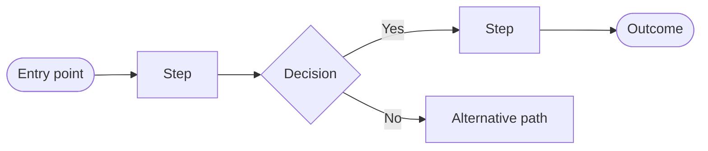

# User Flows

| | |
|---|---|
| **Status** | ⏳ Not started |
| **Phase** | 3 — Product Requirements |
| **Depends on** | [PRD](PRD.md), [User Personas](user-personas.md) |

---

## Purpose

Describe, step by step, how users accomplish their key jobs in VeriGlow-ai.

## Flows to Define

| # | Flow | Persona | Priority |
|---|---|---|---|
| F1 | Check a product listing before purchase | *TBD* | *TBD* |
| F2 | Verify a product after delivery | *TBD* | *TBD* |
| F3 | Understand why a product received its trust signal | *TBD* | *TBD* |

## Flow Template

For each flow, also document: entry point, success outcome, error states, and edge cases.
