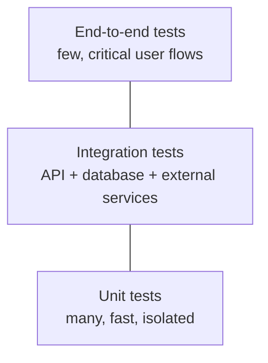

# Testing Strategy

| | |
|---|---|
| **Status** | ⏳ Not started |
| **Phase** | 5–6 — MVP Development, Testing & Launch |

---

## Purpose

Define how VeriGlow-ai is tested so that both the software **and** the AI-driven trust signals can be relied on.

## Test Levels (proposed)

| Level | What it covers | When it runs |
|---|---|---|
| Unit | Business logic in isolation | Every commit |
| Integration | API, database, external service boundaries | Every pull request |
| End-to-end | Critical user flows in a browser | Before release |
| AI evaluation | Accuracy, false positives/negatives of trust signals | On model or prompt changes |

## AI Evaluation (key risk)

A wrong "this looks genuine" is worse than "we're not sure". The strategy will define:

- A labelled evaluation set
- Target precision / recall for each signal
- How false positives and false negatives are weighed
- Regression checks when prompts or models change

## Sections (to be completed)

1. Tooling per test level
2. Coverage targets
3. Test data management
4. CI integration and quality gates
